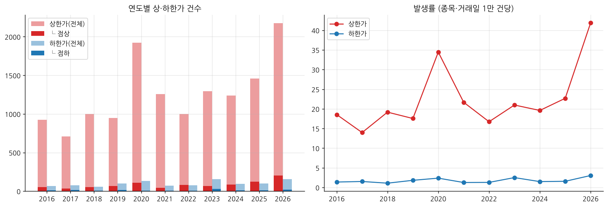
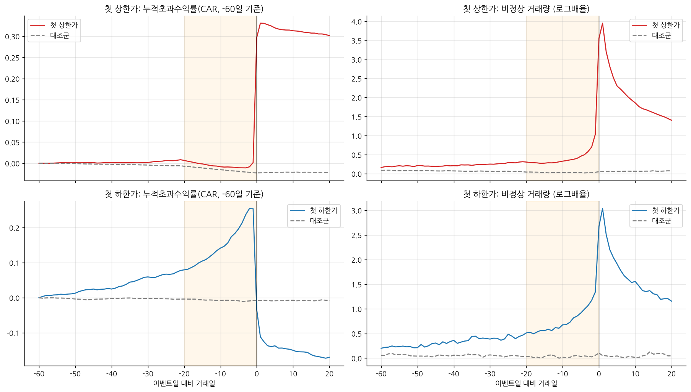
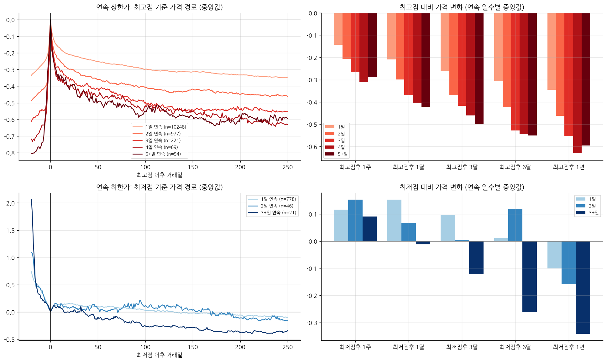
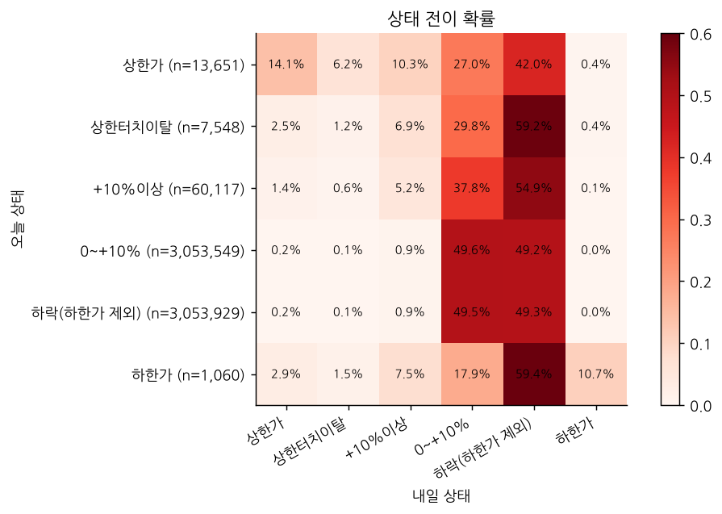
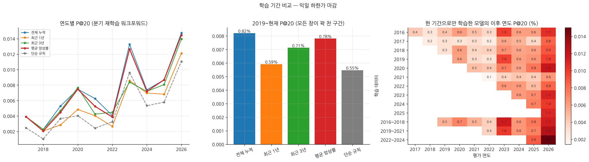

# 핵심 발견 요약 (발표용)

> **기존 결과 보관본**: 아래 숫자는 `ce87af8` 시점의 결과다. 2026-10-17에 관측 누락·상폐 추정·실전 채점 처리를 수정했으며 이 파일 전체를 새 코드로 재계산하지 않았다. 수정 내용과 같은 원자료 비교는 [연구 비교 문서](../docs/STUDY_COMPARISON.md), 새 거래량 신호 집계는 `comparison/`을 참고한다. 아래의 ‘상장폐지’ 및 기업행위 조정 관련 표현은 확인된 공식 상태나 총수익률을 뜻하지 않는다.

데이터: KRX Open API 유가증권·코스닥 일별매매정보, 2016-01-04 ~ 2026-10-15 (2,643거래일, 3,265종목, 약 640만 종목·일).
가격제한폭 ±30% 규정 하나만 포함되는 기간입니다. 상장폐지 종목을 포함하고, 거래정지일·상장 첫날·정리매매는 뺐습니다.
세부 표는 `outputs/tables/`, 그림은 `outputs/figures/`, 전체 보고서는 `outputs/REPORT.md` 에 있습니다.

> 상한가 판정 검증: 기준가와 호가단위 규정으로 계산한 상한가가 "등락률 ≥ 29.5% & 종가 = 고가" 기준과
> 13,778건 일치했습니다. 어긋난 120건은 호가단위 절사 때문에 상한가가 +29.5%보다 낮은 경우였습니다
> (예: 기준가 7,730원 → 상한가 10,000원 = +29.37%). 규정 계산이 더 정확합니다.

## 1. 얼마나 자주? (목표 1)
- 상한가 **13,898건**(점상 920), 하한가 **1,120건**(점하 137). 장중 상한가 터치 후 밀린 경우 7,635건.
- 상한가는 하한가의 약 12배입니다. 하루 평균 상한가 5.3개, 하한가 0.4개.
- **잘 나오는 곳** (1만 종목·거래일당 상한가 수)

  | 구분 | 상한가 |
  |---|---|
  | 관리종목·투자주의환기종목 | 73 |
  | 코스닥 동전주(1천원 미만) | 70 |
  | 코스피 우선주 | 46 |
  | 코스피 시가총액 하위 20% | 48 |
  | 코스피 보통주 전체 | 14 |
  | 코스피 시가총액 상위 20% | 6.5 |

- **시기**: 2020년(34)과 2026년(1~10월 42, 이미 2,148건)에 급증. 2018-05-28 하루 64종목(남북정상회담 직후 경협주),
  2020-03-19 하루 하한가 32종목(코로나 폭락). 금요일이 가장 적습니다(일평균 4.4 vs 월요일 5.7).
- 상한가 다발 종목 상위는 대부분 우선주입니다(금호건설우 45회, 신풍제약우 41회, 태영건설우 39회).

## 2. 직전 20/60일에 흔적이 있었나? (목표 2)
첫 상한가 9,397건 vs 같은 날·같은 시장·같은 시총 구간 대조군 28,191건.

- **거래량이 먼저 움직입니다.** 비정상 거래량(과거 대비 배율)은 20일 전 1.4배 → 5일 전 1.6배 → 하루 전 2.8배로 커지다가
  당일 35배로 폭발합니다. 대조군은 내내 약 1.1배입니다.
- 가격은 직전까지 조용합니다. 직전 20일 누적초과수익률은 거의 0으로, 대조군(−2.3%)과 큰 차이가 없습니다.
- 대조군보다 뚜렷이 큰 것 (표준화 평균차 SMD 기준)
  - 변동성 (SMD 0.61)
  - 장대윗꼬리 '시세 테스트' 일수 (60일간 0.89 vs 0.44일)
  - 거래량 급증일 수, 이전 상한가 터치 횟수
- **"조용한 박스권 매집" 가설은 지지되지 않았습니다.** 60일 박스권(폭 30% 이하) 비율이 오히려 낮았고(27% vs 47%),
  규칙 기반 매집 점수는 상한가와 대조군을 구분하지 못했습니다(배율 ≈ 1). 상한가는 이미 들썩이던 종목에서 나옵니다.
- **하한가 직전은 '펌프 후 덤프'** 모습입니다. 60일간 시장 대비 +25%를 오른 뒤 하한가로 꺾였고, 이후 20일 동안 −17%가 더 빠졌습니다.
  직전 60일 상한가 터치 횟수도 대조군의 5배(1.32 vs 0.26회)입니다.
- 직전 패턴 군집(K-means 4개): '60일간 거래량 폭증 + 35% 상승' 군집은 3달 안에 30% 넘게 급락한 비율이 29%로,
  '거래량 고갈' 군집(14%)의 2배입니다(3달 수익률이 관측된 사건만으로 계산). 다만 군집 분리도(실루엣 0.17)는 약해서
  보조 근거로만 써야 합니다.
- 한계: 투자자별(개인·외국인·기관) 매매 데이터가 없어서 '매집'은 가격·거래량으로만 추정했습니다.

## 3. 상한가를 따라 산 개미는? (목표 3)
| 진입 | 건수(익일 기준) | 익일 평균 | 익일 중앙값 | 1달 중앙값 | 1년 중앙값 | 1년 승률 |
|---|---|---|---|---|---|---|
| 상따: 상한가 터치 때 상한가 가격 매수 | 21,231 | −1.9% | −3.8% | −12.8% | −26.9% | 27% |
| 상한가 마감 종목, 익일 시가 매수 | 13,651 | −3.2% | −3.5% | −14.1% | −29.5% | 24% |
| 상한가 터치 후 이탈 종목 (물린 경우) | 7,580 | −11.9% | −12.2% | −17.8% | −28.3% | 25% |
| 점상 (사실상 매수 불가) | 892 | +13.8% | +17.9% | −6.6% | −22.4% | 33% |
| 하한가 마감, 익일 시가 매수 (하따) | 1,079 | −0.6% | −0.8% | −6.7% | −28.0% | 26% |

- 평균보다 **중앙값**이 중요합니다. 소수 대박 종목이 평균을 끌어올려도, 대부분의 상따는 손실입니다.
- 1년 뒤 시장(동일가중) 대비 초과수익은 약 −22%입니다. 연속 상한가(2연상 이상) 종목은 1년 중앙값 −41%로 더 나쁩니다.
- 상한가 다음 날 시초가에 따라 사는 것은 모든 보유기간에서 손실이었습니다(익일 승률 33%).
- **수익률은 진입일과 매도일에 모두 정규장 거래가 있고 중간에 관측이 끊기지 않은 사건만으로 계산했습니다.**
  상따 21,533건 중 1년 수익률을 계산한 것은 16,070건이고, 나머지는 1년이 안 지났거나(3,980건) 거래정지·상장폐지 등으로
  팔 수 없었던(1,483건) 경우입니다. 팔 수 없었던 종목을 빼고 본 것이라 실제 손실은 이보다 클 수 있습니다.

## 4. 연속 상한가는 예측 가능한가? (목표 4)
- **이어질 확률**: 1→2일째 11.6%, 2→3일째 26%, 3→4일째 35%, 4→5일째 45%. 오래 갈수록 다음 날도 갈 확률이 높아집니다.
- **첫날이 점상이면** 다음 날도 상한가일 확률 38.6% (일반 상한가는 10.4%). 코스피(14.5%)가 코스닥(10.3%)보다 높습니다.
- **연상하는 종목의 첫날 특징**
  - 거래대금 순위가 낮습니다 (팔려는 물량이 묶인 '잠긴' 상한가)
  - 시총이 작고, 시초가 갭이 크고, 우선주·동전주 비중이 높습니다
- **예측 모델** (2023-11 이전 학습 → 이후 검증)

  | 모델 | AUC |
  |---|---|
  | 단순 규칙 (연속일수 + 점상) | 0.62 |
  | 로지스틱 회귀 | 0.72 |
  | LightGBM | 0.73 |

  예측 상위 10%는 실제 연상 비율이 40~43%로, 평균 16%의 약 2.5~2.7배입니다.
- **연상이 끝나면 크게 빠집니다.** 끝난 뒤 1달 중앙값은 1연상 −10%, 2연상 −20%, 3연상 −27%, 4연상 −34%입니다.
- 상태 전이: 오늘 상한가 → 내일 상한가 14%, 내일 하락 42%. 오늘 하한가 → 내일 하한가 11%.

### 연속 상·하한가 종목의 최고점/최저점 대비 가격 변화
최고점은 연속 상한가 시작일부터 끝난 뒤 20거래일 사이의 가장 높은 종가입니다(분할·증자 영향은 조정). 수치는 모두 중앙값이고,
1년 뒤 지표는 1년치 데이터가 있고 그날 정규장 거래가 있었던 구간만으로 계산했습니다(최근 1년 안에 생긴 구간과 거래정지 중인 종목은 제외).
최고점 탐색 창(20거래일) 안에 관측이 끊긴 구간도 제외했습니다.

| 연속 상한가 | 건수 | 연상 전 → 최고점 | 최고점 후 1달 | 최고점 후 1년 | 1년 내 최대 낙폭 | 1년 내 최고점 재돌파 | 1년 뒤 연상 전 가격보다 낮음 | 1년 뒤 정규장 거래 없음 | 1년 안에 관측 소실 |
|---|---|---|---|---|---|---|---|---|---|
| 1일 | 10,219 | +42% | −21% | −35% | −49% | 55% | 53% | 4% | 2% |
| 2일 | 972 | +80% | −30% | −46% | −57% | 44% | 43% | 9% | 3% |
| 3일 | 221 | +131% | −37% | −55% | −66% | 28% | 39% | 10% | 4% |
| 4일 | 69 | +187% | −41% | −63% | −70% | 33% | 30% | 9% | 6% |
| 5일 이상 | 54 | +455% | −42% | −60% | −71% | 29% | 11% | 5% | 9% |

- **최고점은 금방 오는 편입니다.** 최고점 시점의 중앙값은 연상 종료 당일~3거래일 뒤입니다(1일 연상은 절반 정도가 3일 이내,
  약 4분의 1은 종료 당일, 약 4분의 1은 10일 이후로 갈립니다).
- **연속이 길수록 최고점 이후 더 크게 빠집니다.** 최고점 대비 1년 뒤 1일 연상 −35%, 5일 이상 −60%입니다.
- **1일 상한가는 1년 뒤 오른 만큼을 다 반납합니다.** 중앙값 반납률이 107%로, 절반 이상(53%)이 상한가 전 가격보다 낮아집니다.
- **5일 이상 연상은 상승폭이 워낙 커서 연상 전 가격까지 떨어지는 경우는 11%뿐입니다.** 다만 최고점에서 사면 1년 뒤 중앙값 −60%이고,
  9%는 1년 안에 데이터에서 사라집니다(상장폐지 등).
- 코스피와 코스닥은 비슷합니다. 2일 이상 연상의 최고점 대비 1년 뒤는 코스피 −46%, 코스닥 −52%입니다.

| 연속 하한가 | 건수 | 하락 전 → 최저점 | 최저점 후 1달 | 최저점 후 1년 | 1년 내 최대 반등 | 1년 내 하락 전 가격 회복 | 1년 뒤 정규장 거래 없음 | 1년 안에 관측 소실 |
|---|---|---|---|---|---|---|---|---|
| 1일 | 775 | −44% | +16% | −10% | +64% | 45% | 18% | 3% |
| 2일 | 46 | −61% | +7% | −16% | +77% | 31% | 14% | 3% |
| 3일 이상 | 21 | −79% | −1% | −34% | +20% | 0% | 22% | 5% |

- **최저점은 하한가가 끝나고 중앙값 기준 약 9거래일 뒤에 옵니다.** 하한가가 끝났다고 바로 바닥은 아닙니다.
- **최저점 이후 1년 뒤에도 −10%이고, 1년 뒤 18%는 정규장 거래가 없는 상태(거래정지 등)입니다.** 최저점 뒤 1달 반등(+16%)은
  아래 '선택 효과' 범위 안이라 하한가 종목이 특별히 반등한다고 보기 어렵습니다.
- **3일 이상 연속 하한가 21건 중 1년 안에 하락 전 가격을 회복한 종목은 한 건도 없었습니다.**
- 하한가 쪽은 거래정지가 잦아 20거래일 탐색 창 안에 관측이 끊긴 구간(약 14%)이 빠졌습니다. 그만큼 남은 표본은 '거래가 이어진'
  비교적 나은 종목이라, 실제 하한가 종목 전체의 결과는 이보다 나쁠 수 있습니다.

> **읽을 때 주의 (선택 효과)**: 최고점·최저점은 사후에 20거래일 창에서 고른 극값입니다. 그래서 추세가 전혀 없는 무작위 가격에
> 같은 규칙을 적용해도 극점 뒤에는 되돌림이 나옵니다(일 변동성 3~5% 가정, 2만 번 모의): 최고점 뒤 1달 −9~−15%, 1년 −9~−15%,
> 1년 내 최대 낙폭 −33~−48%, 최고점 재돌파 82%; 최저점 뒤 1달 +10~+17%, 1년 +10~+15%. 위 표는 이 기준선과 비교해 읽어야 합니다.
> 연상 종목은 1년 뒤 −35~−60%, 재돌파 28~55%로 기준선보다 훨씬 나쁘고, 하한가 종목의 1달 반등은 기준선과 비슷합니다.

## 5. 익일 상한가 예측 (목표 5)
`outputs/REPORT.md` 5절과 `outputs/tables/g5_*` 를 참고하세요. 개선 탐색 결과는 `g5_improve_*` 에 있습니다.

### 10년치를 어떻게 학습하는 것이 좋은가? (학습 기간 비교, `g5_window_*`, `g5_cross_*`)
분기마다 다시 학습하는 워크포워드(2017~2026, 같은 특징·같은 모델)로 네 가지를 비교했습니다. 지표는 매일 상위 k개 중 실제
상한가(하한가) 비율(P@k)이고, 날짜별로 짝지은 t 검정으로 차이를 판단했습니다.

| 학습 데이터 | 상한가 P@10 (2019~) | 전체 누적 대비 | 하한가 P@20 (2019~) | 전체 누적 대비 |
|---|---|---|---|---|
| **전체 누적** (예측 시점 이전 전부) | **9.8%** | — | **0.82%** | — |
| 최근 1년만 | 9.3% | −0.47%p (t −3.8) | 0.59% | −0.23%p (t −6.2) |
| 최근 3년만 | 9.8% | −0.02%p (t −0.2) | 0.71% | −0.11%p (t −3.1) |
| 세 모델 확률 평균 | 10.0% | +0.20%p (t +2.6) | 0.78% | −0.04%p (t −1.8) |
| 단순 규칙 (연속일수+점상 등) | 8.9% | −0.92%p (t −7.8) | 0.55% | −0.27%p (t −7.2) |

- **데이터는 많을수록 좋습니다.** 1년치만 쓰면 상한가·하한가 모두 뚜렷이 나빠지고(t −3.8, −6.2), 3년치는 상한가에서는
  전체 누적과 같지만 하한가(사례가 적음)에서는 나빠집니다. "최근 시장만 반영"하는 이점보다 표본이 줄어드는 손해가 큽니다.
- **세 모델의 평균은 상한가에서만 작게 낫습니다(+0.2%p, t 2.6).** 2024년 이후만 보면 차이가 없어(t −0.1) 운영 모델로 바꿀 만큼은 아닙니다.
- **옛날 모델도 꽤 오래 통합니다.** 2016년 한 해로만 학습한 모델이 2026년에도 P@10 14.6%로, 2025년으로 학습한 모델(18.0%)의 80% 수준입니다.
  3년 묶음은 항상 1년짜리보다 낫습니다(2022~2024 모델의 2026년 18.1% vs 2024 단독 17.6%).
- **해마다 난이도가 다릅니다.** 2020년(코로나 급등락)과 2025~2026년(상한가 급증)에 모든 모델의 적중률이 오릅니다.
  모델 차이보다 시장 국면 차이가 훨씬 큽니다.
- 결론: 운영 모델은 **10년 전체 누적 학습 + 분기 재학습**을 유지합니다.

