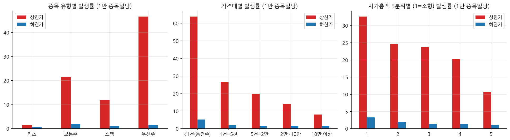
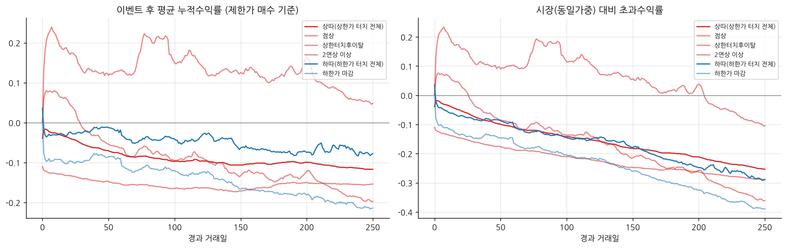
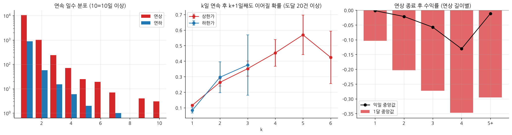

# 핵심 발견 요약 (발표용)

데이터: KRX Open API 유가증권·코스닥 일별매매정보, 2016-01-04 ~ 2026-10-15 (2,643거래일, 3,265종목, 약 640만 종목·일).
가격제한폭 ±30% 규정 하나만 포함되는 기간입니다. 상장폐지 종목을 포함하고, 거래정지일·상장 첫날·정리매매는 뺐습니다.
세부 표는 `outputs/tables/`, 그림은 `outputs/figures/`, 전체 보고서는 `outputs/REPORT.md` 에 있습니다.

> 상한가 판정 검증: 기준가와 호가단위 규정으로 계산한 상한가가 "등락률 ≥ 29.5% & 종가 = 고가" 기준과
> 13,778건 일치했습니다. 어긋난 120건은 호가단위 절사 때문에 상한가가 +29.5%보다 낮은 경우였습니다
> (예: 기준가 7,730원 → 상한가 10,000원 = +29.37%). 규정 계산이 더 정확합니다.

## 1. 얼마나 자주? (목표 1)
- 상한가 **13,898건**(점상 920), 하한가 **1,120건**(점하 137). 장중 상한가 터치 후 밀린 경우 7,635건.
- 상한가는 하한가의 약 12배입니다. 하루 평균 상한가 5.3개, 하한가 0.4개.
- **잘 나오는 곳** (1만 종목·거래일당 상한가 수)

  | 구분 | 상한가 |
  |---|---|
  | 관리종목·투자주의환기종목 | 73 |
  | 코스닥 동전주(1천원 미만) | 70 |
  | 코스피 우선주 | 46 |
  | 코스피 시가총액 하위 20% | 48 |
  | 코스피 보통주 전체 | 14 |
  | 코스피 시가총액 상위 20% | 6.5 |

- **시기**: 2020년(34)과 2026년(1~10월 42, 이미 2,148건)에 급증. 2018-05-28 하루 64종목(남북정상회담 직후 경협주),
  2020-03-19 하루 하한가 32종목(코로나 폭락). 금요일이 가장 적습니다(일평균 4.4 vs 월요일 5.7).
- 상한가 다발 종목 상위는 대부분 우선주입니다(금호건설우 45회, 신풍제약우 41회, 태영건설우 39회).

## 2. 직전 20/60일에 흔적이 있었나? (목표 2)
첫 상한가 9,397건 vs 같은 날·같은 시장·같은 시총 구간 대조군 28,191건.

- **거래량이 먼저 움직입니다.** 비정상 거래량(과거 대비 배율)은 20일 전 1.4배 → 5일 전 1.6배 → 하루 전 2.8배로 커지다가
  당일 35배로 폭발합니다. 대조군은 내내 약 1.1배입니다.
- 가격은 직전까지 조용합니다. 직전 20일 누적초과수익률은 거의 0으로, 대조군(−2.3%)과 큰 차이가 없습니다.
- 대조군보다 뚜렷이 큰 것 (표준화 평균차 SMD 기준)
  - 변동성 (SMD 0.61)
  - 장대윗꼬리 '시세 테스트' 일수 (60일간 0.89 vs 0.44일)
  - 거래량 급증일 수, 이전 상한가 터치 횟수
- **"조용한 박스권 매집" 가설은 지지되지 않았습니다.** 60일 박스권(폭 30% 이하) 비율이 오히려 낮았고(27% vs 47%),
  규칙 기반 매집 점수는 상한가와 대조군을 구분하지 못했습니다(배율 ≈ 1). 상한가는 이미 들썩이던 종목에서 나옵니다.
- **하한가 직전은 '펌프 후 덤프'** 모습입니다. 60일간 시장 대비 +25%를 오른 뒤 하한가로 꺾였고, 이후 20일 동안 −17%가 더 빠졌습니다.
  직전 60일 상한가 터치 횟수도 대조군의 5배(1.32 vs 0.26회)입니다.
- 직전 패턴 군집(K-means 4개): '60일간 거래량 폭증 + 35% 상승' 군집은 3달 안에 30% 넘게 급락한 비율이 28%로,
  '거래량 고갈' 군집(14%)의 2배입니다. 다만 군집 분리도(실루엣 0.17)는 약해서 보조 근거로만 써야 합니다.
- 한계: 투자자별(개인·외국인·기관) 매매 데이터가 없어서 '매집'은 가격·거래량으로만 추정했습니다.

## 3. 상한가를 따라 산 개미는? (목표 3)
| 진입 | 건수 | 익일 평균 | 익일 중앙값 | 1달 중앙값 | 1년 중앙값 | 1년 승률 |
|---|---|---|---|---|---|---|
| 상따: 상한가 터치 때 상한가 가격 매수 | 21,522 | −1.9% | −3.7% | −13.0% | −28.4% | 25% |
| 상한가 마감 종목, 익일 시가 매수 | 13,891 | −3.2% | −3.5% | −14.2% | −31.0% | 23% |
| 상한가 터치 후 이탈 종목 (물린 경우) | 7,631 | −12.0% | −12.2% | −18.1% | −30.2% | 23% |
| 점상 (사실상 매수 불가) | 920 | +13.3% | +15.7% | −6.6% | −23.6% | 33% |
| 하한가 마감, 익일 시가 매수 (하따) | 1,119 | −0.6% | −0.8% | −8.1% | −32.1% | 23% |

- 평균보다 **중앙값**이 중요합니다. 소수 대박 종목이 평균을 끌어올려도, 대부분의 상따는 손실입니다.
- 1년 뒤 시장(동일가중) 대비 초과수익은 약 −25%입니다. 연속 상한가(2연상 이상) 종목은 1년 중앙값 −39%로 더 나쁩니다.
- 상한가 다음 날 시초가에 따라 사는 것은 모든 보유기간에서 손실이었습니다(익일 승률 33%).

## 4. 연속 상한가는 예측 가능한가? (목표 4)
- **이어질 확률**: 1→2일째 11.6%, 2→3일째 26%, 3→4일째 35%, 4→5일째 45%. 오래 갈수록 다음 날도 갈 확률이 높아집니다.
- **첫날이 점상이면** 다음 날도 상한가일 확률 38.6% (일반 상한가는 10.4%). 코스피(14.5%)가 코스닥(10.3%)보다 높습니다.
- **연상하는 종목의 첫날 특징**
  - 거래대금 순위가 낮습니다 (팔려는 물량이 묶인 '잠긴' 상한가)
  - 시총이 작고, 시초가 갭이 크고, 우선주·동전주 비중이 높습니다
- **예측 모델** (2023-11 이전 학습 → 이후 검증)

  | 모델 | AUC |
  |---|---|
  | 단순 규칙 (연속일수 + 점상) | 0.62 |
  | 로지스틱 회귀 | 0.72 |
  | LightGBM | 0.72 |

  예측 상위 10%는 실제 연상 비율이 41~44%로, 평균 16%의 약 2.6배입니다.
- **연상이 끝나면 크게 빠집니다.** 끝난 뒤 1달 중앙값은 1연상 −10%, 2연상 −20%, 3연상 −27%, 4연상 −34%입니다.
- 상태 전이: 오늘 상한가 → 내일 상한가 14%, 내일 하락 42%. 오늘 하한가 → 내일 하한가 11%.

## 5. 익일 상한가 예측 (목표 5)
`outputs/REPORT.md` 5절과 `outputs/tables/g5_*` 를 참고하세요. 개선 탐색 결과는 `g5_improve_*` 에 있습니다.
