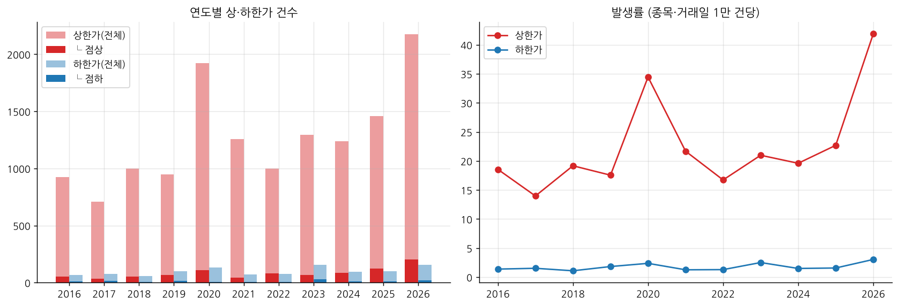
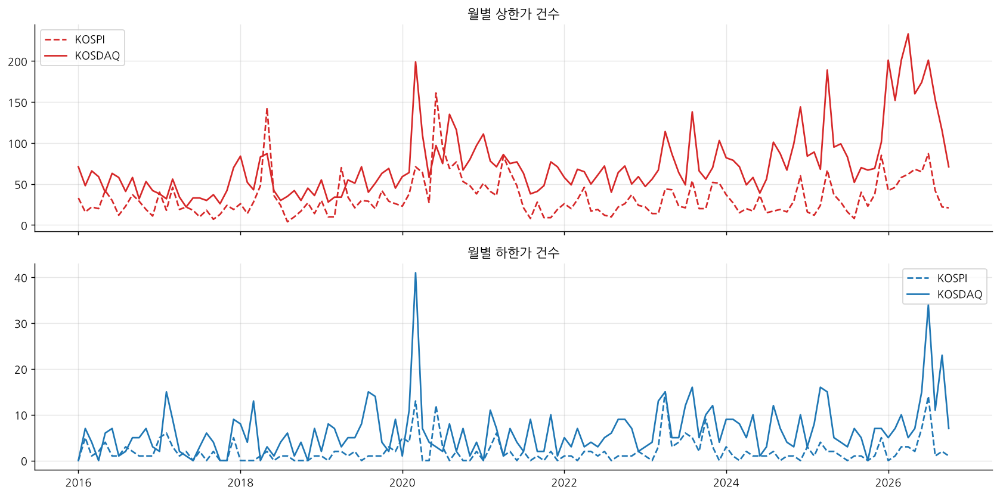
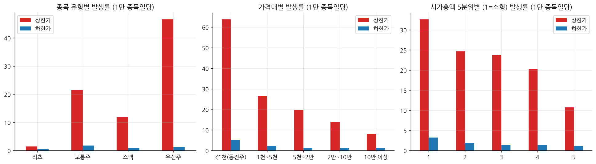
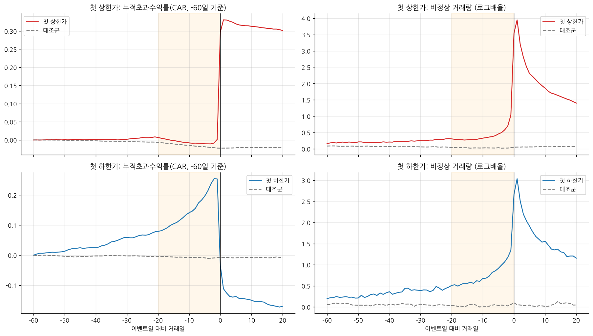
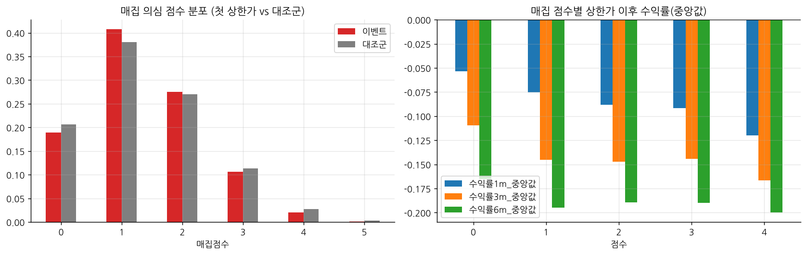
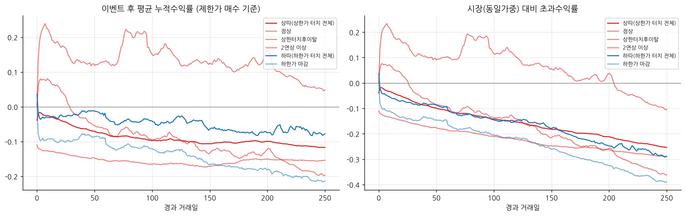
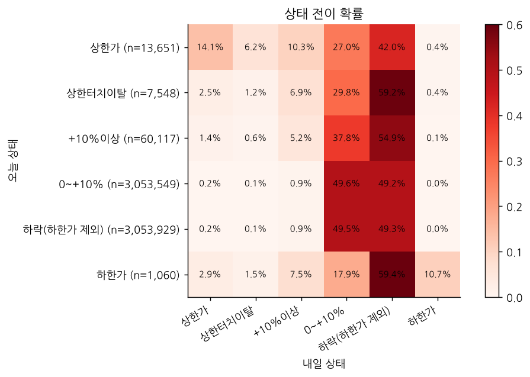
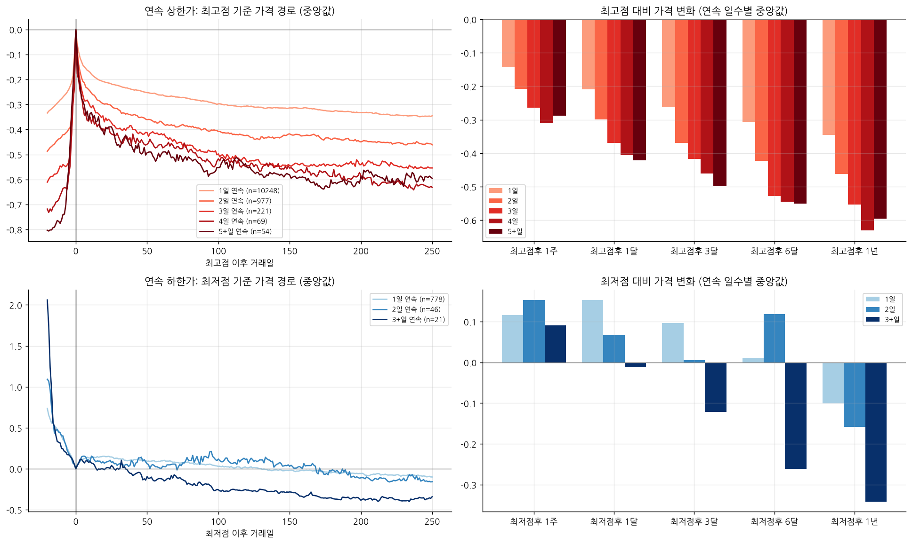
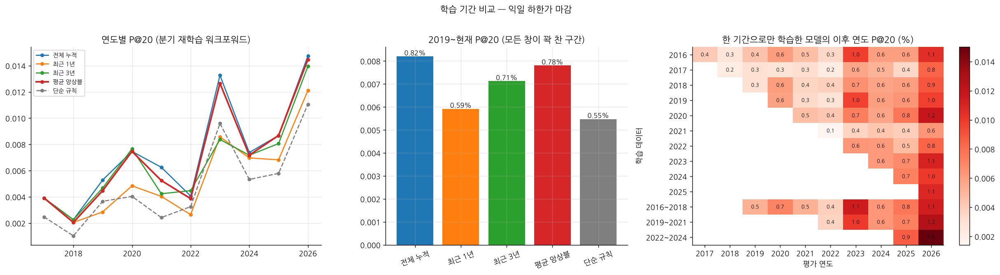

# 한국 주식 상한가·하한가 데이터마이닝 결과

생성: 2026-10-17 12:04  
데이터: KRX Open API 유가증권/코스닥 일별매매정보

## 0. 데이터와 상한가 판정 점검

| 항목 | 건수 |
|---|---|
| 상한가 | 13898 |
| 점상 | 920 |
| 상한터치후이탈 | 7635 |
| 하한가 | 1120 |
| 점하 | 137 |
| 하한터치후회복 | 686 |
| 상한가 경험 종목 수 | 2329 |
| 하한가 경험 종목 수 | 629 |
| 분석 거래일 수 | 2643 |
| 분석 종목 수 | 3265 |
| 기간 | 2016-01-04 ~ 2026-10-15 |


규정 계산(기준가·호가단위)과 등락률 기준 판정의 일치도. '누락 의심'이 크면 `KRX_LIMIT_RULE=loose` 로 비교.


| 항목 | 건수 |
|---|---|
| 상한가(규정계산) | 13,898 |
| 등락률≥29.5% & 종가=고가 | 13,817 |
| 상한가: 둘 다 해당 | 13,778 |
| 상한가: 등락률 기준만 해당(누락 의심) | 39 |
| 상한가: 규정계산만 해당(등락률<29.5%) | 120 |
| 하한가(규정계산) | 1,120 |
| 등락률≤-29.5% & 종가=저가 | 1,111 |
| 하한가: 등락률 기준만 해당(누락 의심) | 22 |
| 하한가: 규정계산만 해당(등락률>-29.5%) | 31 |
| /등락률/>30.5% (가격제한 없음, 제외) | 619 |


## 1. 상한가·하한가 건수 (목표 1)

| year | 종목일수 | 상한가 | 점상 | 상한터치후이탈 | 하한가 | 점하 | 하한터치후회복 | 상한가/만종목일 | 하한가/만종목일 |
|---|---|---|---|---|---|---|---|---|---|
| 2,016.0 | 498,798.0 | 925.0 | 52.0 | 468.0 | 70.0 | 13.0 | 31.0 | 18.5 | 1.4000 |
| 2,017.0 | 506,245.0 | 707.0 | 35.0 | 357.0 | 78.0 | 15.0 | 50.0 | 14.0 | 1.5400 |
| 2,018.0 | 521,665.0 | 1,002.0 | 55.0 | 491.0 | 59.0 | 4.0000 | 57.0 | 19.2 | 1.1300 |
| 2,019.0 | 539,477.0 | 947.0 | 68.0 | 481.0 | 98.0 | 14.0 | 54.0 | 17.6 | 1.8200 |
| 2,020.0 | 557,615.0 | 1,921.0 | 108.0 | 1,042.0 | 135.0 | 7.0000 | 126.0 | 34.5 | 2.4200 |
| 2,021.0 | 579,051.0 | 1,255.0 | 44.0 | 664.0 | 76.0 | 5.0000 | 43.0 | 21.7 | 1.3100 |
| 2,022.0 | 596,527.0 | 998.0 | 80.0 | 578.0 | 80.0 | 6.0000 | 46.0 | 16.7 | 1.3400 |
| 2,023.0 | 617,366.0 | 1,295.0 | 69.0 | 694.0 | 156.0 | 30.0 | 59.0 | 21.0 | 2.5300 |
| 2,024.0 | 632,628.0 | 1,240.0 | 85.0 | 749.0 | 101.0 | 12.0 | 51.0 | 19.6 | 1.6000 |
| 2,025.0 | 643,026.0 | 1,460.0 | 121.0 | 858.0 | 103.0 | 11.0 | 67.0 | 22.7 | 1.6000 |
| 2,026.0 | 506,032.0 | 2,148.0 | 203.0 | 1,253.0 | 164.0 | 20.0 | 102.0 | 42.5 | 3.2400 |









### 상한가 다발 종목 (상위 10)
| code | 종목명 | 시장 | 건수 | 첫발생 | 마지막발생 |
|---|---|---|---|---|---|
| 002995 | 금호건설우 | KOSPI | 45 | 2016-08-05 | 2026-08-12 |
| 152550 | 한국ANKOR유전 | KOSPI | 42 | 2022-12-14 | 2026-04-02 |
| 019175 | 신풍제약우 | KOSPI | 41 | 2017-11-09 | 2026-08-24 |
| 009415 | 태영건설우 | KOSPI | 39 | 2016-09-12 | 2026-05-21 |
| 049180 | 셀루메드 | KOSDAQ | 37 | 2016-03-04 | 2026-03-11 |
| 004835 | 덕성우 | KOSPI | 36 | 2018-05-11 | 2024-12-04 |
| 016385 | KG스틸우 | KOSPI | 34 | 2016-05-26 | 2022-06-09 |
| 121850 | 코이즈 | KOSDAQ | 34 | 2016-01-29 | 2026-08-28 |
| 224060 | 더코디 | KOSDAQ | 33 | 2016-01-04 | 2026-09-10 |
| 011080 | 형지I&C | KOSDAQ | 32 | 2016-04-11 | 2026-10-13 |


### 하한가 다발 종목 (상위 10)
| code | 종목명 | 시장 | 건수 | 첫발생 | 마지막발생 |
|---|---|---|---|---|---|
| 007390 | 네이처셀 | KOSDAQ | 10 | 2017-12-08 | 2025-08-06 |
| 006740 | 영풍제지 | KOSPI | 7 | 2023-10-18 | 2023-11-02 |
| 035290 | 골드앤에스 | KOSDAQ | 7 | 2019-09-10 | 2026-09-02 |
| 028300 | HLB | KOSDAQ | 7 | 2019-06-27 | 2026-07-13 |
| 030790 | 비케이탑스 | KOSPI | 7 | 2017-07-26 | 2024-05-09 |
| 151910 | SBW생명과학 | KOSDAQ | 6 | 2016-02-12 | 2022-08-16 |
| 152550 | 한국ANKOR유전 | KOSPI | 6 | 2023-01-04 | 2026-04-28 |
| 065620 | 제낙스 | KOSDAQ | 6 | 2018-05-09 | 2020-03-23 |
| 047770 | 코데즈컴바인 | KOSDAQ | 6 | 2016-03-17 | 2016-07-01 |
| 023460 | CNH | KOSDAQ | 6 | 2024-08-05 | 2024-10-04 |


### 하한가가 가장 많았던 날
| date | 하한가 종목수 |
|---|---|
| 2020-03-19 | 32 |
| 2017-02-02 | 13 |
| 2024-05-17 | 8 |
| 2023-04-24 | 8 |
| 2018-01-11 | 8 |
| 2026-07-21 | 7 |
| 2020-08-18 | 7 |
| 2026-07-20 | 7 |
| 2026-06-25 | 7 |
| 2017-02-03 | 7 |


## 2. 상·하한가 직전 20/60일 특이사항 (목표 2)





### 첫 상한가 vs 대조군 (|SMD| 큰 순, 상위 12)
| 지표 | 설명 | 이벤트_평균 | 대조_평균 | 이벤트_중앙값 | 대조_중앙값 | SMD | AUC | p값 |
|---|---|---|---|---|---|---|---|---|
| volat_20 | 일간 변동성 (직전 20일) | 0.0399 | 0.0278 | 0.0350 | 0.0239 | 0.6067 | 0.6800 | 0.0000 |
| volat_60 | 일간 변동성 (직전 60일) | 0.0425 | 0.0306 | 0.0375 | 0.0271 | 0.5953 | 0.6702 | 0.0000 |
| shadow_60 | 장대윗꼬리(고가+10%↑ 종가+3%↓) 일수 (직전 60일) | 0.8932 | 0.4396 | 0.0000 | 0.0000 | 0.4151 | 0.6072 | 0.0000 |
| range_60 | 고저폭(박스권 폭) (직전 60일) | 0.7096 | 0.4339 | 0.4788 | 0.3197 | 0.3623 | 0.6487 | 0.0000 |
| spikes_20 | 거래량 급증일수(3배↑) (직전 20일) | 5.2901 | 3.2815 | 3.0000 | 1.0000 | 0.3596 | 0.5989 | 0.0000 |
| uptouch_60 | 상한가 터치 횟수 (직전 60일) | 0.4686 | 0.1673 | 0.0000 | 0.0000 | 0.3479 | 0.5730 | 0.0000 |
| vol_trend_20 | 거래량 추세(기울기) (직전 20일) | 0.0222 | -0.0015 | 0.0135 | -0.0051 | 0.3440 | 0.5961 | 0.0000 |
| abvol_20 | 평균 비정상거래량(로그배율) (직전 20일) | 0.4062 | 0.0319 | 0.2730 | -0.0284 | 0.3265 | 0.5876 | 0.0000 |
| shadow_20 | 장대윗꼬리(고가+10%↑ 종가+3%↓) 일수 (직전 20일) | 0.3044 | 0.1347 | 0.0000 | 0.0000 | 0.3211 | 0.5618 | 0.0000 |
| spikes_60 | 거래량 급증일수(3배↑) (직전 60일) | 13.1 | 9.3166 | 8.0000 | 5.0000 | 0.2950 | 0.5783 | 0.0000 |
| obv_20 | OBV 순매수비율 (직전 20일) | 0.1676 | 0.0639 | 0.2001 | 0.0617 | 0.2806 | 0.5871 | 0.0000 |
| range_20 | 고저폭(박스권 폭) (직전 20일) | 0.3078 | 0.1956 | 0.2157 | 0.1435 | 0.2649 | 0.6520 | 0.0000 |


### 첫 하한가 vs 대조군 (|SMD| 큰 순, 상위 12)
| 지표 | 설명 | 이벤트_평균 | 대조_평균 | 이벤트_중앙값 | 대조_중앙값 | SMD | AUC | p값 |
|---|---|---|---|---|---|---|---|---|
| volat_20 | 일간 변동성 (직전 20일) | 0.0710 | 0.0297 | 0.0528 | 0.0241 | 0.9375 | 0.8058 | 0.0000 |
| volat_60 | 일간 변동성 (직전 60일) | 0.0651 | 0.0320 | 0.0564 | 0.0278 | 0.8671 | 0.8119 | 0.0000 |
| uptouch_60 | 상한가 터치 횟수 (직전 60일) | 1.3227 | 0.2548 | 0.0000 | 0.0000 | 0.6658 | 0.6582 | 0.0000 |
| uptouch_20 | 상한가 터치 횟수 (직전 20일) | 0.8280 | 0.0842 | 0.0000 | 0.0000 | 0.6317 | 0.6265 | 0.0000 |
| abvol_20 | 평균 비정상거래량(로그배율) (직전 20일) | 0.7666 | 0.0363 | 0.5447 | -0.0681 | 0.5633 | 0.6570 | 0.0000 |
| vol_trend_60 | 거래량 추세(기울기) (직전 60일) | 0.0124 | -0.0012 | 0.0055 | -0.0026 | 0.4944 | 0.6316 | 0.0000 |
| shadow_60 | 장대윗꼬리(고가+10%↑ 종가+3%↓) 일수 (직전 60일) | 1.0955 | 0.5032 | 1.0000 | 0.0000 | 0.4737 | 0.6150 | 0.0000 |
| vol_trend_20 | 거래량 추세(기울기) (직전 20일) | 0.0381 | -0.0004 | 0.0158 | -0.0059 | 0.4735 | 0.6256 | 0.0000 |
| ret_60 | 누적수익률 (직전 60일) | 0.4511 | -0.0138 | -0.0068 | -0.0347 | 0.4681 | 0.5453 | 0.0000 |
| spikes_20 | 거래량 급증일수(3배↑) (직전 20일) | 6.2431 | 3.4501 | 3.0000 | 1.0000 | 0.4654 | 0.6193 | 0.0000 |
| car_60 | 누적초과수익률 (직전 60일) | 0.2299 | -0.0079 | 0.0523 | -0.0277 | 0.4531 | 0.5855 | 0.0000 |
| abvol_60 | 평균 비정상거래량(로그배율) (직전 60일) | 0.4627 | 0.0517 | 0.3460 | -0.0115 | 0.4190 | 0.6258 | 0.0000 |


### 매집 의심 점수
| 조건 | 이벤트 | 대조군 | lift |
|---|---|---|---|
| F1_거래량증가+횡보 | 0.0777 | 0.0983 | 0.7900 |
| F2_박스권(폭≤30%) | 0.2688 | 0.4655 | 0.5775 |
| F3_OBV매수우위+가격정체 | 0.2668 | 0.2628 | 1.0153 |
| F4_윗꼬리시세테스트 | 0.4850 | 0.2908 | 1.6680 |
| F5_소형주(시총하위20%) | 0.2668 | 0.2668 | 1.0000 |

| 매집점수 | 이벤트 | 대조군 | lift(이벤트/대조) |
|---|---|---|---|
| 0.0000 | 0.1895 | 0.2061 | 0.9196 |
| 1.0000 | 0.4074 | 0.3802 | 1.0714 |
| 2.0000 | 0.2751 | 0.2700 | 1.0188 |
| 3.0000 | 0.1060 | 0.1137 | 0.9320 |
| 4.0000 | 0.0205 | 0.0269 | 0.7628 |
| 5.0000 | 0.0015 | 0.0030 | 0.4941 |

| 점수 | n | 수익률1m_중앙값 | 수익률3m_중앙값 | 수익률6m_중앙값 | 급락비율_3m |
|---|---|---|---|---|---|
| 0.0000 | 1,781.0 | -0.0535 | -0.1096 | -0.1650 | 0.2041 |
| 1.0000 | 3,828.0 | -0.0754 | -0.1454 | -0.1950 | 0.2248 |
| 2.0000 | 2,585.0 | -0.0882 | -0.1473 | -0.1892 | 0.2064 |
| 3.0000 | 996.0 | -0.0918 | -0.1444 | -0.1897 | 0.1805 |
| 4.0000 | 207.0 | -0.1198 | -0.1667 | -0.1997 | 0.1796 |




### 직전 패턴 군집 (K-means)
| 군집 | n | 특징(정규점수 중심 상위3) | car_60 | abvol_60 | volat_60 | range_60 | vol_trend_60 | spikes_60 | lowvol_60 | shadow_60 | cmf_60 | obv_60 | uptouch_60 | car_20 | abvol_20 | post_1m | post_3m | post_6m | 급락비율_3m(≤-30%) |
|---|---|---|---|---|---|---|---|---|---|---|---|---|---|---|---|---|---|---|---|
| 0 | 2,469 | abvol_20↓, abvol_60↓, lowvol_60↑ | -0.1587 | -0.6318 | 0.0287 | 0.4042 | -0.0089 | 1.0000 | 0.5167 | 0.0000 | -0.1675 | 0.0160 | 0.0000 | -0.0422 | -0.7885 | -0.0881 | -0.1310 | -0.1678 | 0.1377 |
| 1 | 3,077 | range_60↓, volat_60↓, car_20↑ | 0.0489 | 0.1672 | 0.0298 | 0.3134 | 0.0097 | 8.0000 | 0.1333 | 0.0000 | -0.0565 | 0.3115 | 0.0000 | 0.0627 | 0.3798 | -0.0784 | -0.1282 | -0.1803 | 0.1784 |
| 2 | 1,968 | car_60↑, spikes_60↑, abvol_20↑ | 0.3523 | 1.3474 | 0.0582 | 0.8503 | 0.0249 | 31.0 | 0.0167 | 1.0000 | -0.0384 | 0.4056 | 1.0000 | 0.0780 | 1.8224 | -0.0812 | -0.1643 | -0.2328 | 0.2840 |
| 3 | 1,439 | car_60↓, car_20↓, range_60↑ | -0.3193 | 0.4854 | 0.0512 | 0.9350 | -0.0021 | 13.0 | 0.0667 | 1.0000 | -0.2207 | -0.0101 | 0.0000 | -0.1583 | 0.4187 | -0.0557 | -0.1324 | -0.1824 | 0.2252 |


## 3. 상따·하따 이후 수익률 (목표 3)


### 평균
| 방향 | 이벤트 | 진입 | 1d | 1w | 1m | 3m | 6m | 1y |
|---|---|---|---|---|---|---|---|---|
| up | 상따(상한가 터치 전체) | 당일(제한가 매수) | -0.0187 | -0.0230 | -0.0384 | -0.0783 | -0.0965 | -0.1170 |
| up | 상따(상한가 터치 전체) | 익일 시가 | -0.0240 | -0.0309 | -0.0446 | -0.0817 | -0.0989 | -0.1138 |
| up | 상한가 마감 | 당일(제한가 매수) | 0.0368 | 0.0338 | 0.0132 | -0.0367 | -0.0601 | -0.0969 |
| up | 상한가 마감 | 익일 시가 | -0.0325 | -0.0386 | -0.0564 | -0.0999 | -0.1209 | -0.1502 |
| up | 점상 | 당일(제한가 매수) | 0.1333 | 0.2254 | 0.1748 | 0.1322 | 0.1438 | 0.0483 |
| up | 점상 | 익일 시가 | -0.0424 | 0.0219 | -0.0169 | -0.0463 | -0.0473 | -0.1194 |
| up | 상한가(점상 제외) | 당일(제한가 매수) | 0.0300 | 0.0203 | 0.0019 | -0.0482 | -0.0736 | -0.1063 |
| up | 상한가(점상 제외) | 익일 시가 | -0.0318 | -0.0428 | -0.0592 | -0.1035 | -0.1257 | -0.1522 |
| up | 상한터치후이탈 | 당일(제한가 매수) | -0.1197 | -0.1263 | -0.1324 | -0.1545 | -0.1635 | -0.1538 |
| up | 상한터치후이탈 | 익일 시가 | -0.0088 | -0.0170 | -0.0232 | -0.0487 | -0.0589 | -0.0477 |
| up | 첫 상한가 | 당일(제한가 매수) | 0.0334 | 0.0263 | 0.0070 | -0.0322 | -0.0556 | -0.0813 |
| up | 첫 상한가 | 익일 시가 | -0.0302 | -0.0386 | -0.0564 | -0.0923 | -0.1135 | -0.1342 |
| up | 2연상 이상 | 당일(제한가 매수) | 0.0574 | 0.0786 | 0.0505 | -0.0639 | -0.0872 | -0.1969 |
| up | 2연상 이상 | 익일 시가 | -0.0470 | -0.0388 | -0.0569 | -0.1497 | -0.1701 | -0.2620 |
| down | 하따(하한가 터치 전체) | 당일(제한가 매수) | -0.0161 | -0.0292 | -0.0248 | -0.0321 | -0.0349 | -0.0781 |
| down | 하따(하한가 터치 전체) | 익일 시가 | -0.0079 | -0.0244 | -0.0199 | -0.0259 | -0.0297 | -0.0839 |
| down | 하한가 마감 | 당일(제한가 매수) | -0.0767 | -0.0904 | -0.0977 | -0.1082 | -0.1265 | -0.2142 |
| down | 하한가 마감 | 익일 시가 | -0.0059 | -0.0261 | -0.0331 | -0.0416 | -0.0634 | -0.1584 |
| down | 점하 | 당일(제한가 매수) | -0.1907 | -0.2340 | -0.2430 | -0.2060 | -0.2945 | -0.3684 |
| down | 점하 | 익일 시가 | 0.0184 | -0.0485 | -0.0660 | -0.0250 | -0.1297 | -0.2241 |
| down | 하한가(점하 제외) | 당일(제한가 매수) | -0.0608 | -0.0704 | -0.0778 | -0.0949 | -0.1039 | -0.1924 |
| down | 하한가(점하 제외) | 익일 시가 | -0.0094 | -0.0228 | -0.0284 | -0.0439 | -0.0542 | -0.1487 |
| down | 하한터치후회복 | 당일(제한가 매수) | 0.0829 | 0.0706 | 0.0931 | 0.0883 | 0.1137 | 0.1478 |
| down | 하한터치후회복 | 익일 시가 | -0.0111 | -0.0218 | 0.0015 | -0.0009 | 0.0252 | 0.0406 |
| down | 첫 하한가 | 당일(제한가 매수) | -0.0688 | -0.0744 | -0.0774 | -0.0856 | -0.1044 | -0.1821 |
| down | 첫 하한가 | 익일 시가 | -0.0076 | -0.0170 | -0.0175 | -0.0224 | -0.0431 | -0.1269 |
| down | 2연하 이상 | 당일(제한가 매수) | -0.1401 | -0.2188 | -0.2659 | -0.3019 | -0.3165 | -0.4820 |
| down | 2연하 이상 | 익일 시가 | 0.0076 | -0.0982 | -0.1610 | -0.2028 | -0.2333 | -0.4141 |


### 중앙값
| 방향 | 이벤트 | 진입 | 1d | 1w | 1m | 3m | 6m | 1y |
|---|---|---|---|---|---|---|---|---|
| up | 상따(상한가 터치 전체) | 당일(제한가 매수) | -0.0367 | -0.0806 | -0.1298 | -0.1856 | -0.2378 | -0.2844 |
| up | 상따(상한가 터치 전체) | 익일 시가 | -0.0257 | -0.0662 | -0.1127 | -0.1755 | -0.2293 | -0.2750 |
| up | 상한가 마감 | 당일(제한가 매수) | 0.0083 | -0.0352 | -0.0949 | -0.1649 | -0.2216 | -0.2753 |
| up | 상한가 마감 | 익일 시가 | -0.0346 | -0.0852 | -0.1424 | -0.2070 | -0.2622 | -0.3096 |
| up | 점상 | 당일(제한가 매수) | 0.1571 | 0.0548 | -0.0665 | -0.1113 | -0.1905 | -0.2357 |
| up | 점상 | 익일 시가 | 0.0000 | -0.0851 | -0.1921 | -0.2267 | -0.3196 | -0.3464 |
| up | 상한가(점상 제외) | 당일(제한가 매수) | 0.0042 | -0.0382 | -0.0960 | -0.1672 | -0.2232 | -0.2765 |
| up | 상한가(점상 제외) | 익일 시가 | -0.0364 | -0.0852 | -0.1407 | -0.2056 | -0.2601 | -0.3065 |
| up | 상한터치후이탈 | 당일(제한가 매수) | -0.1220 | -0.1506 | -0.1808 | -0.2242 | -0.2664 | -0.3023 |
| up | 상한터치후이탈 | 익일 시가 | -0.0168 | -0.0417 | -0.0727 | -0.1204 | -0.1701 | -0.2148 |
| up | 첫 상한가 | 당일(제한가 매수) | 0.0085 | -0.0318 | -0.0896 | -0.1548 | -0.2062 | -0.2585 |
| up | 첫 상한가 | 익일 시가 | -0.0347 | -0.0804 | -0.1362 | -0.1959 | -0.2492 | -0.2949 |
| up | 2연상 이상 | 당일(제한가 매수) | 0.0064 | -0.0740 | -0.1605 | -0.2527 | -0.3346 | -0.3940 |
| up | 2연상 이상 | 익일 시가 | -0.0341 | -0.1458 | -0.2271 | -0.3144 | -0.3865 | -0.4334 |
| down | 하따(하한가 터치 전체) | 당일(제한가 매수) | -0.0208 | -0.0390 | -0.0643 | -0.1240 | -0.1959 | -0.3129 |
| down | 하따(하한가 터치 전체) | 익일 시가 | -0.0104 | -0.0421 | -0.0714 | -0.1201 | -0.1980 | -0.3057 |
| down | 하한가 마감 | 당일(제한가 매수) | -0.0694 | -0.0945 | -0.1367 | -0.1766 | -0.2473 | -0.3799 |
| down | 하한가 마감 | 익일 시가 | -0.0076 | -0.0485 | -0.0813 | -0.1298 | -0.1956 | -0.3213 |
| down | 점하 | 당일(제한가 매수) | -0.2136 | -0.2331 | -0.2718 | -0.3150 | -0.4092 | -0.4461 |
| down | 점하 | 익일 시가 | 0.0000 | -0.0470 | -0.0959 | -0.1627 | -0.2607 | -0.3117 |
| down | 하한가(점하 제외) | 당일(제한가 매수) | -0.0545 | -0.0773 | -0.1191 | -0.1621 | -0.2337 | -0.3637 |
| down | 하한가(점하 제외) | 익일 시가 | -0.0116 | -0.0495 | -0.0811 | -0.1236 | -0.1825 | -0.3219 |
| down | 하한터치후회복 | 당일(제한가 매수) | 0.0526 | 0.0471 | 0.0453 | -0.0214 | -0.1099 | -0.1953 |
| down | 하한터치후회복 | 익일 시가 | -0.0139 | -0.0285 | -0.0504 | -0.1064 | -0.2023 | -0.2631 |
| down | 첫 하한가 | 당일(제한가 매수) | -0.0641 | -0.0818 | -0.1142 | -0.1558 | -0.2299 | -0.3454 |
| down | 첫 하한가 | 익일 시가 | -0.0113 | -0.0449 | -0.0697 | -0.1103 | -0.1720 | -0.3005 |
| down | 2연하 이상 | 당일(제한가 매수) | -0.1565 | -0.2065 | -0.2868 | -0.3682 | -0.4854 | -0.5819 |
| down | 2연하 이상 | 익일 시가 | 0.0000 | -0.0904 | -0.2039 | -0.2863 | -0.4190 | -0.5307 |


### 승률
| 방향 | 이벤트 | 진입 | 1d | 1w | 1m | 3m | 6m | 1y |
|---|---|---|---|---|---|---|---|---|
| up | 상따(상한가 터치 전체) | 당일(제한가 매수) | 0.3846 | 0.3327 | 0.2957 | 0.2646 | 0.2523 | 0.2541 |
| up | 상따(상한가 터치 전체) | 익일 시가 | 0.3545 | 0.3246 | 0.3042 | 0.2738 | 0.2569 | 0.2574 |
| up | 상한가 마감 | 당일(제한가 매수) | 0.5344 | 0.4214 | 0.3519 | 0.3016 | 0.2758 | 0.2665 |
| up | 상한가 마감 | 익일 시가 | 0.3340 | 0.3074 | 0.2827 | 0.2502 | 0.2360 | 0.2322 |
| up | 점상 | 당일(제한가 매수) | 0.7304 | 0.5537 | 0.4232 | 0.4176 | 0.3524 | 0.3290 |
| up | 점상 | 익일 시가 | 0.2276 | 0.3643 | 0.2974 | 0.3070 | 0.2576 | 0.2534 |
| up | 상한가(점상 제외) | 당일(제한가 매수) | 0.5205 | 0.4121 | 0.3470 | 0.2937 | 0.2707 | 0.2625 |
| up | 상한가(점상 제외) | 익일 시가 | 0.3414 | 0.3034 | 0.2817 | 0.2464 | 0.2346 | 0.2309 |
| up | 상한터치후이탈 | 당일(제한가 매수) | 0.1119 | 0.1715 | 0.1931 | 0.1968 | 0.2090 | 0.2314 |
| up | 상한터치후이탈 | 익일 시가 | 0.3916 | 0.3556 | 0.3429 | 0.3167 | 0.2950 | 0.3030 |
| up | 첫 상한가 | 당일(제한가 매수) | 0.5345 | 0.4247 | 0.3521 | 0.3047 | 0.2803 | 0.2762 |
| up | 첫 상한가 | 익일 시가 | 0.3363 | 0.3088 | 0.2821 | 0.2536 | 0.2407 | 0.2400 |
| up | 2연상 이상 | 당일(제한가 매수) | 0.5334 | 0.4015 | 0.3511 | 0.2834 | 0.2489 | 0.2049 |
| up | 2연상 이상 | 익일 시가 | 0.3189 | 0.2980 | 0.2866 | 0.2282 | 0.2048 | 0.1782 |
| down | 하따(하한가 터치 전체) | 당일(제한가 매수) | 0.4224 | 0.4142 | 0.3949 | 0.3682 | 0.3315 | 0.2547 |
| down | 하따(하한가 터치 전체) | 익일 시가 | 0.4088 | 0.4156 | 0.3992 | 0.3685 | 0.3290 | 0.2564 |
| down | 하한가 마감 | 당일(제한가 매수) | 0.2690 | 0.3073 | 0.2963 | 0.3033 | 0.2811 | 0.1902 |
| down | 하한가 마감 | 익일 시가 | 0.3994 | 0.3983 | 0.3796 | 0.3605 | 0.3225 | 0.2315 |
| down | 점하 | 당일(제한가 매수) | 0.1095 | 0.1606 | 0.1818 | 0.2720 | 0.2308 | 0.1293 |
| down | 점하 | 익일 시가 | 0.3333 | 0.4222 | 0.3817 | 0.3710 | 0.3419 | 0.1983 |
| down | 하한가(점하 제외) | 당일(제한가 매수) | 0.2912 | 0.3279 | 0.3119 | 0.3075 | 0.2878 | 0.1988 |
| down | 하한가(점하 제외) | 익일 시가 | 0.4089 | 0.3949 | 0.3793 | 0.3590 | 0.3198 | 0.2363 |
| down | 하한터치후회복 | 당일(제한가 매수) | 0.6730 | 0.5883 | 0.5546 | 0.4711 | 0.4131 | 0.3617 |
| down | 하한터치후회복 | 익일 시가 | 0.4240 | 0.4438 | 0.4310 | 0.3813 | 0.3396 | 0.2981 |
| down | 첫 하한가 | 당일(제한가 매수) | 0.2764 | 0.3236 | 0.3146 | 0.3173 | 0.2878 | 0.2010 |
| down | 첫 하한가 | 익일 시가 | 0.4088 | 0.4096 | 0.3972 | 0.3778 | 0.3341 | 0.2475 |
| down | 2연하 이상 | 당일(제한가 매수) | 0.2097 | 0.1774 | 0.1441 | 0.1835 | 0.2233 | 0.1000 |
| down | 2연하 이상 | 익일 시가 | 0.3250 | 0.3083 | 0.2348 | 0.2150 | 0.2255 | 0.1010 |


### 시장초과평균
| 방향 | 이벤트 | 진입 | 1d | 1w | 1m | 3m | 6m | 1y |
|---|---|---|---|---|---|---|---|---|
| up | 상따(상한가 터치 전체) | 당일(제한가 매수) | -0.0194 | -0.0269 | -0.0529 | -0.1093 | -0.1540 | -0.2533 |
| up | 상따(상한가 터치 전체) | 익일 시가 | -0.0247 | -0.0347 | -0.0590 | -0.1126 | -0.1564 | -0.2498 |
| up | 상한가 마감 | 당일(제한가 매수) | 0.0360 | 0.0296 | -0.0013 | -0.0674 | -0.1170 | -0.2341 |
| up | 상한가 마감 | 익일 시가 | -0.0333 | -0.0428 | -0.0708 | -0.1303 | -0.1778 | -0.2870 |
| up | 점상 | 당일(제한가 매수) | 0.1339 | 0.2216 | 0.1611 | 0.1036 | 0.0998 | -0.1042 |
| up | 점상 | 익일 시가 | -0.0417 | 0.0186 | -0.0296 | -0.0731 | -0.0910 | -0.2733 |
| up | 상한가(점상 제외) | 당일(제한가 매수) | 0.0291 | 0.0160 | -0.0127 | -0.0790 | -0.1314 | -0.2425 |
| up | 상한가(점상 제외) | 익일 시가 | -0.0327 | -0.0470 | -0.0736 | -0.1342 | -0.1835 | -0.2879 |
| up | 상한터치후이탈 | 당일(제한가 매수) | -0.1203 | -0.1295 | -0.1469 | -0.1862 | -0.2220 | -0.2884 |
| up | 상한터치후이탈 | 익일 시가 | -0.0094 | -0.0202 | -0.0377 | -0.0804 | -0.1174 | -0.1822 |
| up | 첫 상한가 | 당일(제한가 매수) | 0.0327 | 0.0223 | -0.0072 | -0.0626 | -0.1130 | -0.2142 |
| up | 첫 상한가 | 익일 시가 | -0.0310 | -0.0426 | -0.0704 | -0.1226 | -0.1707 | -0.2669 |
| up | 2연상 이상 | 당일(제한가 매수) | 0.0560 | 0.0732 | 0.0336 | -0.0957 | -0.1415 | -0.3615 |
| up | 2연상 이상 | 익일 시가 | -0.0482 | -0.0440 | -0.0732 | -0.1806 | -0.2248 | -0.4273 |
| down | 하따(하한가 터치 전체) | 당일(제한가 매수) | -0.0198 | -0.0425 | -0.0693 | -0.1055 | -0.1477 | -0.2892 |
| down | 하따(하한가 터치 전체) | 익일 시가 | -0.0116 | -0.0376 | -0.0640 | -0.0989 | -0.1420 | -0.2951 |
| down | 하한가 마감 | 당일(제한가 매수) | -0.0791 | -0.1008 | -0.1339 | -0.1647 | -0.2165 | -0.3890 |
| down | 하한가 마감 | 익일 시가 | -0.0082 | -0.0362 | -0.0683 | -0.0973 | -0.1529 | -0.3334 |
| down | 점하 | 당일(제한가 매수) | -0.1901 | -0.2370 | -0.2679 | -0.2273 | -0.3241 | -0.4662 |
| down | 점하 | 익일 시가 | 0.0192 | -0.0514 | -0.0920 | -0.0485 | -0.1593 | -0.3219 |
| down | 하한가(점하 제외) | 당일(제한가 매수) | -0.0637 | -0.0817 | -0.1155 | -0.1562 | -0.2021 | -0.3781 |
| down | 하한가(점하 제외) | 익일 시가 | -0.0122 | -0.0340 | -0.0649 | -0.1042 | -0.1520 | -0.3351 |
| down | 하한터치후회복 | 당일(제한가 매수) | 0.0771 | 0.0524 | 0.0353 | -0.0118 | -0.0361 | -0.1236 |
| down | 하한터치후회복 | 익일 시가 | -0.0170 | -0.0398 | -0.0569 | -0.1015 | -0.1243 | -0.2310 |
| down | 첫 하한가 | 당일(제한가 매수) | -0.0714 | -0.0848 | -0.1148 | -0.1459 | -0.2004 | -0.3617 |
| down | 첫 하한가 | 익일 시가 | -0.0101 | -0.0271 | -0.0537 | -0.0816 | -0.1387 | -0.3067 |
| down | 2연하 이상 | 당일(제한가 매수) | -0.1413 | -0.2289 | -0.2923 | -0.3260 | -0.3550 | -0.6174 |
| down | 2연하 이상 | 익일 시가 | 0.0067 | -0.1083 | -0.1882 | -0.2294 | -0.2715 | -0.5505 |





### 연도별 1달 수익률 (상한가/하한가 마감, 당일 진입)
| 이벤트 | 분해기준 | 보유기간 | 그룹값 | n | 평균 | 중앙값 | 승률 |
|---|---|---|---|---|---|---|---|
| 상한가 마감 | 연도 | 1m | 2016 | 925 | -0.0218 | -0.0988 | 0.3200 |
| 상한가 마감 | 연도 | 1m | 2017 | 707 | 0.0673 | -0.1008 | 0.3437 |
| 상한가 마감 | 연도 | 1m | 2018 | 1,002 | -0.0050 | -0.0959 | 0.3553 |
| 상한가 마감 | 연도 | 1m | 2019 | 947 | -0.0049 | -0.0968 | 0.3337 |
| 상한가 마감 | 연도 | 1m | 2020 | 1,921 | 0.0733 | -0.0346 | 0.4492 |
| 상한가 마감 | 연도 | 1m | 2021 | 1,255 | 0.0333 | -0.0628 | 0.3833 |
| 상한가 마감 | 연도 | 1m | 2022 | 998 | -0.0059 | -0.1008 | 0.3427 |
| 상한가 마감 | 연도 | 1m | 2023 | 1,295 | 0.0001 | -0.1030 | 0.3282 |
| 상한가 마감 | 연도 | 1m | 2024 | 1,240 | -0.0214 | -0.1167 | 0.3065 |
| 상한가 마감 | 연도 | 1m | 2025 | 1,460 | 0.0588 | -0.0995 | 0.3555 |
| 상한가 마감 | 연도 | 1m | 2026 | 2,008 | -0.0360 | -0.1443 | 0.3093 |
| 하한가 마감 | 연도 | 1m | 2016 | 70 | -0.1274 | -0.1573 | 0.2571 |
| 하한가 마감 | 연도 | 1m | 2017 | 78 | -0.0138 | -0.0383 | 0.3462 |
| 하한가 마감 | 연도 | 1m | 2018 | 59 | 0.0350 | -0.0051 | 0.4237 |
| 하한가 마감 | 연도 | 1m | 2019 | 98 | -0.1005 | -0.1423 | 0.2755 |
| 하한가 마감 | 연도 | 1m | 2020 | 135 | 0.1077 | 0.0000 | 0.4889 |
| 하한가 마감 | 연도 | 1m | 2021 | 76 | -0.1213 | -0.1396 | 0.2237 |
| 하한가 마감 | 연도 | 1m | 2022 | 80 | -0.1626 | -0.1745 | 0.2375 |
| 하한가 마감 | 연도 | 1m | 2023 | 156 | -0.1867 | -0.2437 | 0.2115 |
| 하한가 마감 | 연도 | 1m | 2024 | 101 | -0.1754 | -0.1829 | 0.2277 |
| 하한가 마감 | 연도 | 1m | 2025 | 103 | -0.0923 | -0.1467 | 0.3204 |
| 하한가 마감 | 연도 | 1m | 2026 | 141 | -0.1802 | -0.2411 | 0.2624 |


## 4. 연속 상·하한가 (목표 4)

| k일 연속 | 도달 건수 | k+1일 이어짐 | 연속확률 | 95%CI |
|---|---|---|---|---|
| 1.0000 | 11,894.0 | 1,378.0 | 0.1159 | 0.0058 |
| 2.0000 | 1,378.0 | 361.0 | 0.2620 | 0.0232 |
| 3.0000 | 361.0 | 127.0 | 0.3518 | 0.0493 |
| 4.0000 | 127.0 | 57.0 | 0.4488 | 0.0865 |
| 5.0000 | 57.0 | 33.0 | 0.5789 | 0.1282 |
| 6.0000 | 33.0 | 14.0 | 0.4242 | 0.1686 |
| 7.0000 | 14.0 | 7.0000 | 0.5000 | 0.2619 |
| 8.0000 | 7.0000 | 7.0000 | 1.0000 | 0.0000 |

| k일 연속 | 도달 건수 | k+1일 이어짐 | 연속확률 | 95%CI |
|---|---|---|---|---|
| 1.0000 | 995.0 | 84.0 | 0.0844 | 0.0173 |
| 2.0000 | 84.0 | 26.0 | 0.3095 | 0.0989 |
| 3.0000 | 26.0 | 9.0000 | 0.3462 | 0.1829 |
| 4.0000 | 9.0000 | 3.0000 | 0.3333 | 0.3080 |
| 5.0000 | 3.0000 | 1.0000 | 0.3333 | 0.5334 |
| 6.0000 | 1.0000 | 1.0000 | 1.0000 | 0.0000 |
| 7.0000 | 1.0000 | 0.0000 | 0.0000 | 0.0000 |


### 상태 전이 확률
| 오늘\내일 | 표본수 | 상한가 | 상한터치이탈 | +10%이상 | 0~+10% | 하락(하한가 제외) | 하한가 |
|---|---|---|---|---|---|---|---|
| 상한가 | 13,651 | 0.1405 | 0.0620 | 0.1028 | 0.2704 | 0.4204 | 0.0038 |
| 상한터치이탈 | 7,548 | 0.0252 | 0.0122 | 0.0688 | 0.2984 | 0.5919 | 0.0036 |
| +10%이상 | 60,117 | 0.0136 | 0.0063 | 0.0517 | 0.3784 | 0.5491 | 0.0008 |
| 0~+10% | 3,053,549 | 0.0018 | 0.0011 | 0.0092 | 0.4956 | 0.4922 | 0.0001 |
| 하락(하한가 제외) | 3,053,929 | 0.0016 | 0.0009 | 0.0088 | 0.4950 | 0.4934 | 0.0002 |
| 하한가 | 1,060 | 0.0292 | 0.0151 | 0.0755 | 0.1792 | 0.5943 | 0.1066 |




### 연상 예측 모델 성능 (시간 분할 검증)
| 학습기간 | 검증 n | 모델 | AUC | AP | 기저율(검증) | 상위10% 적중률 | Lift@10% |
|---|---|---|---|---|---|---|---|
| ~2023-11-15 | 4,975 | 기준(연속일수+점상) | 0.6234 | 0.2797 | 0.1624 | 0.3755 | 2.3120 |
| ~2023-11-15 | 4,975 | 로지스틱 회귀 | 0.7201 | 0.3611 | 0.1624 | 0.4357 | 2.6829 |
| ~2023-11-15 | 4,975 | 의사결정나무(깊이4) | 0.6840 | 0.2938 | 0.1624 | 0.3842 | 2.3657 |
| ~2023-11-15 | 4,975 | 그래디언트부스팅(lgbm) | 0.7234 | 0.3390 | 0.1624 | 0.4137 | 2.5469 |


### 연하 예측 모델 성능
| 학습기간 | 검증 n | 모델 | AUC | AP | 기저율(검증) | 상위10% 적중률 | Lift@10% |
|---|---|---|---|---|---|---|---|
| ~2023-11-15 | 357 | 기준(연속일수+점상) | 0.6000 | 0.2376 | 0.1317 | 0.3611 | 2.7429 |
| ~2023-11-15 | 357 | 로지스틱 회귀 | 0.6077 | 0.2866 | 0.1317 | 0.3333 | 2.5319 |
| ~2023-11-15 | 357 | 의사결정나무(깊이4) | 0.6302 | 0.2374 | 0.1317 | 0.2979 | 2.2626 |
| ~2023-11-15 | 357 | 그래디언트부스팅(lgbm) | 0.6716 | 0.3354 | 0.1317 | 0.3889 | 2.9539 |


### 연상 성공 vs 실패 (첫 상한가 당일 특징, |SMD| 상위 12)
| 지표 | 설명 | 연속_평균 | 중단_평균 | 연속_중앙값 | 중단_중앙값 | SMD | AUC | p값 |
|---|---|---|---|---|---|---|---|---|
| value_rank | value_rank | 0.7940 | 0.9009 | 0.8567 | 0.9498 | -0.6455 | 0.3187 | 0.0000 |
| log_value | log_value | 22.8 | 23.9 | 22.8 | 24.0 | -0.6123 | 0.3318 | 0.0000 |
| log_mcap | log_mcap | 24.8 | 25.3 | 24.8 | 25.3 | -0.4149 | 0.3799 | 0.0000 |
| up_jeom | up_jeom | 0.1399 | 0.0290 | 0.0000 | 0.0000 | 0.4073 | 0.5555 | 0.0000 |
| mcap_rank | mcap_rank | 0.3262 | 0.4333 | 0.2583 | 0.4253 | -0.3996 | 0.3810 | 0.0000 |
| gap | gap | 0.0900 | 0.0556 | 0.0310 | 0.0204 | 0.3443 | 0.5683 | 0.0000 |
| body | body | 0.2090 | 0.2434 | 0.2680 | 0.2784 | -0.3436 | 0.4323 | 0.0000 |
| hl_range | hl_range | 0.2305 | 0.2636 | 0.2815 | 0.2903 | -0.3361 | 0.4391 | 0.0000 |
| cmf20 | cmf20 | 0.2293 | 0.3389 | 0.2016 | 0.3210 | -0.3247 | 0.4077 | 0.0000 |
| is_pref | is_pref | 0.1670 | 0.0799 | 0.0000 | 0.0000 | 0.2672 | 0.5436 | 0.0000 |
| turnover | turnover | 0.3259 | 0.4422 | 0.1668 | 0.2922 | -0.2537 | 0.3806 | 0.0000 |
| peer_corr | peer_corr | 0.4821 | 0.5062 | 0.4677 | 0.4925 | -0.2032 | 0.4427 | 0.0000 |


### 연속 상한가: 최고점 대비 가격 변화 (연속 일수별 중앙값)
| 연속일수 | n | 연속중변화(중앙) | 극점까지변화(중앙) | 극점도달일(중앙) | 극점후1주(중앙) | 극점후1달(중앙) | 극점후3달(중앙) | 극점후6달(중앙) | 극점후1년(중앙) | 1년내최대낙폭(중앙) | 1년내최고점회복(비율) | 상승분반납률1년(중앙) | 1년후연상전보다낮음(비율) | 극점후6달 거래정지(비율) | 극점후1년 거래정지(비율) | 상장폐지(비율) |
|---|---|---|---|---|---|---|---|---|---|---|---|---|---|---|---|---|
| 1 | 10,420.0 | 0.2992 | 0.4199 | 3.0000 | -0.1429 | -0.2099 | -0.2660 | -0.3126 | -0.3570 | -0.4949 | 0.5308 | 1.1006 | 0.5455 | 0.0366 | 0.0480 | 0.0202 |
| 2 | 1,008.0 | 0.6877 | 0.7956 | 2.0000 | -0.2081 | -0.2970 | -0.3756 | -0.4293 | -0.4739 | -0.5752 | 0.4126 | 0.9571 | 0.4679 | 0.0645 | 0.0956 | 0.0327 |
| 3 | 232.0 | 1.1929 | 1.2871 | 1.0000 | -0.2638 | -0.3745 | -0.4264 | -0.5446 | -0.5564 | -0.6593 | 0.2905 | 0.9432 | 0.4213 | 0.0676 | 0.1006 | 0.0391 |
| 4 | 70.0 | 1.8494 | 1.8671 | 1.0000 | -0.3117 | -0.3953 | -0.4920 | -0.5612 | -0.6371 | -0.7055 | 0.3200 | 0.9437 | 0.3800 | 0.0667 | 0.0800 | 0.0600 |
| 5+ | 56.0 | 3.7981 | 4.4690 | 1.5000 | -0.2821 | -0.4212 | -0.5174 | -0.5693 | -0.6314 | -0.7128 | 0.2391 | 0.7839 | 0.1957 | 0.0185 | 0.0435 | 0.1304 |
| 전체 | 11,786.0 | 0.2993 | 0.4595 | 3.0000 | -0.1497 | -0.2176 | -0.2781 | -0.3256 | -0.3747 | -0.5070 | 0.5144 | 1.0689 | 0.5345 | 0.0396 | 0.0530 | 0.0223 |


### 연속 하한가: 최저점 대비 가격 변화
| 연속일수 | n | 연속중변화(중앙) | 극점까지변화(중앙) | 극점도달일(중앙) | 극점후1주(중앙) | 극점후1달(중앙) | 극점후3달(중앙) | 극점후6달(중앙) | 극점후1년(중앙) | 1년내최대반등(중앙) | 1년내하락전가격회복(비율) | 하락분회복률1년(중앙) | 극점후6달 거래정지(비율) | 극점후1년 거래정지(비율) | 상장폐지(비율) |
|---|---|---|---|---|---|---|---|---|---|---|---|---|---|---|---|
| 1 | 898.0 | -0.2994 | -0.4457 | 8.0000 | 0.1018 | 0.1278 | 0.0598 | 0.0000 | -0.1006 | 0.5372 | 0.3815 | -0.1113 | 0.1736 | 0.2331 | 0.0599 |
| 2 | 56.0 | -0.5093 | -0.6329 | 7.0000 | 0.1086 | 0.0413 | 0.0007 | 0.0000 | -0.1240 | 0.5237 | 0.1957 | -0.0538 | 0.2245 | 0.2609 | 0.0435 |
| 3+ | 24.0 | -0.6565 | -0.7995 | 16.0 | 0.0630 | 0.0000 | -0.0886 | -0.2679 | -0.3954 | 0.2278 | 0.0000 | -0.0651 | 0.1000 | 0.2000 | 0.1000 |
| 전체 | 978.0 | -0.2995 | -0.4587 | 8.0000 | 0.1018 | 0.1202 | 0.0460 | 0.0000 | -0.1134 | 0.5296 | 0.3621 | -0.0950 | 0.1748 | 0.2338 | 0.0600 |




```
|--- value_rank <= 0.82
|   |--- hl_range <= 0.02
|   |   |--- ret20 <= 0.34
|   |   |   |--- weights: [41.28, 136.78] class: 1
|   |   |--- ret20 >  0.34
|   |   |   |--- peer_ret <= 0.01
|   |   |   |   |--- weights: [34.97, 472.88] class: 1
|   |   |   |--- peer_ret >  0.01
|   |   |   |   |--- weights: [32.68, 183.68] class: 1
|   |--- hl_range >  0.02
|   |   |--- value_rank <= 0.74
|   |   |   |--- upvol_ratio20 <= 0.90
|   |   |   |   |--- weights: [249.41, 539.32] class: 1
|   |   |   |--- upvol_ratio20 >  0.90
|   |   |   |   |--- weights: [26.95, 152.42] class: 1
|   |   |--- value_rank >  0.74
|   |   |   |--- ma120_gap <= 0.11
|   |   |   |   |--- weights: [83.14, 35.17] class: 0
|   |   |   |--- ma120_gap >  0.11
|   |   |   |   |--- weights: [156.53, 273.57] class: 1
|--- value_rank >  0.82
|   |--- ma20_gap <= 0.82
|   |   |--- value_rank <= 0.94
|   |   |   |--- ma60_gap <= 0.32
|   |   |   |   |--- weights: [561.89, 308.74] class: 0
|   |   |   |--- ma60_gap >  0.32
|   |   |   |   |--- weights: [474.74, 617.48] class: 1
|   |   |--- value_rank >  0.94
|   |   |   |--- mcap_rank <= 0.06
|   |   |   |   |--- weights: [42.43, 82.07] class: 1
|   |   |   |--- mcap_rank >  0.06
|   |   |   |   |--- weights: [2471.73, 1094.27] class: 0
|   |--- ma20_gap >  0.82
|   |   |--- ret5 <= 1.52
|   |   |   |--- gap <= 0.09
|   |   |   |   |--- weights: [59.63, 66.44] class: 1
|   |   |   |--- gap >  0.09
|   |   |   |   |--- weights: [76.26, 207.13] class: 1
|   |   |--- ret5 >  1.52
|   |   |   |--- weights: [26.37, 168.05] class: 1
```


## 5. 익일 상한가 예측 모델 (목표 5)

### 실험 기록 (experiments.csv)
| 시각 | tag | target | model | freq | AUC | AP | 기저율 | P@5 | P@10 | P@20 | Lift@10 | 수익_시가진입@10 |
|---|---|---|---|---|---|---|---|---|---|---|---|---|
| 2026-10-16 22:56 | evo:31da276d98 | y_up |  | YS | 0.8659 | 0.0659 | 0.0020 | 0.1193 | 0.0794 | 0.0525 | 39.2 | -0.0168 |
| 2026-10-16 23:02 | evo:63bc73bc1c | y_up |  | YS | 0.8590 | 0.0601 | 0.0020 | 0.1179 | 0.0791 | 0.0525 | 39.1 | -0.0173 |
| 2026-10-16 23:08 | evo:9bad82f832 | y_up |  | YS | 0.8598 | 0.0623 | 0.0020 | 0.1164 | 0.0791 | 0.0522 | 39.1 | -0.0174 |
| 2026-10-16 23:15 | evo:95583500a0 | y_up |  | YS | 0.8570 | 0.0601 | 0.0020 | 0.1144 | 0.0780 | 0.0516 | 38.4 | -0.0167 |
| 2026-10-16 23:20 | evo:abfda751da | y_up |  | YS | 0.8595 | 0.0608 | 0.0020 | 0.1133 | 0.0772 | 0.0514 | 38.0 | -0.0172 |
| 2026-10-16 23:27 | evo:ce47d1d989 | y_up |  | YS | 0.8579 | 0.0608 | 0.0020 | 0.1159 | 0.0782 | 0.0517 | 38.6 | -0.0179 |
| 2026-10-16 23:34 | evo:1c95fc22d5 | y_up |  | YS | 0.8588 | 0.0635 | 0.0020 | 0.1156 | 0.0788 | 0.0521 | 38.9 | -0.0173 |
| 2026-10-17 00:16 | 10y:도전자_beb681b958 | y_down |  | QS | 0.8979 | 0.0215 | 0.0002 | 0.0169 | 0.0111 | 0.0074 | 66.0 | -0.0118 |
| 2026-10-17 00:19 | evo:52e9f4734c | y_up |  | YS | 0.8598 | 0.0579 | 0.0020 | 0.1147 | 0.0767 | 0.0513 | 37.9 | -0.0173 |
| 2026-10-17 00:27 | evo:03885da080 | y_down |  | YS | 0.8649 | 0.0246 | 0.0002 | 0.0136 | 0.0092 | 0.0061 | 58.2 | -0.0101 |
| 2026-10-17 00:33 | evo:024e6b3a48 | y_up |  | YS | 0.8625 | 0.0593 | 0.0020 | 0.1172 | 0.0790 | 0.0525 | 39.0 | -0.0173 |
| 2026-10-17 00:38 | evo:069b92d1b7 | y_down |  | YS | 0.8600 | 0.0106 | 0.0002 | 0.0131 | 0.0088 | 0.0053 | 55.2 | -0.0096 |
| 2026-10-17 00:44 | evo:530225730d | y_up |  | YS | 0.8588 | 0.0590 | 0.0020 | 0.1163 | 0.0797 | 0.0524 | 39.4 | -0.0173 |
| 2026-10-17 00:50 | evo:ee9a02fa47 | y_down |  | YS | 0.8866 | 0.0190 | 0.0002 | 0.0129 | 0.0094 | 0.0063 | 59.3 | -0.0100 |
| 2026-10-17 00:57 | evo:791f1f3f58 | y_down |  | YS | 0.8776 | 0.0154 | 0.0002 | 0.0130 | 0.0098 | 0.0063 | 61.5 | -0.0099 |
| 2026-10-17 01:34 | 10y:도전자_530225730d | y_up |  | QS | 0.8481 | 0.0540 | 0.0022 | 0.1299 | 0.0896 | 0.0595 | 40.3 | -0.0216 |
| 2026-10-17 01:40 | evo:053a176111 | y_down |  | YS | 0.8761 | 0.0176 | 0.0002 | 0.0128 | 0.0091 | 0.0063 | 57.4 | -0.0094 |
| 2026-10-17 01:47 | evo:3d355a792f | y_up |  | YS | 0.8588 | 0.0635 | 0.0020 | 0.1156 | 0.0788 | 0.0521 | 38.9 | -0.0173 |
| 2026-10-17 01:53 | evo:559024cfa1 | y_down |  | YS | 0.8835 | 0.0173 | 0.0002 | 0.0134 | 0.0093 | 0.0064 | 58.5 | -0.0093 |
| 2026-10-17 01:59 | evo:daf0b0e2b5 | y_up |  | YS | 0.8578 | 0.0496 | 0.0020 | 0.1128 | 0.0781 | 0.0519 | 38.6 | -0.0173 |


### 학습 기간 비교 — 익일 상한가 (전체 누적 / 최근 1년 / 최근 3년 / 평균 앙상블)
| 구간 | 전략 | 일수 | P@5 | P@10 | P@20 | AP(전체) |
|---|---|---|---|---|---|---|
| 2017~현재 (약 10년) | 전체 누적 | 2,396 | 0.1308 | 0.0889 | 0.0588 | 0.0532 |
| 2019~현재 (3년 창이 꽉 찬 구간) | 전체 누적 | 1,909 | 0.1439 | 0.0977 | 0.0645 |  |
| 2024~현재 | 전체 누적 | 676 | 0.1754 | 0.1198 | 0.0781 |  |
| 2017~현재 (약 10년) | 최근 1년 | 2,396 | 0.1162 | 0.0835 | 0.0559 | 0.0447 |
| 2019~현재 (3년 창이 꽉 찬 구간) | 최근 1년 | 1,909 | 0.1294 | 0.0930 | 0.0618 |  |
| 2024~현재 | 최근 1년 | 676 | 0.1577 | 0.1145 | 0.0754 |  |
| 2017~현재 (약 10년) | 최근 3년 | 2,396 | 0.1285 | 0.0887 | 0.0581 | 0.0512 |
| 2019~현재 (3년 창이 꽉 찬 구간) | 최근 3년 | 1,909 | 0.1411 | 0.0975 | 0.0636 |  |
| 2024~현재 | 최근 3년 | 676 | 0.1689 | 0.1191 | 0.0765 |  |
| 2017~현재 (약 10년) | 평균 앙상블 | 2,396 | 0.1294 | 0.0902 | 0.0588 | 0.0546 |
| 2019~현재 (3년 창이 꽉 찬 구간) | 평균 앙상블 | 1,909 | 0.1430 | 0.0997 | 0.0644 |  |
| 2024~현재 | 평균 앙상블 | 676 | 0.1734 | 0.1197 | 0.0780 |  |
| 2017~현재 (약 10년) | 단순 규칙 | 2,396 | 0.1149 | 0.0801 | 0.0499 | 0.0418 |
| 2019~현재 (3년 창이 꽉 찬 구간) | 단순 규칙 | 1,909 | 0.1265 | 0.0885 | 0.0552 |  |
| 2024~현재 | 단순 규칙 | 676 | 0.1444 | 0.1072 | 0.0659 |  |

전체 누적 대비 짝지은 차이 (t 값):
| 비교 | 구간 | ΔP@10 | t |
|---|---|---|---|
| 최근 1년 − 전체 누적 | 2017~현재 | -0.0054 | -5.2132 |
| 최근 1년 − 전체 누적 | 2019~현재 | -0.0047 | -3.8330 |
| 최근 1년 − 전체 누적 | 2024~현재 | -0.0053 | -2.7423 |
| 최근 3년 − 전체 누적 | 2017~현재 | -0.0001 | -0.1723 |
| 최근 3년 − 전체 누적 | 2019~현재 | -0.0002 | -0.1723 |
| 최근 3년 − 전체 누적 | 2024~현재 | -0.0007 | -0.4620 |
| 평균 앙상블 − 전체 누적 | 2017~현재 | 0.0013 | 2.0670 |
| 평균 앙상블 − 전체 누적 | 2019~현재 | 0.0020 | 2.5541 |
| 평균 앙상블 − 전체 누적 | 2024~현재 | -0.0001 | -0.1124 |
| 단순 규칙 − 전체 누적 | 2017~현재 | -0.0088 | -8.3019 |
| 단순 규칙 − 전체 누적 | 2019~현재 | -0.0092 | -7.8239 |
| 단순 규칙 − 전체 누적 | 2024~현재 | -0.0126 | -5.8292 |


### 학습 기간 비교 — 익일 하한가 (전체 누적 / 최근 1년 / 최근 3년 / 평균 앙상블)
| 구간 | 전략 | 일수 | P@5 | P@10 | P@20 | AP(전체) |
|---|---|---|---|---|---|---|
| 2017~현재 (약 10년) | 전체 누적 | 2,396 | 0.0150 | 0.0107 | 0.0072 | 0.0187 |
| 2019~현재 (3년 창이 꽉 찬 구간) | 전체 누적 | 1,909 | 0.0172 | 0.0120 | 0.0082 |  |
| 2024~현재 | 전체 누적 | 676 | 0.0251 | 0.0157 | 0.0099 |  |
| 2017~현재 (약 10년) | 최근 1년 | 2,396 | 0.0103 | 0.0078 | 0.0053 | 0.0038 |
| 2019~현재 (3년 창이 꽉 찬 구간) | 최근 1년 | 1,909 | 0.0118 | 0.0088 | 0.0059 |  |
| 2024~현재 | 최근 1년 | 676 | 0.0189 | 0.0130 | 0.0084 |  |
| 2017~현재 (약 10년) | 최근 3년 | 2,396 | 0.0139 | 0.0096 | 0.0063 | 0.0149 |
| 2019~현재 (3년 창이 꽉 찬 구간) | 최근 3년 | 1,909 | 0.0157 | 0.0107 | 0.0071 |  |
| 2024~현재 | 최근 3년 | 676 | 0.0240 | 0.0151 | 0.0094 |  |
| 2017~현재 (약 10년) | 평균 앙상블 | 2,396 | 0.0153 | 0.0105 | 0.0068 | 0.0207 |
| 2019~현재 (3년 창이 꽉 찬 구간) | 평균 앙상블 | 1,909 | 0.0175 | 0.0119 | 0.0078 |  |
| 2024~현재 | 평균 앙상블 | 676 | 0.0269 | 0.0164 | 0.0098 |  |
| 2017~현재 (약 10년) | 단순 규칙 | 2,396 | 0.0133 | 0.0079 | 0.0047 | 0.0248 |
| 2019~현재 (3년 창이 꽉 찬 구간) | 단순 규칙 | 1,909 | 0.0157 | 0.0094 | 0.0055 |  |
| 2024~현재 | 단순 규칙 | 676 | 0.0204 | 0.0121 | 0.0071 |  |

전체 누적 대비 짝지은 차이 (t 값):
| 비교 | 구간 | ΔP@20 | t |
|---|---|---|---|
| 최근 1년 − 전체 누적 | 2017~현재 | -0.0018 | -5.9758 |
| 최근 1년 − 전체 누적 | 2019~현재 | -0.0023 | -6.1651 |
| 최근 1년 − 전체 누적 | 2024~현재 | -0.0015 | -3.0179 |
| 최근 3년 − 전체 누적 | 2017~현재 | -0.0009 | -3.1049 |
| 최근 3년 − 전체 누적 | 2019~현재 | -0.0011 | -3.1063 |
| 최근 3년 − 전체 누적 | 2024~현재 | -0.0005 | -1.1211 |
| 평균 앙상블 − 전체 누적 | 2017~현재 | -0.0003 | -1.9414 |
| 평균 앙상블 − 전체 누적 | 2019~현재 | -0.0004 | -1.8337 |
| 평균 앙상블 − 전체 누적 | 2024~현재 | -0.0001 | -0.4080 |
| 단순 규칙 − 전체 누적 | 2017~현재 | -0.0024 | -7.5938 |
| 단순 규칙 − 전체 누적 | 2019~현재 | -0.0027 | -7.1691 |
| 단순 규칙 − 전체 누적 | 2024~현재 | -0.0028 | -4.9077 |


