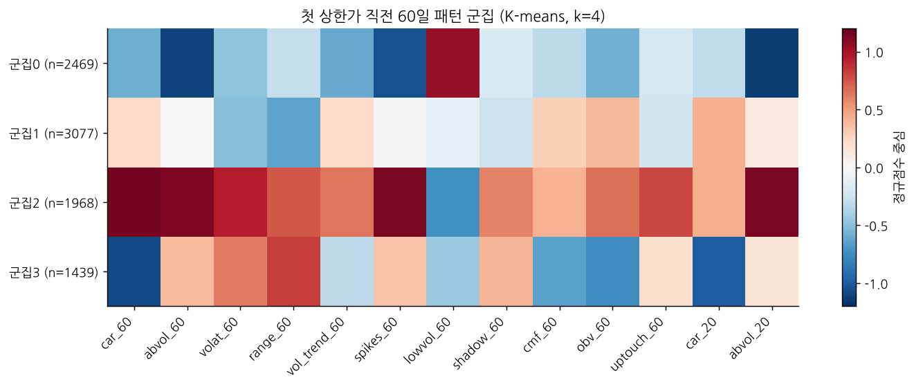
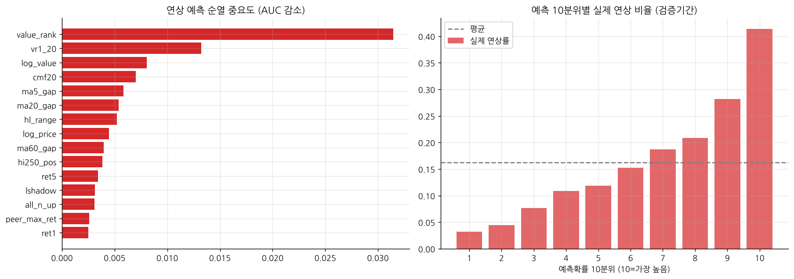
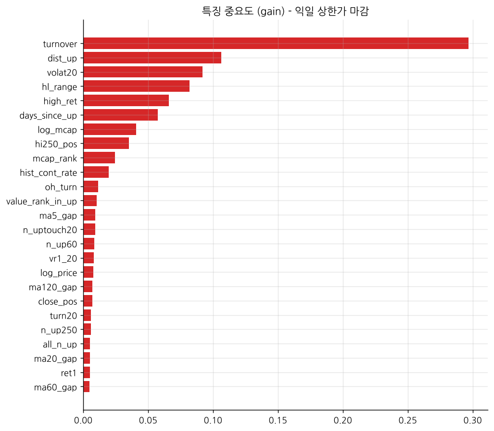
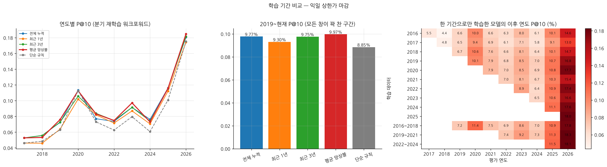

# 한국 주식 상한가·하한가 데이터마이닝 결과

생성: 2026-10-23 07:01  
데이터: KRX Open API 유가증권/코스닥 일별매매정보

## 0. 데이터와 상한가 판정 점검

| 항목 | 건수 |
|---|---|
| 상한가 | 13921 |
| 점상 | 921 |
| 상한터치후이탈 | 7546 |
| 하한가 | 1092 |
| 점하 | 137 |
| 하한터치후회복 | 590 |
| 상한가 경험 종목 수 | 2331 |
| 하한가 경험 종목 수 | 625 |
| 분석 거래일 수 | 2648 |
| 분석 종목 수 | 3263 |
| 기간 | 2016-01-04 ~ 2026-10-22 |


수익률은 역산 기준가격을 연결한 가격지수 대용치이며 기업행위 현금흐름과 체결을 검증한 총수익률이 아닙니다. 관측 누락·만기 미거래를 결측으로 두며, 관측 소실을 상장폐지로 확정하지 않습니다. 관측 가능한 미래 경로를 선별하므로 전체 사건의 투자성과로 일반화할 수 없습니다.


규정 계산(기준가·호가단위)과 등락률 기준 판정의 일치도. '누락 의심'이 크면 `KRX_LIMIT_RULE=loose` 로 비교.


| 항목 | 건수 |
|---|---|
| 상한가(규정계산) | 13,921 |
| 등락률≥29.5% & 종가=고가 | 13,843 |
| 상한가: 둘 다 해당 | 13,804 |
| 상한가: 등락률 기준만 해당(누락 의심) | 39 |
| 상한가: 규정계산만 해당(등락률<29.5%) | 117 |
| 하한가(규정계산) | 1,092 |
| 등락률≤-29.5% & 종가=저가 | 1,107 |
| 하한가: 등락률 기준만 해당(누락 의심) | 17 |
| 하한가: 규정계산만 해당(등락률>-29.5%) | 2 |
| /등락률/>30.5% (가격제한 없음, 제외) | 623 |


## 1. 상한가·하한가 건수 (목표 1)

| year | 종목일수 | 상한가 | 점상 | 상한터치후이탈 | 하한가 | 점하 | 하한터치후회복 | 상한가/만종목일 | 하한가/만종목일 |
|---|---|---|---|---|---|---|---|---|---|
| 2,016.0 | 498,755.0 | 925.0 | 52.0 | 465.0 | 69.0 | 13.0 | 19.0 | 18.6 | 1.3800 |
| 2,017.0 | 506,188.0 | 707.0 | 35.0 | 347.0 | 77.0 | 15.0 | 39.0 | 14.0 | 1.5200 |
| 2,018.0 | 521,580.0 | 1,000.0 | 55.0 | 474.0 | 58.0 | 4.0000 | 43.0 | 19.2 | 1.1100 |
| 2,019.0 | 539,470.0 | 947.0 | 68.0 | 479.0 | 98.0 | 14.0 | 54.0 | 17.6 | 1.8200 |
| 2,020.0 | 557,576.0 | 1,921.0 | 108.0 | 1,037.0 | 132.0 | 7.0000 | 110.0 | 34.5 | 2.3700 |
| 2,021.0 | 578,978.0 | 1,255.0 | 44.0 | 655.0 | 73.0 | 5.0000 | 35.0 | 21.7 | 1.2600 |
| 2,022.0 | 596,468.0 | 998.0 | 80.0 | 571.0 | 77.0 | 6.0000 | 41.0 | 16.7 | 1.2900 |
| 2,023.0 | 617,308.0 | 1,295.0 | 69.0 | 689.0 | 155.0 | 30.0 | 51.0 | 21.0 | 2.5100 |
| 2,024.0 | 632,567.0 | 1,240.0 | 85.0 | 742.0 | 94.0 | 12.0 | 47.0 | 19.6 | 1.4900 |
| 2,025.0 | 642,929.0 | 1,459.0 | 121.0 | 841.0 | 101.0 | 11.0 | 57.0 | 22.7 | 1.5700 |
| 2,026.0 | 519,099.0 | 2,174.0 | 204.0 | 1,246.0 | 158.0 | 20.0 | 94.0 | 41.9 | 3.0400 |


### 상한가 다발 종목 (상위 10)
| code | 종목명 | 시장 | 건수 | 첫발생 | 마지막발생 |
|---|---|---|---|---|---|
| 002995 | 금호건설우 | KOSPI | 45 | 2016-08-05 | 2026-08-12 |
| 152550 | 한국ANKOR유전 | KOSPI | 42 | 2022-12-14 | 2026-04-02 |
| 019175 | 신풍제약우 | KOSPI | 41 | 2017-11-09 | 2026-08-24 |
| 009415 | 태영건설우 | KOSPI | 39 | 2016-09-12 | 2026-05-21 |
| 049180 | 셀루메드 | KOSDAQ | 37 | 2016-03-04 | 2026-03-11 |
| 004835 | 덕성우 | KOSPI | 36 | 2018-05-11 | 2024-12-04 |
| 016385 | KG스틸우 | KOSPI | 34 | 2016-05-26 | 2022-06-09 |
| 121850 | 코이즈 | KOSDAQ | 34 | 2016-01-29 | 2026-08-28 |
| 011080 | 형지I&C | KOSDAQ | 33 | 2016-04-11 | 2026-10-20 |
| 224060 | 더코디 | KOSDAQ | 33 | 2016-01-04 | 2026-09-10 |


### 하한가 다발 종목 (상위 10)
| code | 종목명 | 시장 | 건수 | 첫발생 | 마지막발생 |
|---|---|---|---|---|---|
| 007390 | 네이처셀 | KOSDAQ | 10 | 2017-12-08 | 2025-08-06 |
| 006740 | 영풍제지 | KOSPI | 7 | 2023-10-18 | 2023-11-02 |
| 028300 | HLB | KOSDAQ | 7 | 2019-06-27 | 2026-07-13 |
| 035290 | 골드앤에스 | KOSDAQ | 7 | 2019-09-10 | 2026-09-02 |
| 047770 | 코데즈컴바인 | KOSDAQ | 6 | 2016-03-17 | 2016-07-01 |
| 288330 | 브릿지바이오테라퓨틱스 | KOSDAQ | 6 | 2024-04-23 | 2025-04-21 |
| 030790 | 비케이탑스 | KOSPI | 6 | 2017-07-26 | 2022-01-19 |
| 065620 | 제낙스 | KOSDAQ | 6 | 2018-05-09 | 2020-03-23 |
| 152550 | 한국ANKOR유전 | KOSPI | 6 | 2023-01-04 | 2026-04-28 |
| 043090 | 더테크놀로지 | KOSDAQ | 6 | 2020-08-18 | 2025-03-12 |


### 하한가가 가장 많았던 날
| date | 하한가 종목수 |
|---|---|
| 2020-03-19 | 32 |
| 2017-02-02 | 13 |
| 2023-04-24 | 8 |
| 2018-01-11 | 8 |
| 2024-05-17 | 8 |
| 2026-07-20 | 7 |
| 2020-08-18 | 7 |
| 2026-07-21 | 7 |
| 2026-06-25 | 7 |
| 2017-02-03 | 7 |


## 2. 상·하한가 직전 20/60일 특이사항 (목표 2)


### 첫 상한가 vs 대조군 (|SMD| 큰 순, 상위 12)
| 지표 | 설명 | 이벤트_평균 | 대조_평균 | 이벤트_중앙값 | 대조_중앙값 | SMD | AUC | p값 |
|---|---|---|---|---|---|---|---|---|
| volat_20 | 일간 변동성 (직전 20일) | 0.0398 | 0.0277 | 0.0350 | 0.0238 | 0.6220 | 0.6804 | 0.0000 |
| volat_60 | 일간 변동성 (직전 60일) | 0.0425 | 0.0307 | 0.0375 | 0.0272 | 0.5936 | 0.6688 | 0.0000 |
| range_20 | 고저폭(박스권 폭) (직전 20일) | 0.3014 | 0.1910 | 0.2157 | 0.1422 | 0.4443 | 0.6543 | 0.0000 |
| range_60 | 고저폭(박스권 폭) (직전 60일) | 0.7013 | 0.4322 | 0.4790 | 0.3197 | 0.4256 | 0.6487 | 0.0000 |
| shadow_60 | 장대윗꼬리(고가+10%↑ 종가+3%↓) 일수 (직전 60일) | 0.8949 | 0.4417 | 0.0000 | 0.0000 | 0.4145 | 0.6067 | 0.0000 |
| vol_trend_20 | 거래량 추세(기울기) (직전 20일) | 0.0222 | -0.0023 | 0.0135 | -0.0053 | 0.3582 | 0.5982 | 0.0000 |
| spikes_20 | 거래량 급증일수(3배↑) (직전 20일) | 5.2837 | 3.2805 | 3.0000 | 1.0000 | 0.3564 | 0.6004 | 0.0000 |
| uptouch_60 | 상한가 터치 횟수 (직전 60일) | 0.4688 | 0.1651 | 0.0000 | 0.0000 | 0.3499 | 0.5741 | 0.0000 |
| abvol_20 | 평균 비정상거래량(로그배율) (직전 20일) | 0.4032 | 0.0307 | 0.2719 | -0.0348 | 0.3243 | 0.5885 | 0.0000 |
| shadow_20 | 장대윗꼬리(고가+10%↑ 종가+3%↓) 일수 (직전 20일) | 0.3049 | 0.1346 | 0.0000 | 0.0000 | 0.3224 | 0.5621 | 0.0000 |
| spikes_60 | 거래량 급증일수(3배↑) (직전 60일) | 13.1 | 9.3646 | 8.0000 | 5.0000 | 0.2882 | 0.5790 | 0.0000 |
| obv_20 | OBV 순매수비율 (직전 20일) | 0.1676 | 0.0627 | 0.1997 | 0.0615 | 0.2849 | 0.5881 | 0.0000 |


### 첫 하한가 vs 대조군 (|SMD| 큰 순, 상위 12)
| 지표 | 설명 | 이벤트_평균 | 대조_평균 | 이벤트_중앙값 | 대조_중앙값 | SMD | AUC | p값 |
|---|---|---|---|---|---|---|---|---|
| volat_60 | 일간 변동성 (직전 60일) | 0.0600 | 0.0323 | 0.0555 | 0.0282 | 1.0982 | 0.8080 | 0.0000 |
| volat_20 | 일간 변동성 (직전 20일) | 0.0658 | 0.0307 | 0.0526 | 0.0254 | 1.0472 | 0.7965 | 0.0000 |
| range_60 | 고저폭(박스권 폭) (직전 60일) | 1.3549 | 0.4628 | 0.8547 | 0.3408 | 0.6814 | 0.7782 | 0.0000 |
| uptouch_60 | 상한가 터치 횟수 (직전 60일) | 1.3590 | 0.2697 | 0.0000 | 0.0000 | 0.6688 | 0.6569 | 0.0000 |
| uptouch_20 | 상한가 터치 횟수 (직전 20일) | 0.8503 | 0.0973 | 0.0000 | 0.0000 | 0.6268 | 0.6242 | 0.0000 |
| abvol_20 | 평균 비정상거래량(로그배율) (직전 20일) | 0.7596 | 0.0444 | 0.5429 | -0.0569 | 0.5525 | 0.6543 | 0.0000 |
| range_20 | 고저폭(박스권 폭) (직전 20일) | 0.7572 | 0.2207 | 0.3828 | 0.1544 | 0.5469 | 0.7548 | 0.0000 |
| car_60 | 누적초과수익률 (직전 60일) | 0.2701 | -0.0010 | 0.0664 | -0.0271 | 0.5450 | 0.5969 | 0.0000 |
| car_20 | 누적초과수익률 (직전 20일) | 0.1979 | 0.0019 | 0.0051 | -0.0133 | 0.4979 | 0.5631 | 0.0000 |
| ret_60 | 누적수익률 (직전 60일) | 0.4860 | -0.0046 | 0.0000 | -0.0375 | 0.4937 | 0.5561 | 0.0000 |
| vol_trend_60 | 거래량 추세(기울기) (직전 60일) | 0.0126 | -0.0008 | 0.0059 | -0.0026 | 0.4880 | 0.6312 | 0.0000 |
| shadow_60 | 장대윗꼬리(고가+10%↑ 종가+3%↓) 일수 (직전 60일) | 1.1236 | 0.5094 | 1.0000 | 0.0000 | 0.4832 | 0.6213 | 0.0000 |


### 매집 의심 점수
| 조건 | 이벤트 | 대조군 | lift |
|---|---|---|---|
| F1_거래량증가+횡보 | 0.0776 | 0.0966 | 0.8025 |
| F2_박스권(폭≤30%) | 0.2686 | 0.4645 | 0.5782 |
| F3_OBV매수우위+가격정체 | 0.2671 | 0.2603 | 1.0258 |
| F4_윗꼬리시세테스트 | 0.4853 | 0.2922 | 1.6609 |
| F5_소형주(시총하위20%) | 0.2669 | 0.2669 | 1.0000 |

| 매집점수 | 이벤트 | 대조군 | lift(이벤트/대조) |
|---|---|---|---|
| 0.0000 | 0.1894 | 0.2011 | 0.9417 |
| 1.0000 | 0.4074 | 0.3883 | 1.0493 |
| 2.0000 | 0.2750 | 0.2704 | 1.0173 |
| 3.0000 | 0.1061 | 0.1118 | 0.9490 |
| 4.0000 | 0.0205 | 0.0260 | 0.7899 |
| 5.0000 | 0.0015 | 0.0024 | 0.6087 |

| 점수 | n | 수익률1m_중앙값 | 수익률3m_중앙값 | 수익률6m_중앙값 | 급락비율_3m |
|---|---|---|---|---|---|
| 0.0000 | 1,783.0 | -0.0549 | -0.1084 | -0.1640 | 0.1996 |
| 1.0000 | 3,835.0 | -0.0756 | -0.1436 | -0.1929 | 0.2209 |
| 2.0000 | 2,589.0 | -0.0895 | -0.1470 | -0.1850 | 0.2006 |
| 3.0000 | 999.0 | -0.0913 | -0.1394 | -0.1845 | 0.1747 |
| 4.0000 | 207.0 | -0.1198 | -0.1662 | -0.1976 | 0.1692 |


### 직전 패턴 군집 (K-means)
| 군집 | n | 특징(정규점수 중심 상위3) | car_60 | abvol_60 | volat_60 | range_60 | vol_trend_60 | spikes_60 | lowvol_60 | shadow_60 | cmf_60 | obv_60 | uptouch_60 | car_20 | abvol_20 | post_1m | post_3m | post_6m | 3m수익률관측수 | 3m수익률미관측수 | 급락건수_3m(≤-30%) | 급락비율_3m(≤-30%) |
|---|---|---|---|---|---|---|---|---|---|---|---|---|---|---|---|---|---|---|---|---|---|---|
| 0 | 2,480 | abvol_20↓, abvol_60↓, lowvol_60↑ | -0.1587 | -0.6347 | 0.0288 | 0.4054 | -0.0090 | 1.0000 | 0.5167 | 0.0000 | -0.1671 | 0.0167 | 0.0000 | -0.0423 | -0.7904 | -0.0888 | -0.1293 | -0.1653 | 2,286 | 194 | 330 | 0.1444 |
| 1 | 1,435 | car_60↓, car_20↓, range_60↑ | -0.3204 | 0.4854 | 0.0513 | 0.9391 | -0.0021 | 13.0 | 0.0667 | 1.0000 | -0.2205 | -0.0114 | 0.0000 | -0.1588 | 0.4202 | -0.0556 | -0.1293 | -0.1587 | 1,184 | 251 | 270 | 0.2280 |
| 2 | 1,977 | car_60↑, spikes_60↑, abvol_20↑ | 0.3525 | 1.3435 | 0.0582 | 0.8502 | 0.0250 | 31.0 | 0.0167 | 1.0000 | -0.0379 | 0.4065 | 1.0000 | 0.0785 | 1.8202 | -0.0841 | -0.1622 | -0.2289 | 1,909 | 68 | 545 | 0.2855 |
| 3 | 3,078 | range_60↓, volat_60↓, car_20↑ | 0.0477 | 0.1675 | 0.0298 | 0.3126 | 0.0096 | 8.0000 | 0.1333 | 0.0000 | -0.0573 | 0.3103 | 0.0000 | 0.0614 | 0.3763 | -0.0779 | -0.1281 | -0.1806 | 3,015 | 63 | 536 | 0.1778 |




## 3. 상따·하따 이후 수익률 (목표 3)


평가일은 사건일 D에서 세는 D+h입니다. 익일 시가 진입의 1일 결과는 D+1 시가→D+1 종가입니다. 같은 시가 기준 시장 벤치마크가 없어 그 진입 방식의 시장초과수익은 산출하지 않습니다.


### 표본 유지와 관측 누락
| 방향 | 이벤트 | 진입 | 보유기간 | 사건수 | 관측기간충족수 | n | 수익률미산출수 | 관측소실건수 |
|---|---|---|---|---|---|---|---|---|
| up | 상한가 마감 | 당일(제한가 매수) | 1d | 13,921 | 13,918 | 13,679 | 242 | 0 |
| up | 상한가 마감 | 당일(제한가 매수) | 1w | 13,921 | 13,894 | 13,625 | 296 | 0 |
| up | 상한가 마감 | 당일(제한가 매수) | 1m | 13,921 | 13,794 | 13,468 | 453 | 17 |
| up | 상한가 마감 | 당일(제한가 매수) | 3m | 13,921 | 13,422 | 12,866 | 1,055 | 107 |
| up | 상한가 마감 | 당일(제한가 매수) | 6m | 13,921 | 12,685 | 11,969 | 1,952 | 206 |
| up | 상한가 마감 | 당일(제한가 매수) | 1y | 13,921 | 11,393 | 10,449 | 3,472 | 286 |
| down | 하한가 마감 | 당일(제한가 매수) | 1d | 1,092 | 1,091 | 1,055 | 37 | 0 |
| down | 하한가 마감 | 당일(제한가 매수) | 1w | 1,092 | 1,087 | 1,011 | 81 | 4 |
| down | 하한가 마감 | 당일(제한가 매수) | 1m | 1,092 | 1,072 | 945 | 147 | 11 |
| down | 하한가 마감 | 당일(제한가 매수) | 3m | 1,092 | 1,035 | 885 | 207 | 13 |
| down | 하한가 마감 | 당일(제한가 매수) | 6m | 1,092 | 964 | 783 | 309 | 17 |
| down | 하한가 마감 | 당일(제한가 매수) | 1y | 1,092 | 914 | 664 | 428 | 34 |


### 평균
| 방향 | 이벤트 | 진입 | 1d | 1w | 1m | 3m | 6m | 1y |
|---|---|---|---|---|---|---|---|---|
| up | 상따(상한가 터치 전체) | 당일(제한가 매수) | -0.0174 | -0.0300 | -0.0381 | -0.0732 | -0.0833 | -0.0873 |
| up | 상따(상한가 터치 전체) | 익일 시가 | -0.0234 | -0.0359 | -0.0441 | -0.0764 | -0.0867 | -0.0846 |
| up | 상한가 마감 | 당일(제한가 매수) | 0.0374 | 0.0207 | 0.0099 | -0.0357 | -0.0469 | -0.0692 |
| up | 상한가 마감 | 익일 시가 | -0.0325 | -0.0482 | -0.0585 | -0.0983 | -0.1083 | -0.1240 |
| up | 점상 | 당일(제한가 매수) | 0.1375 | 0.1748 | 0.1663 | 0.1222 | 0.1775 | 0.0834 |
| up | 점상 | 익일 시가 | -0.0425 | -0.0152 | -0.0234 | -0.0544 | -0.0207 | -0.0896 |
| up | 상한가(점상 제외) | 당일(제한가 매수) | 0.0304 | 0.0102 | -0.0011 | -0.0466 | -0.0616 | -0.0788 |
| up | 상한가(점상 제외) | 익일 시가 | -0.0318 | -0.0505 | -0.0610 | -0.1012 | -0.1139 | -0.1261 |
| up | 상한터치후이탈 | 당일(제한가 매수) | -0.1171 | -0.1227 | -0.1265 | -0.1424 | -0.1506 | -0.1208 |
| up | 상한터치후이탈 | 익일 시가 | -0.0070 | -0.0135 | -0.0179 | -0.0364 | -0.0472 | -0.0128 |
| up | 첫 상한가 | 당일(제한가 매수) | 0.0335 | 0.0163 | 0.0052 | -0.0313 | -0.0446 | -0.0565 |
| up | 첫 상한가 | 익일 시가 | -0.0302 | -0.0460 | -0.0575 | -0.0908 | -0.1028 | -0.1103 |
| up | 2연상 이상 | 당일(제한가 매수) | 0.0625 | 0.0477 | 0.0382 | -0.0629 | -0.0616 | -0.1558 |
| up | 2연상 이상 | 익일 시가 | -0.0472 | -0.0628 | -0.0652 | -0.1481 | -0.1463 | -0.2256 |
| down | 하따(하한가 터치 전체) | 당일(제한가 매수) | -0.0134 | 0.0049 | 0.0191 | 0.0152 | 0.0432 | 0.0655 |
| down | 하따(하한가 터치 전체) | 익일 시가 | -0.0002 | 0.0131 | 0.0262 | 0.0248 | 0.0505 | 0.0569 |
| down | 하한가 마감 | 당일(제한가 매수) | -0.0729 | -0.0706 | -0.0751 | -0.0827 | -0.0746 | -0.1172 |
| down | 하한가 마감 | 익일 시가 | -0.0000 | -0.0034 | -0.0074 | -0.0140 | -0.0074 | -0.0551 |
| down | 점하 | 당일(제한가 매수) | -0.1935 | -0.2365 | -0.2455 | -0.2091 | -0.3001 | -0.3379 |
| down | 점하 | 익일 시가 | 0.0184 | -0.0480 | -0.0679 | -0.0253 | -0.1310 | -0.1916 |
| down | 하한가(점하 제외) | 당일(제한가 매수) | -0.0552 | -0.0455 | -0.0482 | -0.0625 | -0.0401 | -0.0813 |
| down | 하한가(점하 제외) | 익일 시가 | -0.0027 | 0.0033 | 0.0023 | -0.0122 | 0.0119 | -0.0322 |
| down | 하한터치후회복 | 당일(제한가 매수) | 0.0939 | 0.1411 | 0.1861 | 0.1918 | 0.2533 | 0.3988 |
| down | 하한터치후회복 | 익일 시가 | -0.0007 | 0.0428 | 0.0851 | 0.0940 | 0.1517 | 0.2559 |
| down | 첫 하한가 | 당일(제한가 매수) | -0.0653 | -0.0560 | -0.0538 | -0.0582 | -0.0488 | -0.0811 |
| down | 첫 하한가 | 익일 시가 | -0.0026 | 0.0040 | 0.0087 | 0.0056 | 0.0160 | -0.0198 |
| down | 2연하 이상 | 당일(제한가 매수) | -0.1350 | -0.1953 | -0.2512 | -0.2889 | -0.2864 | -0.4343 |
| down | 2연하 이상 | 익일 시가 | 0.0208 | -0.0668 | -0.1387 | -0.1769 | -0.1954 | -0.3552 |


### 중앙값
| 방향 | 이벤트 | 진입 | 1d | 1w | 1m | 3m | 6m | 1y |
|---|---|---|---|---|---|---|---|---|
| up | 상따(상한가 터치 전체) | 당일(제한가 매수) | -0.0382 | -0.0814 | -0.1284 | -0.1811 | -0.2305 | -0.2697 |
| up | 상따(상한가 터치 전체) | 익일 시가 | -0.0255 | -0.0670 | -0.1112 | -0.1709 | -0.2213 | -0.2594 |
| up | 상한가 마감 | 당일(제한가 매수) | 0.0106 | -0.0377 | -0.0949 | -0.1612 | -0.2132 | -0.2608 |
| up | 상한가 마감 | 익일 시가 | -0.0346 | -0.0870 | -0.1418 | -0.2034 | -0.2560 | -0.2962 |
| up | 점상 | 당일(제한가 매수) | 0.1782 | 0.0360 | -0.0670 | -0.1143 | -0.1833 | -0.2250 |
| up | 점상 | 익일 시가 | 0.0000 | -0.0982 | -0.1929 | -0.2274 | -0.3116 | -0.3286 |
| up | 상한가(점상 제외) | 당일(제한가 매수) | 0.0059 | -0.0403 | -0.0960 | -0.1644 | -0.2151 | -0.2628 |
| up | 상한가(점상 제외) | 익일 시가 | -0.0364 | -0.0865 | -0.1400 | -0.2019 | -0.2539 | -0.2936 |
| up | 상한터치후이탈 | 당일(제한가 매수) | -0.1206 | -0.1494 | -0.1780 | -0.2174 | -0.2576 | -0.2833 |
| up | 상한터치후이탈 | 익일 시가 | -0.0164 | -0.0406 | -0.0701 | -0.1133 | -0.1624 | -0.1952 |
| up | 첫 상한가 | 당일(제한가 매수) | 0.0091 | -0.0337 | -0.0896 | -0.1518 | -0.2015 | -0.2470 |
| up | 첫 상한가 | 익일 시가 | -0.0347 | -0.0816 | -0.1359 | -0.1928 | -0.2432 | -0.2822 |
| up | 2연상 이상 | 당일(제한가 매수) | 0.0255 | -0.0847 | -0.1605 | -0.2470 | -0.3239 | -0.3727 |
| up | 2연상 이상 | 익일 시가 | -0.0342 | -0.1541 | -0.2241 | -0.3060 | -0.3681 | -0.4146 |
| down | 하따(하한가 터치 전체) | 당일(제한가 매수) | -0.0216 | -0.0314 | -0.0493 | -0.0956 | -0.1613 | -0.2754 |
| down | 하따(하한가 터치 전체) | 익일 시가 | -0.0070 | -0.0259 | -0.0471 | -0.0912 | -0.1577 | -0.2487 |
| down | 하한가 마감 | 당일(제한가 매수) | -0.0719 | -0.0911 | -0.1310 | -0.1637 | -0.2188 | -0.3370 |
| down | 하한가 마감 | 익일 시가 | -0.0052 | -0.0416 | -0.0687 | -0.1118 | -0.1637 | -0.2799 |
| down | 점하 | 당일(제한가 매수) | -0.2275 | -0.2331 | -0.2744 | -0.3219 | -0.4116 | -0.4201 |
| down | 점하 | 익일 시가 | 0.0000 | -0.0470 | -0.0959 | -0.1627 | -0.2681 | -0.2774 |
| down | 하한가(점하 제외) | 당일(제한가 매수) | -0.0578 | -0.0736 | -0.1098 | -0.1541 | -0.2075 | -0.3215 |
| down | 하한가(점하 제외) | 익일 시가 | -0.0081 | -0.0390 | -0.0669 | -0.1077 | -0.1537 | -0.2807 |
| down | 하한터치후회복 | 당일(제한가 매수) | 0.0576 | 0.0858 | 0.0897 | 0.0321 | -0.0528 | -0.1292 |
| down | 하한터치후회복 | 익일 시가 | -0.0082 | 0.0000 | 0.0000 | -0.0560 | -0.1230 | -0.1885 |
| down | 첫 하한가 | 당일(제한가 매수) | -0.0679 | -0.0795 | -0.1093 | -0.1496 | -0.2042 | -0.3109 |
| down | 첫 하한가 | 익일 시가 | -0.0088 | -0.0331 | -0.0567 | -0.0961 | -0.1364 | -0.2652 |
| down | 2연하 이상 | 당일(제한가 매수) | -0.1561 | -0.1941 | -0.2775 | -0.3718 | -0.4650 | -0.5540 |
| down | 2연하 이상 | 익일 시가 | 0.0000 | -0.0840 | -0.2006 | -0.2500 | -0.3821 | -0.4888 |


### 승률
| 방향 | 이벤트 | 진입 | 1d | 1w | 1m | 3m | 6m | 1y |
|---|---|---|---|---|---|---|---|---|
| up | 상따(상한가 터치 전체) | 당일(제한가 매수) | 0.3907 | 0.3292 | 0.2970 | 0.2684 | 0.2581 | 0.2666 |
| up | 상따(상한가 터치 전체) | 익일 시가 | 0.3552 | 0.3207 | 0.3054 | 0.2778 | 0.2630 | 0.2702 |
| up | 상한가 마감 | 당일(제한가 매수) | 0.5434 | 0.4152 | 0.3519 | 0.3043 | 0.2815 | 0.2775 |
| up | 상한가 마감 | 익일 시가 | 0.3340 | 0.3005 | 0.2831 | 0.2525 | 0.2414 | 0.2425 |
| up | 점상 | 당일(제한가 매수) | 0.7536 | 0.5349 | 0.4219 | 0.4158 | 0.3578 | 0.3295 |
| up | 점상 | 익일 시가 | 0.2273 | 0.3377 | 0.2964 | 0.3038 | 0.2602 | 0.2559 |
| up | 상한가(점상 제외) | 당일(제한가 매수) | 0.5287 | 0.4070 | 0.3469 | 0.2967 | 0.2765 | 0.2743 |
| up | 상한가(점상 제외) | 익일 시가 | 0.3415 | 0.2980 | 0.2821 | 0.2490 | 0.2401 | 0.2416 |
| up | 상한터치후이탈 | 당일(제한가 매수) | 0.1126 | 0.1719 | 0.1957 | 0.2022 | 0.2147 | 0.2464 |
| up | 상한터치후이탈 | 익일 시가 | 0.3938 | 0.3574 | 0.3461 | 0.3241 | 0.3026 | 0.3207 |
| up | 첫 상한가 | 당일(제한가 매수) | 0.5374 | 0.4207 | 0.3518 | 0.3071 | 0.2851 | 0.2867 |
| up | 첫 상한가 | 익일 시가 | 0.3363 | 0.3040 | 0.2823 | 0.2554 | 0.2452 | 0.2496 |
| up | 2연상 이상 | 당일(제한가 매수) | 0.5821 | 0.3814 | 0.3521 | 0.2871 | 0.2584 | 0.2154 |
| up | 2연상 이상 | 익일 시가 | 0.3189 | 0.2772 | 0.2882 | 0.2325 | 0.2151 | 0.1899 |
| down | 하따(하한가 터치 전체) | 당일(제한가 매수) | 0.4384 | 0.4459 | 0.4283 | 0.3932 | 0.3666 | 0.2918 |
| down | 하따(하한가 터치 전체) | 익일 시가 | 0.4226 | 0.4484 | 0.4322 | 0.3981 | 0.3670 | 0.2977 |
| down | 하한가 마감 | 당일(제한가 매수) | 0.2872 | 0.3333 | 0.3164 | 0.3220 | 0.3116 | 0.2184 |
| down | 하한가 마감 | 익일 시가 | 0.4085 | 0.4192 | 0.3940 | 0.3741 | 0.3477 | 0.2581 |
| down | 점하 | 당일(제한가 매수) | 0.1111 | 0.1654 | 0.1783 | 0.2623 | 0.2212 | 0.1290 |
| down | 점하 | 익일 시가 | 0.3333 | 0.4286 | 0.3798 | 0.3689 | 0.3462 | 0.2043 |
| down | 하한가(점하 제외) | 당일(제한가 매수) | 0.3130 | 0.3588 | 0.3382 | 0.3316 | 0.3255 | 0.2329 |
| down | 하한가(점하 제외) | 익일 시가 | 0.4196 | 0.4178 | 0.3963 | 0.3750 | 0.3479 | 0.2671 |
| down | 하한터치후회복 | 당일(제한가 매수) | 0.7111 | 0.6488 | 0.6266 | 0.5214 | 0.4647 | 0.4258 |
| down | 하한터치후회복 | 익일 시가 | 0.4479 | 0.5009 | 0.4991 | 0.4408 | 0.4009 | 0.3681 |
| down | 첫 하한가 | 당일(제한가 매수) | 0.2936 | 0.3503 | 0.3369 | 0.3388 | 0.3209 | 0.2299 |
| down | 첫 하한가 | 익일 시가 | 0.4170 | 0.4286 | 0.4111 | 0.3910 | 0.3602 | 0.2729 |
| down | 2연하 이상 | 당일(제한가 매수) | 0.2348 | 0.1887 | 0.1471 | 0.1809 | 0.2353 | 0.1176 |
| down | 2연하 이상 | 익일 시가 | 0.3391 | 0.3396 | 0.2549 | 0.2340 | 0.2471 | 0.1324 |


### 시장초과평균
| 방향 | 이벤트 | 진입 | 1d | 1w | 1m | 3m | 6m | 1y |
|---|---|---|---|---|---|---|---|---|
| up | 상따(상한가 터치 전체) | 당일(제한가 매수) | -0.0181 | -0.0337 | -0.0522 | -0.1034 | -0.1384 | -0.2234 |
| up | 상한가 마감 | 당일(제한가 매수) | 0.0366 | 0.0167 | -0.0042 | -0.0654 | -0.1012 | -0.2057 |
| up | 점상 | 당일(제한가 매수) | 0.1382 | 0.1716 | 0.1531 | 0.0923 | 0.1331 | -0.0731 |
| up | 상한가(점상 제외) | 당일(제한가 매수) | 0.0295 | 0.0061 | -0.0152 | -0.0762 | -0.1166 | -0.2141 |
| up | 상한터치후이탈 | 당일(제한가 매수) | -0.1178 | -0.1260 | -0.1408 | -0.1737 | -0.2073 | -0.2561 |
| up | 첫 상한가 | 당일(제한가 매수) | 0.0328 | 0.0124 | -0.0086 | -0.0610 | -0.0994 | -0.1888 |
| up | 2연상 이상 | 당일(제한가 매수) | 0.0612 | 0.0427 | 0.0227 | -0.0923 | -0.1125 | -0.3213 |
| down | 하따(하한가 터치 전체) | 당일(제한가 매수) | -0.0174 | -0.0085 | -0.0234 | -0.0522 | -0.0599 | -0.1322 |
| down | 하한가 마감 | 당일(제한가 매수) | -0.0753 | -0.0799 | -0.1061 | -0.1280 | -0.1481 | -0.2687 |
| down | 점하 | 당일(제한가 매수) | -0.1927 | -0.2391 | -0.2709 | -0.2337 | -0.3232 | -0.4110 |
| down | 하한가(점하 제외) | 당일(제한가 매수) | -0.0580 | -0.0557 | -0.0800 | -0.1111 | -0.1213 | -0.2455 |
| down | 하한터치후회복 | 당일(제한가 매수) | 0.0869 | 0.1202 | 0.1231 | 0.0843 | 0.0973 | 0.1169 |
| down | 첫 하한가 | 당일(제한가 매수) | -0.0679 | -0.0654 | -0.0858 | -0.1068 | -0.1304 | -0.2442 |
| down | 2연하 이상 | 당일(제한가 매수) | -0.1358 | -0.2030 | -0.2737 | -0.3061 | -0.2936 | -0.4835 |


### 연도별 1달 수익률 (상한가/하한가 마감, 당일 진입)
| 이벤트 | 분해기준 | 보유기간 | 그룹값 | n | 평균 | 중앙값 | 승률 |
|---|---|---|---|---|---|---|---|
| 상한가 마감 | 연도 | 1m | 2016 | 915 | -0.0234 | -0.0989 | 0.3180 |
| 상한가 마감 | 연도 | 1m | 2017 | 670 | 0.0102 | -0.1073 | 0.3299 |
| 상한가 마감 | 연도 | 1m | 2018 | 987 | -0.0053 | -0.0958 | 0.3576 |
| 상한가 마감 | 연도 | 1m | 2019 | 936 | -0.0051 | -0.0974 | 0.3344 |
| 상한가 마감 | 연도 | 1m | 2020 | 1,877 | 0.0753 | -0.0346 | 0.4507 |
| 상한가 마감 | 연도 | 1m | 2021 | 1,247 | 0.0336 | -0.0623 | 0.3841 |
| 상한가 마감 | 연도 | 1m | 2022 | 979 | -0.0079 | -0.1041 | 0.3401 |
| 상한가 마감 | 연도 | 1m | 2023 | 1,272 | 0.0045 | -0.1005 | 0.3310 |
| 상한가 마감 | 연도 | 1m | 2024 | 1,226 | -0.0197 | -0.1167 | 0.3067 |
| 상한가 마감 | 연도 | 1m | 2025 | 1,433 | 0.0473 | -0.0989 | 0.3552 |
| 상한가 마감 | 연도 | 1m | 2026 | 1,926 | -0.0349 | -0.1426 | 0.3100 |
| 하한가 마감 | 연도 | 1m | 2016 | 63 | -0.1317 | -0.1661 | 0.2540 |
| 하한가 마감 | 연도 | 1m | 2017 | 71 | -0.0100 | -0.0577 | 0.3662 |
| 하한가 마감 | 연도 | 1m | 2018 | 51 | 0.0572 | -0.0191 | 0.4706 |
| 하한가 마감 | 연도 | 1m | 2019 | 88 | -0.1007 | -0.1423 | 0.2841 |
| 하한가 마감 | 연도 | 1m | 2020 | 102 | 0.1881 | 0.0500 | 0.5392 |
| 하한가 마감 | 연도 | 1m | 2021 | 60 | -0.1050 | -0.1397 | 0.2333 |
| 하한가 마감 | 연도 | 1m | 2022 | 72 | -0.1520 | -0.1745 | 0.2500 |
| 하한가 마감 | 연도 | 1m | 2023 | 144 | -0.1846 | -0.2453 | 0.2083 |
| 하한가 마감 | 연도 | 1m | 2024 | 88 | -0.1299 | -0.1554 | 0.2614 |
| 하한가 마감 | 연도 | 1m | 2025 | 89 | -0.0627 | -0.1324 | 0.3596 |
| 하한가 마감 | 연도 | 1m | 2026 | 117 | -0.1233 | -0.2025 | 0.3077 |


## 4. 연속 상·하한가 (목표 4)

| k일 연속 | 도달 건수 | k+1일 이어짐 | 연속확률 | 95%CI |
|---|---|---|---|---|
| 1.0000 | 11,921.0 | 1,382.0 | 0.1159 | 0.0057 |
| 2.0000 | 1,382.0 | 364.0 | 0.2634 | 0.0232 |
| 3.0000 | 364.0 | 128.0 | 0.3516 | 0.0491 |
| 4.0000 | 128.0 | 58.0 | 0.4531 | 0.0862 |
| 5.0000 | 58.0 | 33.0 | 0.5690 | 0.1275 |
| 6.0000 | 33.0 | 14.0 | 0.4242 | 0.1686 |
| 7.0000 | 14.0 | 7.0000 | 0.5000 | 0.2619 |
| 8.0000 | 7.0000 | 7.0000 | 1.0000 | 0.0000 |

| k일 연속 | 도달 건수 | k+1일 이어짐 | 연속확률 | 95%CI |
|---|---|---|---|---|
| 1.0000 | 972.0 | 81.0 | 0.0833 | 0.0174 |
| 2.0000 | 81.0 | 24.0 | 0.2963 | 0.0994 |
| 3.0000 | 24.0 | 9.0000 | 0.3750 | 0.1937 |
| 4.0000 | 9.0000 | 3.0000 | 0.3333 | 0.3080 |
| 5.0000 | 3.0000 | 1.0000 | 0.3333 | 0.5334 |
| 6.0000 | 1.0000 | 1.0000 | 1.0000 | 0.0000 |
| 7.0000 | 1.0000 | 0.0000 | 0.0000 | 0.0000 |


### 상태 전이 확률
| 오늘\내일 | 표본수 | 상한가 | 상한터치이탈 | +10%이상 | 0~+10% | 하락(하한가 제외) | 하한가 |
|---|---|---|---|---|---|---|---|
| 상한가 | 13,918 | 0.1378 | 0.0611 | 0.1012 | 0.2826 | 0.4135 | 0.0037 |
| 상한터치이탈 | 7,546 | 0.0250 | 0.0117 | 0.0682 | 0.3031 | 0.5888 | 0.0032 |
| +10%이상 | 60,548 | 0.0135 | 0.0059 | 0.0518 | 0.3798 | 0.5482 | 0.0008 |
| 0~+10% | 3,063,182 | 0.0018 | 0.0011 | 0.0092 | 0.4958 | 0.4920 | 0.0001 |
| 하락(하한가 제외) | 3,063,036 | 0.0016 | 0.0009 | 0.0088 | 0.4954 | 0.4930 | 0.0002 |
| 하한가 | 1,085 | 0.0286 | 0.0138 | 0.0747 | 0.2083 | 0.5751 | 0.0995 |


### 연상 예측 모델 성능 (시간 분할 검증)
| 학습기간 | 검증 n | 모델 | AUC | AP | 기저율(검증) | 상위10% 적중률 | Lift@10% |
|---|---|---|---|---|---|---|---|
| ~2023-11-20 | 5,081 | 기준(연속일수+점상) | 0.6195 | 0.2519 | 0.1590 | 0.3517 | 2.2114 |
| ~2023-11-20 | 5,081 | 로지스틱 회귀 | 0.7190 | 0.3594 | 0.1590 | 0.4283 | 2.6932 |
| ~2023-11-20 | 5,081 | 의사결정나무(깊이4) | 0.6768 | 0.2749 | 0.1590 | 0.3086 | 1.9404 |
| ~2023-11-20 | 5,081 | 그래디언트부스팅(lgbm) | 0.7263 | 0.3439 | 0.1590 | 0.4047 | 2.5450 |


### 연하 예측 모델 성능
| 학습기간 | 검증 n | 모델 | AUC | AP | 기저율(검증) | 상위10% 적중률 | Lift@10% |
|---|---|---|---|---|---|---|---|
| ~2023-11-20 | 359 | 기준(연속일수+점상) | 0.6104 | 0.2015 | 0.1170 | 0.3056 | 2.6118 |
| ~2023-11-20 | 359 | 로지스틱 회귀 | 0.5607 | 0.2558 | 0.1170 | 0.2778 | 2.3743 |
| ~2023-11-20 | 359 | 의사결정나무(깊이4) | 0.6695 | 0.2826 | 0.1170 | 0.3889 | 3.3241 |
| ~2023-11-20 | 359 | 그래디언트부스팅(lgbm) | 0.6776 | 0.3347 | 0.1170 | 0.3611 | 3.0866 |


### 연상 성공 vs 실패 (첫 상한가 당일 특징, |SMD| 상위 12)
| 지표 | 설명 | 연속_평균 | 중단_평균 | 연속_중앙값 | 중단_중앙값 | SMD | AUC | p값 |
|---|---|---|---|---|---|---|---|---|
| value_rank | value_rank | 0.7940 | 0.9007 | 0.8567 | 0.9497 | -0.6438 | 0.3189 | 0.0000 |
| log_value | log_value | 22.8 | 23.9 | 22.8 | 24.0 | -0.6108 | 0.3321 | 0.0000 |
| value_rank_in_up | value_rank_in_up | 0.4515 | 0.6236 | 0.3913 | 0.6429 | -0.6091 | 0.3293 | 0.0000 |
| mcap_rank_in_up | mcap_rank_in_up | 0.4926 | 0.6137 | 0.4444 | 0.6250 | -0.4185 | 0.3806 | 0.0000 |
| log_mcap | log_mcap | 24.8 | 25.3 | 24.8 | 25.3 | -0.4149 | 0.3800 | 0.0000 |
| turn_rank_in_up | turn_rank_in_up | 0.4971 | 0.6159 | 0.4545 | 0.6250 | -0.4139 | 0.3811 | 0.0000 |
| up_jeom | up_jeom | 0.1399 | 0.0290 | 0.0000 | 0.0000 | 0.4071 | 0.5555 | 0.0000 |
| mcap_rank | mcap_rank | 0.3262 | 0.4336 | 0.2583 | 0.4259 | -0.4003 | 0.3810 | 0.0000 |
| child_max_ret1 | child_max_ret1 | 0.2895 | 0.2726 | 0.2994 | 0.2990 | 0.3749 | 0.6345 | 0.0288 |
| gap | gap | 0.0900 | 0.0558 | 0.0310 | 0.0206 | 0.3417 | 0.5673 | 0.0000 |
| body | body | 0.2090 | 0.2431 | 0.2680 | 0.2782 | -0.3411 | 0.4333 | 0.0000 |
| hl_range | hl_range | 0.2305 | 0.2634 | 0.2815 | 0.2902 | -0.3342 | 0.4398 | 0.0000 |


### 연속 상한가: 최고점 대비 가격 변화 (연속 일수별 중앙값)
| 연속일수 | n | 연속중변화(중앙) | 극점까지변화(중앙) | 극점도달일(중앙) | 극점후1주(중앙) | 극점후1달(중앙) | 극점후3달(중앙) | 극점후6달(중앙) | 극점후1년(중앙) | 1년내최대낙폭(중앙) | 1년내최고점회복(비율) | 상승분반납률1년(중앙) | 1년후연상전보다낮음(비율) | 극점후6달 정규장미거래(비율) | 극점후1년 정규장미거래(비율) | 목표일전관측소실(비율) | 1년기간도달수 | 1년수익률관측수 |
|---|---|---|---|---|---|---|---|---|---|---|---|---|---|---|---|---|---|---|
| 1 | 10,248.0 | 0.2992 | 0.4205 | 3.0000 | -0.1427 | -0.2096 | -0.2627 | -0.3059 | -0.3454 | -0.4897 | 0.5486 | 1.0677 | 0.5301 | 0.0290 | 0.0424 | 0.0169 | 8,633.0 | 8,126.0 |
| 2 | 977.0 | 0.6877 | 0.8032 | 2.0000 | -0.2081 | -0.2986 | -0.3692 | -0.4233 | -0.4615 | -0.5692 | 0.4379 | 0.9248 | 0.4279 | 0.0541 | 0.0847 | 0.0258 | 776.0 | 692.0 |
| 3 | 221.0 | 1.1927 | 1.3132 | 1.0000 | -0.2635 | -0.3697 | -0.4168 | -0.5282 | -0.5540 | -0.6514 | 0.2810 | 0.9211 | 0.3960 | 0.0573 | 0.0947 | 0.0398 | 176.0 | 153.0 |
| 4 | 69.0 | 1.8494 | 1.8671 | 1.0000 | -0.3101 | -0.4058 | -0.4612 | -0.5453 | -0.6312 | -0.6947 | 0.3256 | 0.9363 | 0.3000 | 0.0526 | 0.0851 | 0.0600 | 50.0 | 43.0 |
| 5+ | 54.0 | 3.7991 | 4.5510 | 2.0000 | -0.2872 | -0.4212 | -0.4982 | -0.5501 | -0.5952 | -0.7098 | 0.2895 | 0.7460 | 0.1111 | 0.0208 | 0.0500 | 0.0909 | 44.0 | 38.0 |
| 전체 | 11,569.0 | 0.2993 | 0.4579 | 3.0000 | -0.1495 | -0.2173 | -0.2750 | -0.3202 | -0.3607 | -0.5011 | 0.5335 | 1.0384 | 0.5175 | 0.0316 | 0.0470 | 0.0186 | 9,679.0 | 9,052.0 |


### 연속 하한가: 최저점 대비 가격 변화
| 연속일수 | n | 연속중변화(중앙) | 극점까지변화(중앙) | 극점도달일(중앙) | 극점후1주(중앙) | 극점후1달(중앙) | 극점후3달(중앙) | 극점후6달(중앙) | 극점후1년(중앙) | 1년내최대반등(중앙) | 1년내하락전가격회복(비율) | 하락분회복률1년(중앙) | 극점후6달 정규장미거래(비율) | 극점후1년 정규장미거래(비율) | 목표일전관측소실(비율) | 1년기간도달수 | 1년수익률관측수 |
|---|---|---|---|---|---|---|---|---|---|---|---|---|---|---|---|---|---|
| 1 | 778.0 | -0.2994 | -0.4354 | 9.0000 | 0.1158 | 0.1526 | 0.0964 | 0.0112 | -0.1006 | 0.6358 | 0.4488 | -0.1007 | 0.1074 | 0.1778 | 0.0332 | 663.0 | 527.0 |
| 2 | 46.0 | -0.5094 | -0.6071 | 11.5 | 0.1533 | 0.0671 | 0.0056 | 0.1186 | -0.1587 | 0.7688 | 0.3077 | -0.0892 | 0.0976 | 0.1351 | 0.0263 | 38.0 | 32.0 |
| 3+ | 21.0 | -0.6566 | -0.7896 | 16.0 | 0.0914 | -0.0122 | -0.1219 | -0.2615 | -0.3412 | 0.1973 | 0.0000 | -0.0649 | 0.1053 | 0.2222 | 0.0526 | 19.0 | 14.0 |
| 전체 | 845.0 | -0.2995 | -0.4507 | 9.0000 | 0.1161 | 0.1474 | 0.0818 | 0.0055 | -0.1149 | 0.6261 | 0.4332 | -0.0925 | 0.1068 | 0.1767 | 0.0333 | 720.0 | 573.0 |





```
|--- value_rank <= 0.82
|   |--- hl_range <= 0.02
|   |   |--- ret20 <= 0.34
|   |   |   |--- weights: [41.17, 139.32] class: 1
|   |   |--- ret20 >  0.34
|   |   |   |--- mkt_breadth <= 0.57
|   |   |   |   |--- weights: [43.46, 521.46] class: 1
|   |   |   |--- mkt_breadth >  0.57
|   |   |   |   |--- weights: [29.16, 147.28] class: 1
|   |--- hl_range >  0.02
|   |   |--- value_rank <= 0.74
|   |   |   |--- all_n_up_prev <= 6.50
|   |   |   |   |--- weights: [172.12, 302.53] class: 1
|   |   |   |--- all_n_up_prev >  6.50
|   |   |   |   |--- weights: [108.65, 402.04] class: 1
|   |   |--- value_rank >  0.74
|   |   |   |--- ma120_gap <= 0.11
|   |   |   |   |--- weights: [84.06, 35.83] class: 0
|   |   |   |--- ma120_gap >  0.11
|   |   |   |   |--- weights: [162.40, 278.64] class: 1
|--- value_rank >  0.82
|   |--- oh_price <= 1.94
|   |   |--- value_rank <= 0.94
|   |   |   |--- ma60_gap <= 0.32
|   |   |   |   |--- weights: [565.54, 314.47] class: 0
|   |   |   |--- ma60_gap >  0.32
|   |   |   |   |--- weights: [463.75, 597.09] class: 1
|   |   |--- value_rank >  0.94
|   |   |   |--- mcap_rank <= 0.06
|   |   |   |   |--- weights: [40.03, 75.63] class: 1
|   |   |   |--- mcap_rank >  0.06
|   |   |   |   |--- weights: [2388.52, 1023.02] class: 0
|   |--- oh_price >  1.94
|   |   |--- al_halt_next <= 0.50
|   |   |   |--- body <= 0.25
|   |   |   |   |--- weights: [150.96, 461.75] class: 1
|   |   |   |--- body >  0.25
|   |   |   |   |--- weights: [102.36, 99.52] class: 0
|   |   |--- al_halt_next >  0.50
|   |   |   |--- weights: [66.33, 19.90] class: 0
```


## 5. 익일 상한가 예측 모델 (목표 5)

### 실험 기록 (experiments.csv)
| 시각 | tag | target | model | freq | AUC | AP | 기저율 | P@5 | P@10 | P@20 | Lift@10 | 수익_시가진입@10 |
|---|---|---|---|---|---|---|---|---|---|---|---|---|
| 2026-10-23 04:20 | evo-v2-haltlabel:01069bdb47 | y_up |  | YS | 0.8648 | 0.0594 | 0.0020 | 0.1113 | 0.0770 | 0.0509 | 37.9 | -0.0166 |
| 2026-10-23 04:24 | evo-v2-haltlabel:75ef7ebe06 | y_down |  | YS | 0.8965 | 0.0060 | 0.0002 | 0.0097 | 0.0078 | 0.0056 | 49.1 | -0.0120 |
| 2026-10-23 04:29 | evo-v2-haltlabel:a80fa115a3 | y_up |  | YS | 0.8546 | 0.0523 | 0.0020 | 0.1105 | 0.0735 | 0.0485 | 36.4 | -0.0170 |
| 2026-10-23 04:32 | evo-v2-haltlabel:1eb42d7ec6 | y_down |  | YS | 0.8995 | 0.0062 | 0.0002 | 0.0099 | 0.0070 | 0.0053 | 44.0 | -0.0107 |
| 2026-10-23 04:38 | evo-v2-haltlabel:1fe48e561f | y_up |  | YS | 0.8637 | 0.0575 | 0.0020 | 0.1148 | 0.0783 | 0.0526 | 38.7 | -0.0182 |
| 2026-10-23 04:42 | evo-v2-haltlabel:8b38a97721 | y_down |  | YS | 0.8783 | 0.0122 | 0.0002 | 0.0112 | 0.0086 | 0.0059 | 54.0 | -0.0119 |
| 2026-10-23 04:46 | evo-v2-haltlabel:6213dcd6c2 | y_up |  | YS | 0.8586 | 0.0619 | 0.0020 | 0.1127 | 0.0777 | 0.0526 | 38.4 | -0.0187 |
| 2026-10-23 04:51 | evo-v2-haltlabel:89e6d72bc5 | y_down |  | YS | 0.8785 | 0.0154 | 0.0002 | 0.0119 | 0.0089 | 0.0065 | 56.0 | -0.0122 |
| 2026-10-23 04:53 | evo-v2-haltlabel:13e88a334c | y_up |  | YS | 0.8612 | 0.0514 | 0.0020 | 0.1113 | 0.0764 | 0.0515 | 37.8 | -0.0192 |
| 2026-10-23 04:55 | evo-v2-haltlabel:cb1851c8a4 | y_down |  | YS | 0.8828 | 0.0054 | 0.0002 | 0.0095 | 0.0070 | 0.0052 | 44.3 | -0.0117 |
| 2026-10-23 04:56 | evo-v2-haltlabel:abb4b6ad85 | y_up |  | YS | 0.8223 | 0.0343 | 0.0020 | 0.0679 | 0.0459 | 0.0318 | 22.7 | -0.0096 |
| 2026-10-23 05:04 | evo-v2-haltlabel:8ed8eb1070 | y_down |  | YS | 0.8960 | 0.0140 | 0.0002 | 0.0116 | 0.0085 | 0.0057 | 53.8 | -0.0121 |
| 2026-10-23 05:10 | evo-v2-haltlabel:b53d0c0d16 | y_up |  | YS | 0.8671 | 0.0621 | 0.0020 | 0.1141 | 0.0777 | 0.0517 | 38.4 | -0.0183 |
| 2026-10-23 05:15 | evo-v2-haltlabel:6353d1846b | y_down |  | YS | 0.8920 | 0.0163 | 0.0002 | 0.0126 | 0.0090 | 0.0063 | 56.8 | -0.0124 |
| 2026-10-23 05:20 | evo-v2-haltlabel:46bc9341b9 | y_up |  | YS | 0.8503 | 0.0580 | 0.0020 | 0.1113 | 0.0754 | 0.0487 | 37.3 | -0.0172 |
| 2026-10-23 05:25 | evo-v2-haltlabel:a2388ea402 | y_down |  | YS | 0.8887 | 0.0185 | 0.0002 | 0.0122 | 0.0090 | 0.0063 | 56.8 | -0.0123 |
| 2026-10-23 05:31 | evo-v2-haltlabel:5506f41167 | y_up |  | YS | 0.8580 | 0.0617 | 0.0020 | 0.1162 | 0.0780 | 0.0523 | 38.6 | -0.0180 |
| 2026-10-23 05:37 | evo-v2-haltlabel:ab7473d04d | y_down |  | YS | 0.8971 | 0.0126 | 0.0002 | 0.0122 | 0.0085 | 0.0059 | 53.8 | -0.0120 |
| 2026-10-23 05:43 | evo-v2-haltlabel:e8d7a6140c | y_up |  | YS | 0.8639 | 0.0595 | 0.0020 | 0.1142 | 0.0790 | 0.0525 | 39.0 | -0.0178 |
| 2026-10-23 05:47 | evo-v2-haltlabel:76b33f220b | y_down |  | YS | 0.8740 | 0.0114 | 0.0002 | 0.0123 | 0.0086 | 0.0054 | 54.2 | -0.0135 |





### 학습 기간 비교 — 익일 상한가 (전체 누적 / 최근 1년 / 최근 3년 / 평균 앙상블)
| 구간 | 전략 | 일수 | P@5 | P@10 | P@20 | AP(전체) |
|---|---|---|---|---|---|---|
| 2017~현재 (약 10년) | 전체 누적 | 2,396 | 0.1308 | 0.0889 | 0.0588 | 0.0532 |
| 2019~현재 (3년 창이 꽉 찬 구간) | 전체 누적 | 1,909 | 0.1439 | 0.0977 | 0.0645 |  |
| 2024~현재 | 전체 누적 | 676 | 0.1754 | 0.1198 | 0.0781 |  |
| 2017~현재 (약 10년) | 최근 1년 | 2,396 | 0.1162 | 0.0835 | 0.0559 | 0.0447 |
| 2019~현재 (3년 창이 꽉 찬 구간) | 최근 1년 | 1,909 | 0.1294 | 0.0930 | 0.0618 |  |
| 2024~현재 | 최근 1년 | 676 | 0.1577 | 0.1145 | 0.0754 |  |
| 2017~현재 (약 10년) | 최근 3년 | 2,396 | 0.1285 | 0.0887 | 0.0581 | 0.0512 |
| 2019~현재 (3년 창이 꽉 찬 구간) | 최근 3년 | 1,909 | 0.1411 | 0.0975 | 0.0636 |  |
| 2024~현재 | 최근 3년 | 676 | 0.1689 | 0.1191 | 0.0765 |  |
| 2017~현재 (약 10년) | 평균 앙상블 | 2,396 | 0.1294 | 0.0902 | 0.0588 | 0.0546 |
| 2019~현재 (3년 창이 꽉 찬 구간) | 평균 앙상블 | 1,909 | 0.1430 | 0.0997 | 0.0644 |  |
| 2024~현재 | 평균 앙상블 | 676 | 0.1734 | 0.1197 | 0.0780 |  |
| 2017~현재 (약 10년) | 단순 규칙 | 2,396 | 0.1149 | 0.0801 | 0.0499 | 0.0418 |
| 2019~현재 (3년 창이 꽉 찬 구간) | 단순 규칙 | 1,909 | 0.1265 | 0.0885 | 0.0552 |  |
| 2024~현재 | 단순 규칙 | 676 | 0.1444 | 0.1072 | 0.0659 |  |

전체 누적 대비 짝지은 차이 (t 값):
| 비교 | 구간 | ΔP@10 | t |
|---|---|---|---|
| 최근 1년 − 전체 누적 | 2017~현재 | -0.0054 | -5.2132 |
| 최근 1년 − 전체 누적 | 2019~현재 | -0.0047 | -3.8330 |
| 최근 1년 − 전체 누적 | 2024~현재 | -0.0053 | -2.7423 |
| 최근 3년 − 전체 누적 | 2017~현재 | -0.0001 | -0.1723 |
| 최근 3년 − 전체 누적 | 2019~현재 | -0.0002 | -0.1723 |
| 최근 3년 − 전체 누적 | 2024~현재 | -0.0007 | -0.4620 |
| 평균 앙상블 − 전체 누적 | 2017~현재 | 0.0013 | 2.0670 |
| 평균 앙상블 − 전체 누적 | 2019~현재 | 0.0020 | 2.5541 |
| 평균 앙상블 − 전체 누적 | 2024~현재 | -0.0001 | -0.1124 |
| 단순 규칙 − 전체 누적 | 2017~현재 | -0.0088 | -8.3019 |
| 단순 규칙 − 전체 누적 | 2019~현재 | -0.0092 | -7.8239 |
| 단순 규칙 − 전체 누적 | 2024~현재 | -0.0126 | -5.8292 |




### 학습 기간 비교 — 익일 하한가 (전체 누적 / 최근 1년 / 최근 3년 / 평균 앙상블)
| 구간 | 전략 | 일수 | P@5 | P@10 | P@20 | AP(전체) |
|---|---|---|---|---|---|---|
| 2017~현재 (약 10년) | 전체 누적 | 2,396 | 0.0150 | 0.0107 | 0.0072 | 0.0187 |
| 2019~현재 (3년 창이 꽉 찬 구간) | 전체 누적 | 1,909 | 0.0172 | 0.0120 | 0.0082 |  |
| 2024~현재 | 전체 누적 | 676 | 0.0251 | 0.0157 | 0.0099 |  |
| 2017~현재 (약 10년) | 최근 1년 | 2,396 | 0.0103 | 0.0078 | 0.0053 | 0.0038 |
| 2019~현재 (3년 창이 꽉 찬 구간) | 최근 1년 | 1,909 | 0.0118 | 0.0088 | 0.0059 |  |
| 2024~현재 | 최근 1년 | 676 | 0.0189 | 0.0130 | 0.0084 |  |
| 2017~현재 (약 10년) | 최근 3년 | 2,396 | 0.0139 | 0.0096 | 0.0063 | 0.0149 |
| 2019~현재 (3년 창이 꽉 찬 구간) | 최근 3년 | 1,909 | 0.0157 | 0.0107 | 0.0071 |  |
| 2024~현재 | 최근 3년 | 676 | 0.0240 | 0.0151 | 0.0094 |  |
| 2017~현재 (약 10년) | 평균 앙상블 | 2,396 | 0.0153 | 0.0105 | 0.0068 | 0.0207 |
| 2019~현재 (3년 창이 꽉 찬 구간) | 평균 앙상블 | 1,909 | 0.0175 | 0.0119 | 0.0078 |  |
| 2024~현재 | 평균 앙상블 | 676 | 0.0269 | 0.0164 | 0.0098 |  |
| 2017~현재 (약 10년) | 단순 규칙 | 2,396 | 0.0133 | 0.0079 | 0.0047 | 0.0248 |
| 2019~현재 (3년 창이 꽉 찬 구간) | 단순 규칙 | 1,909 | 0.0157 | 0.0094 | 0.0055 |  |
| 2024~현재 | 단순 규칙 | 676 | 0.0204 | 0.0121 | 0.0071 |  |

전체 누적 대비 짝지은 차이 (t 값):
| 비교 | 구간 | ΔP@20 | t |
|---|---|---|---|
| 최근 1년 − 전체 누적 | 2017~현재 | -0.0018 | -5.9758 |
| 최근 1년 − 전체 누적 | 2019~현재 | -0.0023 | -6.1651 |
| 최근 1년 − 전체 누적 | 2024~현재 | -0.0015 | -3.0179 |
| 최근 3년 − 전체 누적 | 2017~현재 | -0.0009 | -3.1049 |
| 최근 3년 − 전체 누적 | 2019~현재 | -0.0011 | -3.1063 |
| 최근 3년 − 전체 누적 | 2024~현재 | -0.0005 | -1.1211 |
| 평균 앙상블 − 전체 누적 | 2017~현재 | -0.0003 | -1.9414 |
| 평균 앙상블 − 전체 누적 | 2019~현재 | -0.0004 | -1.8337 |
| 평균 앙상블 − 전체 누적 | 2024~현재 | -0.0001 | -0.4080 |
| 단순 규칙 − 전체 누적 | 2017~현재 | -0.0024 | -7.5938 |
| 단순 규칙 − 전체 누적 | 2019~현재 | -0.0027 | -7.1691 |
| 단순 규칙 − 전체 누적 | 2024~현재 | -0.0028 | -4.9077 |


