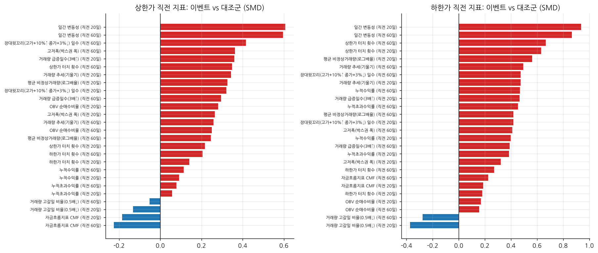
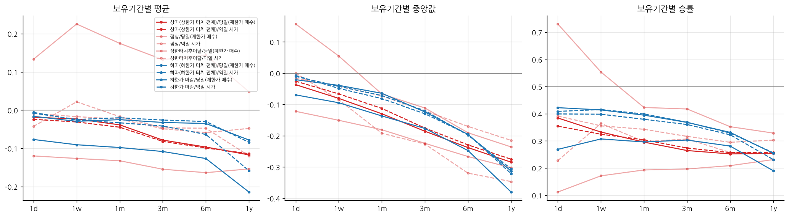
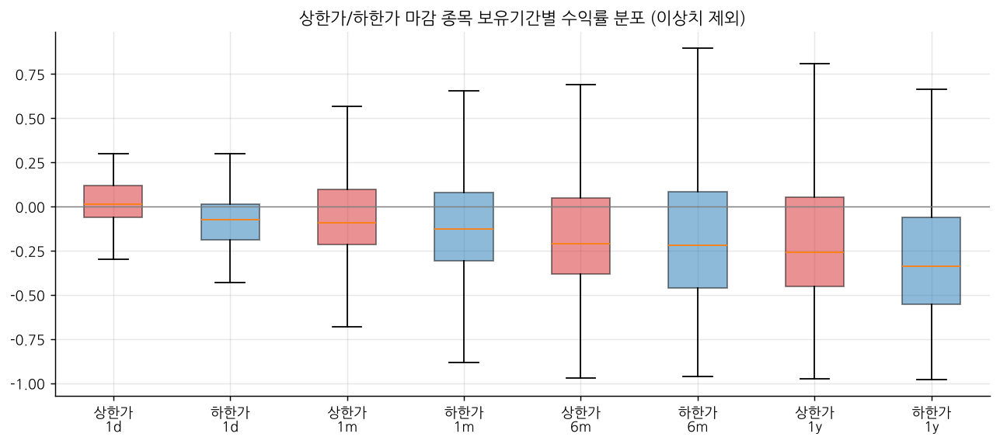
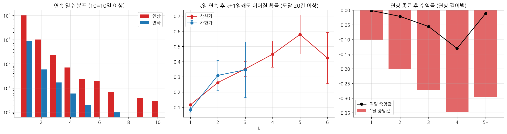
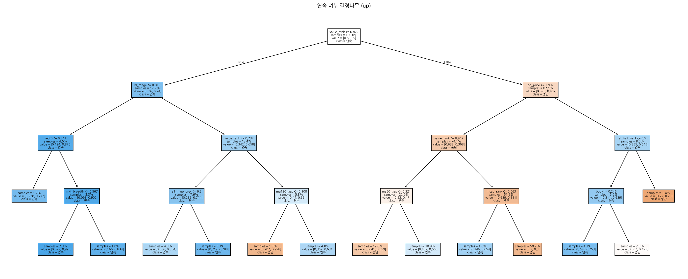
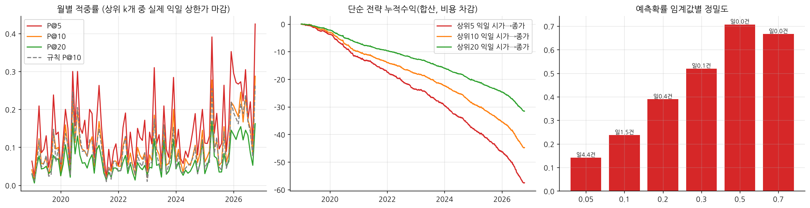
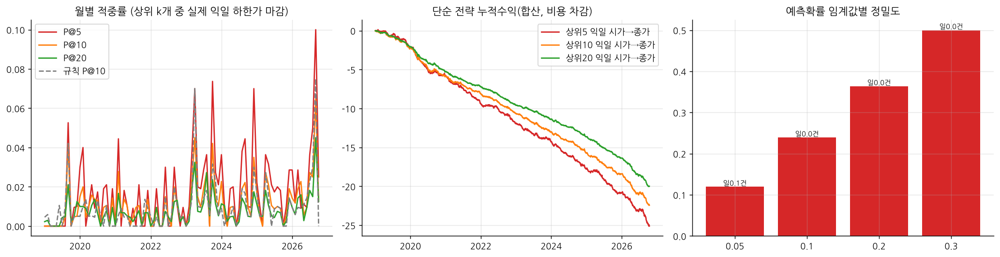
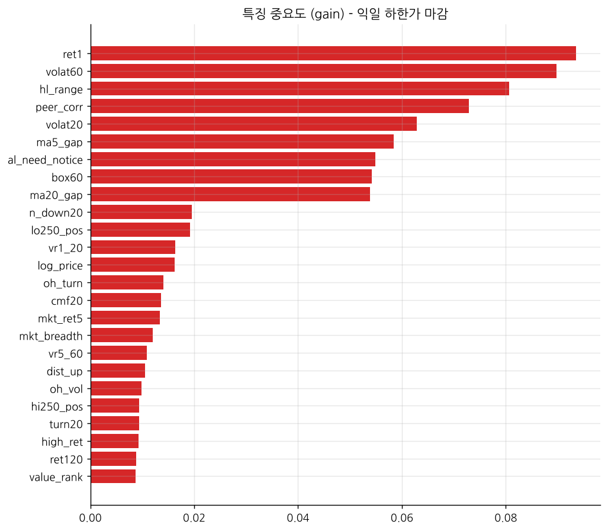

# 한국 주식 상한가·하한가 데이터마이닝 결과

생성: 2026-10-17 12:17  
데이터: KRX Open API 유가증권/코스닥 일별매매정보

## 0. 데이터와 상한가 판정 점검

| 항목 | 건수 |
|---|---|
| 상한가 | 13898 |
| 점상 | 920 |
| 상한터치후이탈 | 7635 |
| 하한가 | 1120 |
| 점하 | 137 |
| 하한터치후회복 | 686 |
| 상한가 경험 종목 수 | 2329 |
| 하한가 경험 종목 수 | 629 |
| 분석 거래일 수 | 2643 |
| 분석 종목 수 | 3265 |
| 기간 | 2016-01-04 ~ 2026-10-15 |


수익률은 역산 기준가격을 연결한 가격지수 대용치이며 기업행위 현금흐름과 체결을 검증한 총수익률이 아닙니다. 관측 누락·만기 미거래를 결측으로 두며, 관측 소실을 상장폐지로 확정하지 않습니다. 관측 가능한 미래 경로를 선별하므로 전체 사건의 투자성과로 일반화할 수 없습니다.


규정 계산(기준가·호가단위)과 등락률 기준 판정의 일치도. '누락 의심'이 크면 `KRX_LIMIT_RULE=loose` 로 비교.


| 항목 | 건수 |
|---|---|
| 상한가(규정계산) | 13,898 |
| 등락률≥29.5% & 종가=고가 | 13,817 |
| 상한가: 둘 다 해당 | 13,778 |
| 상한가: 등락률 기준만 해당(누락 의심) | 39 |
| 상한가: 규정계산만 해당(등락률<29.5%) | 120 |
| 하한가(규정계산) | 1,120 |
| 등락률≤-29.5% & 종가=저가 | 1,111 |
| 하한가: 등락률 기준만 해당(누락 의심) | 22 |
| 하한가: 규정계산만 해당(등락률>-29.5%) | 31 |
| /등락률/>30.5% (가격제한 없음, 제외) | 619 |


## 1. 상한가·하한가 건수 (목표 1)

| year | 종목일수 | 상한가 | 점상 | 상한터치후이탈 | 하한가 | 점하 | 하한터치후회복 | 상한가/만종목일 | 하한가/만종목일 |
|---|---|---|---|---|---|---|---|---|---|
| 2,016.0 | 498,798.0 | 925.0 | 52.0 | 468.0 | 70.0 | 13.0 | 31.0 | 18.5 | 1.4000 |
| 2,017.0 | 506,245.0 | 707.0 | 35.0 | 357.0 | 78.0 | 15.0 | 50.0 | 14.0 | 1.5400 |
| 2,018.0 | 521,665.0 | 1,002.0 | 55.0 | 491.0 | 59.0 | 4.0000 | 57.0 | 19.2 | 1.1300 |
| 2,019.0 | 539,477.0 | 947.0 | 68.0 | 481.0 | 98.0 | 14.0 | 54.0 | 17.6 | 1.8200 |
| 2,020.0 | 557,615.0 | 1,921.0 | 108.0 | 1,042.0 | 135.0 | 7.0000 | 126.0 | 34.5 | 2.4200 |
| 2,021.0 | 579,051.0 | 1,255.0 | 44.0 | 664.0 | 76.0 | 5.0000 | 43.0 | 21.7 | 1.3100 |
| 2,022.0 | 596,527.0 | 998.0 | 80.0 | 578.0 | 80.0 | 6.0000 | 46.0 | 16.7 | 1.3400 |
| 2,023.0 | 617,366.0 | 1,295.0 | 69.0 | 694.0 | 156.0 | 30.0 | 59.0 | 21.0 | 2.5300 |
| 2,024.0 | 632,628.0 | 1,240.0 | 85.0 | 749.0 | 101.0 | 12.0 | 51.0 | 19.6 | 1.6000 |
| 2,025.0 | 643,026.0 | 1,460.0 | 121.0 | 858.0 | 103.0 | 11.0 | 67.0 | 22.7 | 1.6000 |
| 2,026.0 | 506,032.0 | 2,148.0 | 203.0 | 1,253.0 | 164.0 | 20.0 | 102.0 | 42.5 | 3.2400 |


### 상한가 다발 종목 (상위 10)
| code | 종목명 | 시장 | 건수 | 첫발생 | 마지막발생 |
|---|---|---|---|---|---|
| 002995 | 금호건설우 | KOSPI | 45 | 2016-08-05 | 2026-08-12 |
| 152550 | 한국ANKOR유전 | KOSPI | 42 | 2022-12-14 | 2026-04-02 |
| 019175 | 신풍제약우 | KOSPI | 41 | 2017-11-09 | 2026-08-24 |
| 009415 | 태영건설우 | KOSPI | 39 | 2016-09-12 | 2026-05-21 |
| 049180 | 셀루메드 | KOSDAQ | 37 | 2016-03-04 | 2026-03-11 |
| 004835 | 덕성우 | KOSPI | 36 | 2018-05-11 | 2024-12-04 |
| 016385 | KG스틸우 | KOSPI | 34 | 2016-05-26 | 2022-06-09 |
| 121850 | 코이즈 | KOSDAQ | 34 | 2016-01-29 | 2026-08-28 |
| 224060 | 더코디 | KOSDAQ | 33 | 2016-01-04 | 2026-09-10 |
| 011080 | 형지I&C | KOSDAQ | 32 | 2016-04-11 | 2026-10-13 |


### 하한가 다발 종목 (상위 10)
| code | 종목명 | 시장 | 건수 | 첫발생 | 마지막발생 |
|---|---|---|---|---|---|
| 007390 | 네이처셀 | KOSDAQ | 10 | 2017-12-08 | 2025-08-06 |
| 006740 | 영풍제지 | KOSPI | 7 | 2023-10-18 | 2023-11-02 |
| 035290 | 골드앤에스 | KOSDAQ | 7 | 2019-09-10 | 2026-09-02 |
| 028300 | HLB | KOSDAQ | 7 | 2019-06-27 | 2026-07-13 |
| 030790 | 비케이탑스 | KOSPI | 7 | 2017-07-26 | 2024-05-09 |
| 151910 | SBW생명과학 | KOSDAQ | 6 | 2016-02-12 | 2022-08-16 |
| 152550 | 한국ANKOR유전 | KOSPI | 6 | 2023-01-04 | 2026-04-28 |
| 065620 | 제낙스 | KOSDAQ | 6 | 2018-05-09 | 2020-03-23 |
| 047770 | 코데즈컴바인 | KOSDAQ | 6 | 2016-03-17 | 2016-07-01 |
| 023460 | CNH | KOSDAQ | 6 | 2024-08-05 | 2024-10-04 |


### 하한가가 가장 많았던 날
| date | 하한가 종목수 |
|---|---|
| 2020-03-19 | 32 |
| 2017-02-02 | 13 |
| 2024-05-17 | 8 |
| 2023-04-24 | 8 |
| 2018-01-11 | 8 |
| 2026-07-21 | 7 |
| 2020-08-18 | 7 |
| 2026-07-20 | 7 |
| 2026-06-25 | 7 |
| 2017-02-03 | 7 |


## 2. 상·하한가 직전 20/60일 특이사항 (목표 2)


### 첫 상한가 vs 대조군 (|SMD| 큰 순, 상위 12)
| 지표 | 설명 | 이벤트_평균 | 대조_평균 | 이벤트_중앙값 | 대조_중앙값 | SMD | AUC | p값 |
|---|---|---|---|---|---|---|---|---|
| volat_20 | 일간 변동성 (직전 20일) | 0.0399 | 0.0278 | 0.0350 | 0.0239 | 0.6067 | 0.6800 | 0.0000 |
| volat_60 | 일간 변동성 (직전 60일) | 0.0425 | 0.0306 | 0.0375 | 0.0271 | 0.5953 | 0.6702 | 0.0000 |
| shadow_60 | 장대윗꼬리(고가+10%↑ 종가+3%↓) 일수 (직전 60일) | 0.8932 | 0.4396 | 0.0000 | 0.0000 | 0.4151 | 0.6072 | 0.0000 |
| range_60 | 고저폭(박스권 폭) (직전 60일) | 0.7096 | 0.4339 | 0.4788 | 0.3197 | 0.3623 | 0.6487 | 0.0000 |
| spikes_20 | 거래량 급증일수(3배↑) (직전 20일) | 5.2901 | 3.2815 | 3.0000 | 1.0000 | 0.3596 | 0.5989 | 0.0000 |
| uptouch_60 | 상한가 터치 횟수 (직전 60일) | 0.4686 | 0.1673 | 0.0000 | 0.0000 | 0.3479 | 0.5730 | 0.0000 |
| vol_trend_20 | 거래량 추세(기울기) (직전 20일) | 0.0222 | -0.0015 | 0.0135 | -0.0051 | 0.3440 | 0.5961 | 0.0000 |
| abvol_20 | 평균 비정상거래량(로그배율) (직전 20일) | 0.4062 | 0.0319 | 0.2730 | -0.0284 | 0.3265 | 0.5876 | 0.0000 |
| shadow_20 | 장대윗꼬리(고가+10%↑ 종가+3%↓) 일수 (직전 20일) | 0.3044 | 0.1347 | 0.0000 | 0.0000 | 0.3211 | 0.5618 | 0.0000 |
| spikes_60 | 거래량 급증일수(3배↑) (직전 60일) | 13.1 | 9.3166 | 8.0000 | 5.0000 | 0.2950 | 0.5783 | 0.0000 |
| obv_20 | OBV 순매수비율 (직전 20일) | 0.1676 | 0.0639 | 0.2001 | 0.0617 | 0.2806 | 0.5871 | 0.0000 |
| range_20 | 고저폭(박스권 폭) (직전 20일) | 0.3078 | 0.1956 | 0.2157 | 0.1435 | 0.2649 | 0.6520 | 0.0000 |


### 첫 하한가 vs 대조군 (|SMD| 큰 순, 상위 12)
| 지표 | 설명 | 이벤트_평균 | 대조_평균 | 이벤트_중앙값 | 대조_중앙값 | SMD | AUC | p값 |
|---|---|---|---|---|---|---|---|---|
| volat_20 | 일간 변동성 (직전 20일) | 0.0710 | 0.0297 | 0.0528 | 0.0241 | 0.9375 | 0.8058 | 0.0000 |
| volat_60 | 일간 변동성 (직전 60일) | 0.0651 | 0.0320 | 0.0564 | 0.0278 | 0.8671 | 0.8119 | 0.0000 |
| uptouch_60 | 상한가 터치 횟수 (직전 60일) | 1.3227 | 0.2548 | 0.0000 | 0.0000 | 0.6658 | 0.6582 | 0.0000 |
| uptouch_20 | 상한가 터치 횟수 (직전 20일) | 0.8280 | 0.0842 | 0.0000 | 0.0000 | 0.6317 | 0.6265 | 0.0000 |
| abvol_20 | 평균 비정상거래량(로그배율) (직전 20일) | 0.7666 | 0.0363 | 0.5447 | -0.0681 | 0.5633 | 0.6570 | 0.0000 |
| vol_trend_60 | 거래량 추세(기울기) (직전 60일) | 0.0124 | -0.0012 | 0.0055 | -0.0026 | 0.4944 | 0.6316 | 0.0000 |
| shadow_60 | 장대윗꼬리(고가+10%↑ 종가+3%↓) 일수 (직전 60일) | 1.0955 | 0.5032 | 1.0000 | 0.0000 | 0.4737 | 0.6150 | 0.0000 |
| vol_trend_20 | 거래량 추세(기울기) (직전 20일) | 0.0381 | -0.0004 | 0.0158 | -0.0059 | 0.4735 | 0.6256 | 0.0000 |
| ret_60 | 누적수익률 (직전 60일) | 0.4511 | -0.0138 | -0.0068 | -0.0347 | 0.4681 | 0.5453 | 0.0000 |
| spikes_20 | 거래량 급증일수(3배↑) (직전 20일) | 6.2431 | 3.4501 | 3.0000 | 1.0000 | 0.4654 | 0.6193 | 0.0000 |
| car_60 | 누적초과수익률 (직전 60일) | 0.2299 | -0.0079 | 0.0523 | -0.0277 | 0.4531 | 0.5855 | 0.0000 |
| abvol_60 | 평균 비정상거래량(로그배율) (직전 60일) | 0.4627 | 0.0517 | 0.3460 | -0.0115 | 0.4190 | 0.6258 | 0.0000 |





### 매집 의심 점수
| 조건 | 이벤트 | 대조군 | lift |
|---|---|---|---|
| F1_거래량증가+횡보 | 0.0777 | 0.0983 | 0.7900 |
| F2_박스권(폭≤30%) | 0.2688 | 0.4655 | 0.5775 |
| F3_OBV매수우위+가격정체 | 0.2668 | 0.2628 | 1.0153 |
| F4_윗꼬리시세테스트 | 0.4850 | 0.2908 | 1.6680 |
| F5_소형주(시총하위20%) | 0.2668 | 0.2668 | 1.0000 |

| 매집점수 | 이벤트 | 대조군 | lift(이벤트/대조) |
|---|---|---|---|
| 0.0000 | 0.1895 | 0.2061 | 0.9196 |
| 1.0000 | 0.4074 | 0.3802 | 1.0714 |
| 2.0000 | 0.2751 | 0.2700 | 1.0188 |
| 3.0000 | 0.1060 | 0.1137 | 0.9320 |
| 4.0000 | 0.0205 | 0.0269 | 0.7628 |
| 5.0000 | 0.0015 | 0.0030 | 0.4941 |

| 점수 | n | 수익률1m_중앙값 | 수익률3m_중앙값 | 수익률6m_중앙값 | 급락비율_3m |
|---|---|---|---|---|---|
| 0.0000 | 1,781.0 | -0.0540 | -0.1084 | -0.1636 | 0.1999 |
| 1.0000 | 3,828.0 | -0.0756 | -0.1430 | -0.1906 | 0.2200 |
| 2.0000 | 2,585.0 | -0.0887 | -0.1470 | -0.1841 | 0.2008 |
| 3.0000 | 996.0 | -0.0907 | -0.1387 | -0.1845 | 0.1752 |
| 4.0000 | 207.0 | -0.1198 | -0.1662 | -0.1889 | 0.1692 |


### 직전 패턴 군집 (K-means)
| 군집 | n | 특징(정규점수 중심 상위3) | car_60 | abvol_60 | volat_60 | range_60 | vol_trend_60 | spikes_60 | lowvol_60 | shadow_60 | cmf_60 | obv_60 | uptouch_60 | car_20 | abvol_20 | post_1m | post_3m | post_6m | 급락비율_3m(≤-30%) |
|---|---|---|---|---|---|---|---|---|---|---|---|---|---|---|---|---|---|---|---|
| 0 | 2,469 | abvol_20↓, abvol_60↓, lowvol_60↑ | -0.1587 | -0.6318 | 0.0287 | 0.4042 | -0.0089 | 1.0000 | 0.5167 | 0.0000 | -0.1675 | 0.0160 | 0.0000 | -0.0422 | -0.7885 | -0.0882 | -0.1290 | -0.1646 | 0.1316 |
| 1 | 3,077 | range_60↓, volat_60↓, car_20↑ | 0.0489 | 0.1672 | 0.0298 | 0.3134 | 0.0097 | 8.0000 | 0.1333 | 0.0000 | -0.0565 | 0.3115 | 0.0000 | 0.0627 | 0.3798 | -0.0790 | -0.1284 | -0.1803 | 0.1748 |
| 2 | 1,968 | car_60↑, spikes_60↑, abvol_20↑ | 0.3523 | 1.3474 | 0.0582 | 0.8503 | 0.0249 | 31.0 | 0.0167 | 1.0000 | -0.0384 | 0.4056 | 1.0000 | 0.0780 | 1.8224 | -0.0826 | -0.1622 | -0.2294 | 0.2754 |
| 3 | 1,439 | car_60↓, car_20↓, range_60↑ | -0.3193 | 0.4854 | 0.0512 | 0.9350 | -0.0021 | 13.0 | 0.0667 | 1.0000 | -0.2207 | -0.0101 | 0.0000 | -0.1583 | 0.4187 | -0.0547 | -0.1267 | -0.1573 | 0.1862 |


## 3. 상따·하따 이후 수익률 (목표 3)


평가일은 사건일 D에서 세는 D+h입니다. 익일 시가 진입의 1일 결과는 D+1 시가→D+1 종가입니다. 같은 시가 기준 시장 벤치마크가 없어 그 진입 방식의 시장초과수익은 산출하지 않습니다.


### 표본 유지와 관측 누락
| 방향 | 이벤트 | 진입 | 보유기간 | 사건수 | 관측기간충족수 | n | 수익률미산출수 | 관측소실건수 |
|---|---|---|---|---|---|---|---|---|
| up | 상한가 마감 | 당일(제한가 매수) | 1d | 13,898 | 13,891 | 13,651 | 247 | 2 |
| up | 상한가 마감 | 당일(제한가 매수) | 1w | 13,898 | 13,852 | 13,583 | 315 | 3 |
| up | 상한가 마감 | 당일(제한가 매수) | 1m | 13,898 | 13,758 | 13,430 | 468 | 20 |
| up | 상한가 마감 | 당일(제한가 매수) | 3m | 13,898 | 13,348 | 12,807 | 1,091 | 106 |
| up | 상한가 마감 | 당일(제한가 매수) | 6m | 13,898 | 12,631 | 11,919 | 1,979 | 209 |
| up | 상한가 마감 | 당일(제한가 매수) | 1y | 13,898 | 11,368 | 10,422 | 3,476 | 289 |
| down | 하한가 마감 | 당일(제한가 매수) | 1d | 1,120 | 1,119 | 1,079 | 41 | 4 |
| down | 하한가 마감 | 당일(제한가 매수) | 1w | 1,120 | 1,116 | 1,013 | 107 | 31 |
| down | 하한가 마감 | 당일(제한가 매수) | 1m | 1,120 | 1,097 | 942 | 178 | 40 |
| down | 하한가 마감 | 당일(제한가 매수) | 3m | 1,120 | 1,042 | 869 | 251 | 39 |
| down | 하한가 마감 | 당일(제한가 매수) | 6m | 1,120 | 989 | 783 | 337 | 42 |
| down | 하한가 마감 | 당일(제한가 매수) | 1y | 1,120 | 936 | 664 | 456 | 56 |


### 평균
| 방향 | 이벤트 | 진입 | 1d | 1w | 1m | 3m | 6m | 1y |
|---|---|---|---|---|---|---|---|---|
| up | 상따(상한가 터치 전체) | 당일(제한가 매수) | -0.0186 | -0.0307 | -0.0377 | -0.0727 | -0.0818 | -0.0868 |
| up | 상따(상한가 터치 전체) | 익일 시가 | -0.0240 | -0.0365 | -0.0437 | -0.0760 | -0.0853 | -0.0841 |
| up | 상한가 마감 | 당일(제한가 매수) | 0.0375 | 0.0205 | 0.0106 | -0.0348 | -0.0456 | -0.0684 |
| up | 상한가 마감 | 익일 시가 | -0.0325 | -0.0484 | -0.0579 | -0.0974 | -0.1071 | -0.1232 |
| up | 점상 | 당일(제한가 매수) | 0.1375 | 0.1732 | 0.1687 | 0.1284 | 0.1782 | 0.0854 |
| up | 점상 | 익일 시가 | -0.0424 | -0.0160 | -0.0214 | -0.0495 | -0.0202 | -0.0879 |
| up | 상한가(점상 제외) | 당일(제한가 매수) | 0.0305 | 0.0101 | -0.0005 | -0.0459 | -0.0603 | -0.0781 |
| up | 상한가(점상 제외) | 익일 시가 | -0.0318 | -0.0505 | -0.0604 | -0.1006 | -0.1128 | -0.1254 |
| up | 상한터치후이탈 | 당일(제한가 매수) | -0.1194 | -0.1240 | -0.1266 | -0.1428 | -0.1488 | -0.1207 |
| up | 상한터치후이탈 | 익일 시가 | -0.0088 | -0.0150 | -0.0179 | -0.0369 | -0.0452 | -0.0129 |
| up | 첫 상한가 | 당일(제한가 매수) | 0.0336 | 0.0162 | 0.0058 | -0.0305 | -0.0432 | -0.0558 |
| up | 첫 상한가 | 익일 시가 | -0.0302 | -0.0463 | -0.0570 | -0.0900 | -0.1015 | -0.1096 |
| up | 2연상 이상 | 당일(제한가 매수) | 0.0627 | 0.0477 | 0.0392 | -0.0614 | -0.0609 | -0.1547 |
| up | 2연상 이상 | 익일 시가 | -0.0470 | -0.0625 | -0.0641 | -0.1467 | -0.1463 | -0.2245 |
| down | 하따(하한가 터치 전체) | 당일(제한가 매수) | -0.0190 | -0.0051 | 0.0199 | 0.0181 | 0.0444 | 0.0655 |
| down | 하따(하한가 터치 전체) | 익일 시가 | -0.0079 | 0.0025 | 0.0270 | 0.0267 | 0.0518 | 0.0569 |
| down | 하한가 마감 | 당일(제한가 매수) | -0.0796 | -0.0745 | -0.0740 | -0.0799 | -0.0746 | -0.1172 |
| down | 하한가 마감 | 익일 시가 | -0.0059 | -0.0074 | -0.0062 | -0.0117 | -0.0074 | -0.0551 |
| down | 점하 | 당일(제한가 매수) | -0.1935 | -0.2365 | -0.2431 | -0.2081 | -0.3001 | -0.3379 |
| down | 점하 | 익일 시가 | 0.0184 | -0.0480 | -0.0656 | -0.0248 | -0.1310 | -0.1916 |
| down | 하한가(점하 제외) | 당일(제한가 매수) | -0.0633 | -0.0500 | -0.0474 | -0.0600 | -0.0401 | -0.0813 |
| down | 하한가(점하 제외) | 익일 시가 | -0.0094 | -0.0012 | 0.0033 | -0.0097 | 0.0119 | -0.0322 |
| down | 하한터치후회복 | 당일(제한가 매수) | 0.0803 | 0.1162 | 0.1861 | 0.1927 | 0.2576 | 0.3988 |
| down | 하한터치후회복 | 익일 시가 | -0.0111 | 0.0198 | 0.0852 | 0.0944 | 0.1558 | 0.2559 |
| down | 첫 하한가 | 당일(제한가 매수) | -0.0714 | -0.0604 | -0.0525 | -0.0554 | -0.0488 | -0.0811 |
| down | 첫 하한가 | 익일 시가 | -0.0076 | -0.0004 | 0.0101 | 0.0083 | 0.0160 | -0.0198 |
| down | 2연하 이상 | 당일(제한가 매수) | -0.1448 | -0.1953 | -0.2512 | -0.2873 | -0.2864 | -0.4343 |
| down | 2연하 이상 | 익일 시가 | 0.0076 | -0.0668 | -0.1387 | -0.1787 | -0.1954 | -0.3552 |


### 중앙값
| 방향 | 이벤트 | 진입 | 1d | 1w | 1m | 3m | 6m | 1y |
|---|---|---|---|---|---|---|---|---|
| up | 상따(상한가 터치 전체) | 당일(제한가 매수) | -0.0385 | -0.0816 | -0.1281 | -0.1809 | -0.2294 | -0.2694 |
| up | 상따(상한가 터치 전체) | 익일 시가 | -0.0257 | -0.0671 | -0.1110 | -0.1708 | -0.2200 | -0.2592 |
| up | 상한가 마감 | 당일(제한가 매수) | 0.0107 | -0.0377 | -0.0941 | -0.1606 | -0.2121 | -0.2599 |
| up | 상한가 마감 | 익일 시가 | -0.0346 | -0.0870 | -0.1413 | -0.2029 | -0.2552 | -0.2954 |
| up | 점상 | 당일(제한가 매수) | 0.1793 | 0.0343 | -0.0661 | -0.1111 | -0.1830 | -0.2245 |
| up | 점상 | 익일 시가 | 0.0000 | -0.0988 | -0.1913 | -0.2258 | -0.3116 | -0.3277 |
| up | 상한가(점상 제외) | 당일(제한가 매수) | 0.0060 | -0.0403 | -0.0957 | -0.1640 | -0.2133 | -0.2625 |
| up | 상한가(점상 제외) | 익일 시가 | -0.0364 | -0.0865 | -0.1397 | -0.2014 | -0.2530 | -0.2926 |
| up | 상한터치후이탈 | 당일(제한가 매수) | -0.1215 | -0.1498 | -0.1780 | -0.2177 | -0.2556 | -0.2833 |
| up | 상한터치후이탈 | 익일 시가 | -0.0168 | -0.0411 | -0.0701 | -0.1137 | -0.1608 | -0.1951 |
| up | 첫 상한가 | 당일(제한가 매수) | 0.0092 | -0.0336 | -0.0892 | -0.1515 | -0.2000 | -0.2466 |
| up | 첫 상한가 | 익일 시가 | -0.0347 | -0.0816 | -0.1354 | -0.1924 | -0.2421 | -0.2813 |
| up | 2연상 이상 | 당일(제한가 매수) | 0.0255 | -0.0849 | -0.1597 | -0.2454 | -0.3239 | -0.3721 |
| up | 2연상 이상 | 익일 시가 | -0.0341 | -0.1541 | -0.2208 | -0.3051 | -0.3688 | -0.4132 |
| down | 하따(하한가 터치 전체) | 당일(제한가 매수) | -0.0259 | -0.0342 | -0.0492 | -0.0946 | -0.1602 | -0.2754 |
| down | 하따(하한가 터치 전체) | 익일 시가 | -0.0104 | -0.0279 | -0.0462 | -0.0911 | -0.1562 | -0.2487 |
| down | 하한가 마감 | 당일(제한가 매수) | -0.0747 | -0.0938 | -0.1300 | -0.1631 | -0.2188 | -0.3370 |
| down | 하한가 마감 | 익일 시가 | -0.0076 | -0.0430 | -0.0669 | -0.1108 | -0.1637 | -0.2799 |
| down | 점하 | 당일(제한가 매수) | -0.2275 | -0.2331 | -0.2718 | -0.3160 | -0.4116 | -0.4201 |
| down | 점하 | 익일 시가 | 0.0000 | -0.0470 | -0.0924 | -0.1616 | -0.2681 | -0.2774 |
| down | 하한가(점하 제외) | 당일(제한가 매수) | -0.0612 | -0.0765 | -0.1087 | -0.1536 | -0.2075 | -0.3215 |
| down | 하한가(점하 제외) | 익일 시가 | -0.0116 | -0.0429 | -0.0667 | -0.1058 | -0.1537 | -0.2807 |
| down | 하한터치후회복 | 당일(제한가 매수) | 0.0520 | 0.0724 | 0.0878 | 0.0325 | -0.0514 | -0.1292 |
| down | 하한터치후회복 | 익일 시가 | -0.0139 | -0.0055 | -0.0000 | -0.0566 | -0.1220 | -0.1885 |
| down | 첫 하한가 | 당일(제한가 매수) | -0.0703 | -0.0820 | -0.1076 | -0.1483 | -0.2042 | -0.3109 |
| down | 첫 하한가 | 익일 시가 | -0.0113 | -0.0366 | -0.0550 | -0.0948 | -0.1364 | -0.2652 |
| down | 2연하 이상 | 당일(제한가 매수) | -0.1681 | -0.1941 | -0.2775 | -0.3718 | -0.4650 | -0.5540 |
| down | 2연하 이상 | 익일 시가 | 0.0000 | -0.0840 | -0.2006 | -0.2653 | -0.3821 | -0.4888 |


### 승률
| 방향 | 이벤트 | 진입 | 1d | 1w | 1m | 3m | 6m | 1y |
|---|---|---|---|---|---|---|---|---|
| up | 상따(상한가 터치 전체) | 당일(제한가 매수) | 0.3899 | 0.3290 | 0.2975 | 0.2685 | 0.2589 | 0.2669 |
| up | 상따(상한가 터치 전체) | 익일 시가 | 0.3545 | 0.3203 | 0.3060 | 0.2779 | 0.2638 | 0.2704 |
| up | 상한가 마감 | 당일(제한가 매수) | 0.5438 | 0.4152 | 0.3528 | 0.3048 | 0.2822 | 0.2781 |
| up | 상한가 마감 | 익일 시가 | 0.3340 | 0.3002 | 0.2838 | 0.2531 | 0.2420 | 0.2429 |
| up | 점상 | 당일(제한가 매수) | 0.7534 | 0.5335 | 0.4243 | 0.4203 | 0.3583 | 0.3306 |
| up | 점상 | 익일 시가 | 0.2276 | 0.3357 | 0.2981 | 0.3072 | 0.2606 | 0.2567 |
| up | 상한가(점상 제외) | 당일(제한가 매수) | 0.5291 | 0.4071 | 0.3478 | 0.2969 | 0.2772 | 0.2748 |
| up | 상한가(점상 제외) | 익일 시가 | 0.3414 | 0.2978 | 0.2828 | 0.2495 | 0.2408 | 0.2421 |
| up | 상한터치후이탈 | 당일(제한가 매수) | 0.1127 | 0.1718 | 0.1956 | 0.2014 | 0.2156 | 0.2463 |
| up | 상한터치후이탈 | 익일 시가 | 0.3916 | 0.3565 | 0.3464 | 0.3233 | 0.3038 | 0.3206 |
| up | 첫 상한가 | 당일(제한가 매수) | 0.5378 | 0.4206 | 0.3528 | 0.3075 | 0.2860 | 0.2872 |
| up | 첫 상한가 | 익일 시가 | 0.3363 | 0.3037 | 0.2830 | 0.2560 | 0.2459 | 0.2500 |
| up | 2연상 이상 | 당일(제한가 매수) | 0.5825 | 0.3812 | 0.3530 | 0.2878 | 0.2588 | 0.2159 |
| up | 2연상 이상 | 익일 시가 | 0.3189 | 0.2763 | 0.2890 | 0.2335 | 0.2151 | 0.1903 |
| down | 하따(하한가 터치 전체) | 당일(제한가 매수) | 0.4254 | 0.4388 | 0.4288 | 0.3957 | 0.3672 | 0.2918 |
| down | 하따(하한가 터치 전체) | 익일 시가 | 0.4088 | 0.4406 | 0.4327 | 0.3993 | 0.3676 | 0.2977 |
| down | 하한가 마감 | 당일(제한가 매수) | 0.2790 | 0.3297 | 0.3174 | 0.3245 | 0.3116 | 0.2184 |
| down | 하한가 마감 | 익일 시가 | 0.3994 | 0.4154 | 0.3953 | 0.3753 | 0.3477 | 0.2581 |
| down | 점하 | 당일(제한가 매수) | 0.1111 | 0.1654 | 0.1797 | 0.2650 | 0.2212 | 0.1290 |
| down | 점하 | 익일 시가 | 0.3333 | 0.4286 | 0.3828 | 0.3675 | 0.3462 | 0.2043 |
| down | 하한가(점하 제외) | 당일(제한가 매수) | 0.3030 | 0.3545 | 0.3391 | 0.3338 | 0.3255 | 0.2329 |
| down | 하한가(점하 제외) | 익일 시가 | 0.4089 | 0.4134 | 0.3973 | 0.3765 | 0.3479 | 0.2671 |
| down | 하한터치후회복 | 당일(제한가 매수) | 0.6657 | 0.6293 | 0.6259 | 0.5225 | 0.4668 | 0.4258 |
| down | 하한터치후회복 | 익일 시가 | 0.4240 | 0.4845 | 0.4981 | 0.4415 | 0.4027 | 0.3681 |
| down | 첫 하한가 | 당일(제한가 매수) | 0.2868 | 0.3462 | 0.3381 | 0.3411 | 0.3209 | 0.2299 |
| down | 첫 하한가 | 익일 시가 | 0.4088 | 0.4243 | 0.4125 | 0.3930 | 0.3602 | 0.2729 |
| down | 2연하 이상 | 당일(제한가 매수) | 0.2167 | 0.1887 | 0.1471 | 0.1848 | 0.2353 | 0.1176 |
| down | 2연하 이상 | 익일 시가 | 0.3250 | 0.3396 | 0.2549 | 0.2283 | 0.2471 | 0.1324 |


### 시장초과평균
| 방향 | 이벤트 | 진입 | 1d | 1w | 1m | 3m | 6m | 1y |
|---|---|---|---|---|---|---|---|---|
| up | 상따(상한가 터치 전체) | 당일(제한가 매수) | -0.0193 | -0.0345 | -0.0520 | -0.1028 | -0.1384 | -0.2232 |
| up | 상한가 마감 | 당일(제한가 매수) | 0.0367 | 0.0164 | -0.0037 | -0.0643 | -0.1013 | -0.2053 |
| up | 점상 | 당일(제한가 매수) | 0.1382 | 0.1698 | 0.1553 | 0.0987 | 0.1334 | -0.0716 |
| up | 상한가(점상 제외) | 당일(제한가 매수) | 0.0296 | 0.0060 | -0.0148 | -0.0754 | -0.1167 | -0.2137 |
| up | 상한터치후이탈 | 당일(제한가 매수) | -0.1200 | -0.1273 | -0.1411 | -0.1740 | -0.2073 | -0.2563 |
| up | 첫 상한가 | 당일(제한가 매수) | 0.0329 | 0.0122 | -0.0081 | -0.0600 | -0.0995 | -0.1884 |
| up | 2연상 이상 | 당일(제한가 매수) | 0.0615 | 0.0425 | 0.0236 | -0.0906 | -0.1130 | -0.3205 |
| down | 하따(하한가 터치 전체) | 당일(제한가 매수) | -0.0227 | -0.0183 | -0.0228 | -0.0495 | -0.0594 | -0.1322 |
| down | 하한가 마감 | 당일(제한가 매수) | -0.0819 | -0.0838 | -0.1052 | -0.1250 | -0.1481 | -0.2687 |
| down | 점하 | 당일(제한가 매수) | -0.1927 | -0.2391 | -0.2692 | -0.2315 | -0.3232 | -0.4110 |
| down | 하한가(점하 제외) | 당일(제한가 매수) | -0.0660 | -0.0604 | -0.0794 | -0.1084 | -0.1213 | -0.2455 |
| down | 하한터치후회복 | 당일(제한가 매수) | 0.0744 | 0.0963 | 0.1230 | 0.0847 | 0.0996 | 0.1169 |
| down | 첫 하한가 | 당일(제한가 매수) | -0.0739 | -0.0699 | -0.0847 | -0.1038 | -0.1304 | -0.2442 |
| down | 2연하 이상 | 당일(제한가 매수) | -0.1456 | -0.2030 | -0.2737 | -0.3040 | -0.2936 | -0.4835 |








### 연도별 1달 수익률 (상한가/하한가 마감, 당일 진입)
| 이벤트 | 분해기준 | 보유기간 | 그룹값 | n | 평균 | 중앙값 | 승률 |
|---|---|---|---|---|---|---|---|
| 상한가 마감 | 연도 | 1m | 2016 | 915 | -0.0234 | -0.0989 | 0.3180 |
| 상한가 마감 | 연도 | 1m | 2017 | 670 | 0.0102 | -0.1073 | 0.3299 |
| 상한가 마감 | 연도 | 1m | 2018 | 987 | -0.0053 | -0.0958 | 0.3576 |
| 상한가 마감 | 연도 | 1m | 2019 | 936 | -0.0051 | -0.0974 | 0.3344 |
| 상한가 마감 | 연도 | 1m | 2020 | 1,877 | 0.0753 | -0.0346 | 0.4507 |
| 상한가 마감 | 연도 | 1m | 2021 | 1,247 | 0.0336 | -0.0623 | 0.3841 |
| 상한가 마감 | 연도 | 1m | 2022 | 979 | -0.0079 | -0.1041 | 0.3401 |
| 상한가 마감 | 연도 | 1m | 2023 | 1,272 | 0.0045 | -0.1005 | 0.3310 |
| 상한가 마감 | 연도 | 1m | 2024 | 1,226 | -0.0197 | -0.1167 | 0.3067 |
| 상한가 마감 | 연도 | 1m | 2025 | 1,433 | 0.0473 | -0.0989 | 0.3552 |
| 상한가 마감 | 연도 | 1m | 2026 | 1,888 | -0.0311 | -0.1399 | 0.3157 |
| 하한가 마감 | 연도 | 1m | 2016 | 63 | -0.1317 | -0.1661 | 0.2540 |
| 하한가 마감 | 연도 | 1m | 2017 | 71 | -0.0100 | -0.0577 | 0.3662 |
| 하한가 마감 | 연도 | 1m | 2018 | 51 | 0.0572 | -0.0191 | 0.4706 |
| 하한가 마감 | 연도 | 1m | 2019 | 88 | -0.1007 | -0.1423 | 0.2841 |
| 하한가 마감 | 연도 | 1m | 2020 | 102 | 0.1881 | 0.0500 | 0.5392 |
| 하한가 마감 | 연도 | 1m | 2021 | 60 | -0.1050 | -0.1397 | 0.2333 |
| 하한가 마감 | 연도 | 1m | 2022 | 72 | -0.1520 | -0.1745 | 0.2500 |
| 하한가 마감 | 연도 | 1m | 2023 | 144 | -0.1846 | -0.2453 | 0.2083 |
| 하한가 마감 | 연도 | 1m | 2024 | 88 | -0.1299 | -0.1554 | 0.2614 |
| 하한가 마감 | 연도 | 1m | 2025 | 89 | -0.0627 | -0.1324 | 0.3596 |
| 하한가 마감 | 연도 | 1m | 2026 | 114 | -0.1149 | -0.1819 | 0.3158 |


## 4. 연속 상·하한가 (목표 4)

| k일 연속 | 도달 건수 | k+1일 이어짐 | 연속확률 | 95%CI |
|---|---|---|---|---|
| 1.0000 | 11,894.0 | 1,378.0 | 0.1159 | 0.0058 |
| 2.0000 | 1,378.0 | 361.0 | 0.2620 | 0.0232 |
| 3.0000 | 361.0 | 127.0 | 0.3518 | 0.0493 |
| 4.0000 | 127.0 | 57.0 | 0.4488 | 0.0865 |
| 5.0000 | 57.0 | 33.0 | 0.5789 | 0.1282 |
| 6.0000 | 33.0 | 14.0 | 0.4242 | 0.1686 |
| 7.0000 | 14.0 | 7.0000 | 0.5000 | 0.2619 |
| 8.0000 | 7.0000 | 7.0000 | 1.0000 | 0.0000 |

| k일 연속 | 도달 건수 | k+1일 이어짐 | 연속확률 | 95%CI |
|---|---|---|---|---|
| 1.0000 | 995.0 | 84.0 | 0.0844 | 0.0173 |
| 2.0000 | 84.0 | 26.0 | 0.3095 | 0.0989 |
| 3.0000 | 26.0 | 9.0000 | 0.3462 | 0.1829 |
| 4.0000 | 9.0000 | 3.0000 | 0.3333 | 0.3080 |
| 5.0000 | 3.0000 | 1.0000 | 0.3333 | 0.5334 |
| 6.0000 | 1.0000 | 1.0000 | 1.0000 | 0.0000 |
| 7.0000 | 1.0000 | 0.0000 | 0.0000 | 0.0000 |




### 상태 전이 확률
| 오늘\내일 | 표본수 | 상한가 | 상한터치이탈 | +10%이상 | 0~+10% | 하락(하한가 제외) | 하한가 |
|---|---|---|---|---|---|---|---|
| 상한가 | 13,889 | 0.1381 | 0.0610 | 0.1011 | 0.2829 | 0.4132 | 0.0037 |
| 상한터치이탈 | 7,615 | 0.0250 | 0.0121 | 0.0684 | 0.3003 | 0.5907 | 0.0035 |
| +10%이상 | 60,343 | 0.0136 | 0.0062 | 0.0516 | 0.3800 | 0.5478 | 0.0008 |
| 0~+10% | 3,056,950 | 0.0018 | 0.0011 | 0.0092 | 0.4959 | 0.4919 | 0.0001 |
| 하락(하한가 제외) | 3,056,169 | 0.0016 | 0.0009 | 0.0088 | 0.4953 | 0.4932 | 0.0002 |
| 하한가 | 1,109 | 0.0280 | 0.0144 | 0.0721 | 0.2038 | 0.5798 | 0.1019 |


### 연상 예측 모델 성능 (시간 분할 검증)
| 학습기간 | 검증 n | 모델 | AUC | AP | 기저율(검증) | 상위10% 적중률 | Lift@10% |
|---|---|---|---|---|---|---|---|
| ~2023-11-15 | 5,066 | 기준(연속일수+점상) | 0.6173 | 0.2532 | 0.1595 | 0.3590 | 2.2507 |
| ~2023-11-15 | 5,066 | 로지스틱 회귀 | 0.7201 | 0.3613 | 0.1595 | 0.4300 | 2.6959 |
| ~2023-11-15 | 5,066 | 의사결정나무(깊이4) | 0.6773 | 0.2762 | 0.1595 | 0.3112 | 1.9514 |
| ~2023-11-15 | 5,066 | 그래디언트부스팅(lgbm) | 0.7295 | 0.3363 | 0.1595 | 0.4024 | 2.5228 |


### 연하 예측 모델 성능
| 학습기간 | 검증 n | 모델 | AUC | AP | 기저율(검증) | 상위10% 적중률 | Lift@10% |
|---|---|---|---|---|---|---|---|
| ~2023-11-15 | 373 | 기준(연속일수+점상) | 0.5809 | 0.1996 | 0.1260 | 0.3421 | 2.7150 |
| ~2023-11-15 | 373 | 로지스틱 회귀 | 0.5201 | 0.2480 | 0.1260 | 0.2895 | 2.2973 |
| ~2023-11-15 | 373 | 의사결정나무(깊이4) | 0.6266 | 0.2662 | 0.1260 | 0.2340 | 1.8574 |
| ~2023-11-15 | 373 | 그래디언트부스팅(lgbm) | 0.6711 | 0.3349 | 0.1260 | 0.3421 | 2.7150 |


### 연상 성공 vs 실패 (첫 상한가 당일 특징, |SMD| 상위 12)
| 지표 | 설명 | 연속_평균 | 중단_평균 | 연속_중앙값 | 중단_중앙값 | SMD | AUC | p값 |
|---|---|---|---|---|---|---|---|---|
| value_rank | value_rank | 0.7940 | 0.9009 | 0.8567 | 0.9499 | -0.6452 | 0.3185 | 0.0000 |
| log_value | log_value | 22.8 | 23.9 | 22.8 | 24.0 | -0.6131 | 0.3316 | 0.0000 |
| value_rank_in_up | value_rank_in_up | 0.4515 | 0.6237 | 0.3913 | 0.6429 | -0.6095 | 0.3292 | 0.0000 |
| mcap_rank_in_up | mcap_rank_in_up | 0.4926 | 0.6138 | 0.4444 | 0.6250 | -0.4188 | 0.3805 | 0.0000 |
| log_mcap | log_mcap | 24.8 | 25.3 | 24.8 | 25.3 | -0.4160 | 0.3797 | 0.0000 |
| turn_rank_in_up | turn_rank_in_up | 0.4971 | 0.6159 | 0.4545 | 0.6250 | -0.4139 | 0.3811 | 0.0000 |
| up_jeom | up_jeom | 0.1399 | 0.0290 | 0.0000 | 0.0000 | 0.4073 | 0.5555 | 0.0000 |
| mcap_rank | mcap_rank | 0.3262 | 0.4338 | 0.2583 | 0.4263 | -0.4011 | 0.3808 | 0.0000 |
| child_max_ret1 | child_max_ret1 | 0.2895 | 0.2726 | 0.2994 | 0.2990 | 0.3749 | 0.6345 | 0.0288 |
| gap | gap | 0.0900 | 0.0558 | 0.0310 | 0.0206 | 0.3419 | 0.5675 | 0.0000 |
| body | body | 0.2090 | 0.2431 | 0.2680 | 0.2782 | -0.3412 | 0.4331 | 0.0000 |
| hl_range | hl_range | 0.2305 | 0.2635 | 0.2815 | 0.2902 | -0.3346 | 0.4397 | 0.0000 |


### 연속 상한가: 최고점 대비 가격 변화 (연속 일수별 중앙값)
| 연속일수 | n | 연속중변화(중앙) | 극점까지변화(중앙) | 극점도달일(중앙) | 극점후1주(중앙) | 극점후1달(중앙) | 극점후3달(중앙) | 극점후6달(중앙) | 극점후1년(중앙) | 1년내최대낙폭(중앙) | 1년내최고점회복(비율) | 상승분반납률1년(중앙) | 1년후연상전보다낮음(비율) | 극점후6달 정규장미거래(비율) | 극점후1년 정규장미거래(비율) | 목표일전관측소실(비율) | 1년기간도달수 | 1년수익률관측수 |
|---|---|---|---|---|---|---|---|---|---|---|---|---|---|---|---|---|---|---|
| 1 | 10,219.0 | 0.2992 | 0.4209 | 3.0000 | -0.1427 | -0.2092 | -0.2624 | -0.3045 | -0.3453 | -0.4896 | 0.5485 | 1.0667 | 0.5295 | 0.0291 | 0.0424 | 0.0169 | 8,615.0 | 8,109.0 |
| 2 | 972.0 | 0.6877 | 0.8041 | 2.0000 | -0.2085 | -0.2985 | -0.3668 | -0.4230 | -0.4599 | -0.5690 | 0.4377 | 0.9239 | 0.4262 | 0.0534 | 0.0849 | 0.0258 | 774.0 | 690.0 |
| 3 | 221.0 | 1.1927 | 1.3132 | 1.0000 | -0.2635 | -0.3697 | -0.4168 | -0.5282 | -0.5515 | -0.6549 | 0.2829 | 0.9181 | 0.3919 | 0.0573 | 0.0952 | 0.0400 | 175.0 | 152.0 |
| 4 | 69.0 | 1.8494 | 1.8671 | 1.0000 | -0.3101 | -0.4058 | -0.4831 | -0.5453 | -0.6312 | -0.6947 | 0.3256 | 0.9363 | 0.3000 | 0.0526 | 0.0851 | 0.0600 | 50.0 | 43.0 |
| 5+ | 54.0 | 3.7991 | 4.5510 | 2.0000 | -0.2872 | -0.4212 | -0.4982 | -0.5501 | -0.5952 | -0.7098 | 0.2895 | 0.7460 | 0.1111 | 0.0208 | 0.0500 | 0.0909 | 44.0 | 38.0 |
| 전체 | 11,535.0 | 0.2993 | 0.4584 | 3.0000 | -0.1494 | -0.2169 | -0.2747 | -0.3191 | -0.3604 | -0.5010 | 0.5334 | 1.0367 | 0.5167 | 0.0317 | 0.0470 | 0.0186 | 9,658.0 | 9,032.0 |


### 연속 하한가: 최저점 대비 가격 변화
| 연속일수 | n | 연속중변화(중앙) | 극점까지변화(중앙) | 극점도달일(중앙) | 극점후1주(중앙) | 극점후1달(중앙) | 극점후3달(중앙) | 극점후6달(중앙) | 극점후1년(중앙) | 1년내최대반등(중앙) | 1년내하락전가격회복(비율) | 하락분회복률1년(중앙) | 극점후6달 정규장미거래(비율) | 극점후1년 정규장미거래(비율) | 목표일전관측소실(비율) | 1년기간도달수 | 1년수익률관측수 |
|---|---|---|---|---|---|---|---|---|---|---|---|---|---|---|---|---|---|
| 1 | 775.0 | -0.2994 | -0.4349 | 9.0000 | 0.1161 | 0.1558 | 0.0969 | 0.0115 | -0.1006 | 0.6351 | 0.4497 | -0.1040 | 0.1076 | 0.1781 | 0.0332 | 662.0 | 526.0 |
| 2 | 46.0 | -0.5094 | -0.6071 | 11.5 | 0.1533 | 0.0671 | 0.0056 | 0.1186 | -0.1587 | 0.7688 | 0.3077 | -0.0892 | 0.0976 | 0.1351 | 0.0263 | 38.0 | 32.0 |
| 3+ | 21.0 | -0.6566 | -0.7896 | 16.0 | 0.0914 | -0.0122 | -0.1219 | -0.2615 | -0.3412 | 0.1973 | 0.0000 | -0.0649 | 0.1053 | 0.2222 | 0.0526 | 19.0 | 14.0 |
| 전체 | 842.0 | -0.2995 | -0.4504 | 9.0000 | 0.1165 | 0.1476 | 0.0821 | 0.0060 | -0.1164 | 0.6255 | 0.4340 | -0.0928 | 0.1070 | 0.1770 | 0.0334 | 719.0 | 572.0 |





```
|--- value_rank <= 0.82
|   |--- hl_range <= 0.02
|   |   |--- ret20 <= 0.34
|   |   |   |--- weights: [41.18, 139.10] class: 1
|   |   |--- ret20 >  0.34
|   |   |   |--- mkt_breadth <= 0.57
|   |   |   |   |--- weights: [43.47, 520.64] class: 1
|   |   |   |--- mkt_breadth >  0.57
|   |   |   |   |--- weights: [29.17, 147.05] class: 1
|   |--- hl_range >  0.02
|   |   |--- value_rank <= 0.74
|   |   |   |--- all_n_up_prev <= 6.50
|   |   |   |   |--- weights: [172.16, 298.07] class: 1
|   |   |   |--- all_n_up_prev >  6.50
|   |   |   |   |--- weights: [109.24, 405.38] class: 1
|   |   |--- value_rank >  0.74
|   |   |   |--- ma120_gap <= 0.11
|   |   |   |   |--- weights: [84.08, 35.77] class: 0
|   |   |   |--- ma120_gap >  0.11
|   |   |   |   |--- weights: [162.44, 278.20] class: 1
|--- value_rank >  0.82
|   |--- oh_price <= 1.94
|   |   |--- value_rank <= 0.94
|   |   |   |--- ma60_gap <= 0.32
|   |   |   |   |--- weights: [561.09, 313.97] class: 0
|   |   |   |--- ma60_gap >  0.32
|   |   |   |   |--- weights: [463.28, 596.15] class: 1
|   |   |--- value_rank >  0.94
|   |   |   |--- mcap_rank <= 0.06
|   |   |   |   |--- weights: [40.04, 75.51] class: 1
|   |   |   |--- mcap_rank >  0.06
|   |   |   |   |--- weights: [2385.63, 1021.40] class: 0
|   |--- oh_price >  1.94
|   |   |--- al_halt_next <= 0.50
|   |   |   |--- body <= 0.25
|   |   |   |   |--- weights: [151.00, 461.02] class: 1
|   |   |   |--- body >  0.25
|   |   |   |   |--- weights: [102.38, 99.36] class: 0
|   |   |--- al_halt_next >  0.50
|   |   |   |--- weights: [66.35, 19.87] class: 0
```


## 5. 익일 상한가 예측 모델 (목표 5)

### 실험 기록 (experiments.csv)
| 시각 | tag | target | model | freq | AUC | AP | 기저율 | P@5 | P@10 | P@20 | Lift@10 | 수익_시가진입@10 |
|---|---|---|---|---|---|---|---|---|---|---|---|---|
| 2026-10-16 22:56 | evo:31da276d98 | y_up |  | YS | 0.8659 | 0.0659 | 0.0020 | 0.1193 | 0.0794 | 0.0525 | 39.2 | -0.0168 |
| 2026-10-16 23:02 | evo:63bc73bc1c | y_up |  | YS | 0.8590 | 0.0601 | 0.0020 | 0.1179 | 0.0791 | 0.0525 | 39.1 | -0.0173 |
| 2026-10-16 23:08 | evo:9bad82f832 | y_up |  | YS | 0.8598 | 0.0623 | 0.0020 | 0.1164 | 0.0791 | 0.0522 | 39.1 | -0.0174 |
| 2026-10-16 23:15 | evo:95583500a0 | y_up |  | YS | 0.8570 | 0.0601 | 0.0020 | 0.1144 | 0.0780 | 0.0516 | 38.4 | -0.0167 |
| 2026-10-16 23:20 | evo:abfda751da | y_up |  | YS | 0.8595 | 0.0608 | 0.0020 | 0.1133 | 0.0772 | 0.0514 | 38.0 | -0.0172 |
| 2026-10-16 23:27 | evo:ce47d1d989 | y_up |  | YS | 0.8579 | 0.0608 | 0.0020 | 0.1159 | 0.0782 | 0.0517 | 38.6 | -0.0179 |
| 2026-10-16 23:34 | evo:1c95fc22d5 | y_up |  | YS | 0.8588 | 0.0635 | 0.0020 | 0.1156 | 0.0788 | 0.0521 | 38.9 | -0.0173 |
| 2026-10-17 00:16 | 10y:도전자_beb681b958 | y_down |  | QS | 0.8979 | 0.0215 | 0.0002 | 0.0169 | 0.0111 | 0.0074 | 66.0 | -0.0118 |
| 2026-10-17 00:19 | evo:52e9f4734c | y_up |  | YS | 0.8598 | 0.0579 | 0.0020 | 0.1147 | 0.0767 | 0.0513 | 37.9 | -0.0173 |
| 2026-10-17 00:27 | evo:03885da080 | y_down |  | YS | 0.8649 | 0.0246 | 0.0002 | 0.0136 | 0.0092 | 0.0061 | 58.2 | -0.0101 |
| 2026-10-17 00:33 | evo:024e6b3a48 | y_up |  | YS | 0.8625 | 0.0593 | 0.0020 | 0.1172 | 0.0790 | 0.0525 | 39.0 | -0.0173 |
| 2026-10-17 00:38 | evo:069b92d1b7 | y_down |  | YS | 0.8600 | 0.0106 | 0.0002 | 0.0131 | 0.0088 | 0.0053 | 55.2 | -0.0096 |
| 2026-10-17 00:44 | evo:530225730d | y_up |  | YS | 0.8588 | 0.0590 | 0.0020 | 0.1163 | 0.0797 | 0.0524 | 39.4 | -0.0173 |
| 2026-10-17 00:50 | evo:ee9a02fa47 | y_down |  | YS | 0.8866 | 0.0190 | 0.0002 | 0.0129 | 0.0094 | 0.0063 | 59.3 | -0.0100 |
| 2026-10-17 00:57 | evo:791f1f3f58 | y_down |  | YS | 0.8776 | 0.0154 | 0.0002 | 0.0130 | 0.0098 | 0.0063 | 61.5 | -0.0099 |
| 2026-10-17 01:34 | 10y:도전자_530225730d | y_up |  | QS | 0.8481 | 0.0540 | 0.0022 | 0.1299 | 0.0896 | 0.0595 | 40.3 | -0.0216 |
| 2026-10-17 01:40 | evo:053a176111 | y_down |  | YS | 0.8761 | 0.0176 | 0.0002 | 0.0128 | 0.0091 | 0.0063 | 57.4 | -0.0094 |
| 2026-10-17 01:47 | evo:3d355a792f | y_up |  | YS | 0.8588 | 0.0635 | 0.0020 | 0.1156 | 0.0788 | 0.0521 | 38.9 | -0.0173 |
| 2026-10-17 01:53 | evo:559024cfa1 | y_down |  | YS | 0.8835 | 0.0173 | 0.0002 | 0.0134 | 0.0093 | 0.0064 | 58.5 | -0.0093 |
| 2026-10-17 01:59 | evo:daf0b0e2b5 | y_up |  | YS | 0.8578 | 0.0496 | 0.0020 | 0.1128 | 0.0781 | 0.0519 | 38.6 | -0.0173 |











### 학습 기간 비교 — 익일 상한가 (전체 누적 / 최근 1년 / 최근 3년 / 평균 앙상블)
| 구간 | 전략 | 일수 | P@5 | P@10 | P@20 | AP(전체) |
|---|---|---|---|---|---|---|
| 2017~현재 (약 10년) | 전체 누적 | 2,396 | 0.1308 | 0.0889 | 0.0588 | 0.0532 |
| 2019~현재 (3년 창이 꽉 찬 구간) | 전체 누적 | 1,909 | 0.1439 | 0.0977 | 0.0645 |  |
| 2024~현재 | 전체 누적 | 676 | 0.1754 | 0.1198 | 0.0781 |  |
| 2017~현재 (약 10년) | 최근 1년 | 2,396 | 0.1162 | 0.0835 | 0.0559 | 0.0447 |
| 2019~현재 (3년 창이 꽉 찬 구간) | 최근 1년 | 1,909 | 0.1294 | 0.0930 | 0.0618 |  |
| 2024~현재 | 최근 1년 | 676 | 0.1577 | 0.1145 | 0.0754 |  |
| 2017~현재 (약 10년) | 최근 3년 | 2,396 | 0.1285 | 0.0887 | 0.0581 | 0.0512 |
| 2019~현재 (3년 창이 꽉 찬 구간) | 최근 3년 | 1,909 | 0.1411 | 0.0975 | 0.0636 |  |
| 2024~현재 | 최근 3년 | 676 | 0.1689 | 0.1191 | 0.0765 |  |
| 2017~현재 (약 10년) | 평균 앙상블 | 2,396 | 0.1294 | 0.0902 | 0.0588 | 0.0546 |
| 2019~현재 (3년 창이 꽉 찬 구간) | 평균 앙상블 | 1,909 | 0.1430 | 0.0997 | 0.0644 |  |
| 2024~현재 | 평균 앙상블 | 676 | 0.1734 | 0.1197 | 0.0780 |  |
| 2017~현재 (약 10년) | 단순 규칙 | 2,396 | 0.1149 | 0.0801 | 0.0499 | 0.0418 |
| 2019~현재 (3년 창이 꽉 찬 구간) | 단순 규칙 | 1,909 | 0.1265 | 0.0885 | 0.0552 |  |
| 2024~현재 | 단순 규칙 | 676 | 0.1444 | 0.1072 | 0.0659 |  |

전체 누적 대비 짝지은 차이 (t 값):
| 비교 | 구간 | ΔP@10 | t |
|---|---|---|---|
| 최근 1년 − 전체 누적 | 2017~현재 | -0.0054 | -5.2132 |
| 최근 1년 − 전체 누적 | 2019~현재 | -0.0047 | -3.8330 |
| 최근 1년 − 전체 누적 | 2024~현재 | -0.0053 | -2.7423 |
| 최근 3년 − 전체 누적 | 2017~현재 | -0.0001 | -0.1723 |
| 최근 3년 − 전체 누적 | 2019~현재 | -0.0002 | -0.1723 |
| 최근 3년 − 전체 누적 | 2024~현재 | -0.0007 | -0.4620 |
| 평균 앙상블 − 전체 누적 | 2017~현재 | 0.0013 | 2.0670 |
| 평균 앙상블 − 전체 누적 | 2019~현재 | 0.0020 | 2.5541 |
| 평균 앙상블 − 전체 누적 | 2024~현재 | -0.0001 | -0.1124 |
| 단순 규칙 − 전체 누적 | 2017~현재 | -0.0088 | -8.3019 |
| 단순 규칙 − 전체 누적 | 2019~현재 | -0.0092 | -7.8239 |
| 단순 규칙 − 전체 누적 | 2024~현재 | -0.0126 | -5.8292 |


### 학습 기간 비교 — 익일 하한가 (전체 누적 / 최근 1년 / 최근 3년 / 평균 앙상블)
| 구간 | 전략 | 일수 | P@5 | P@10 | P@20 | AP(전체) |
|---|---|---|---|---|---|---|
| 2017~현재 (약 10년) | 전체 누적 | 2,396 | 0.0150 | 0.0107 | 0.0072 | 0.0187 |
| 2019~현재 (3년 창이 꽉 찬 구간) | 전체 누적 | 1,909 | 0.0172 | 0.0120 | 0.0082 |  |
| 2024~현재 | 전체 누적 | 676 | 0.0251 | 0.0157 | 0.0099 |  |
| 2017~현재 (약 10년) | 최근 1년 | 2,396 | 0.0103 | 0.0078 | 0.0053 | 0.0038 |
| 2019~현재 (3년 창이 꽉 찬 구간) | 최근 1년 | 1,909 | 0.0118 | 0.0088 | 0.0059 |  |
| 2024~현재 | 최근 1년 | 676 | 0.0189 | 0.0130 | 0.0084 |  |
| 2017~현재 (약 10년) | 최근 3년 | 2,396 | 0.0139 | 0.0096 | 0.0063 | 0.0149 |
| 2019~현재 (3년 창이 꽉 찬 구간) | 최근 3년 | 1,909 | 0.0157 | 0.0107 | 0.0071 |  |
| 2024~현재 | 최근 3년 | 676 | 0.0240 | 0.0151 | 0.0094 |  |
| 2017~현재 (약 10년) | 평균 앙상블 | 2,396 | 0.0153 | 0.0105 | 0.0068 | 0.0207 |
| 2019~현재 (3년 창이 꽉 찬 구간) | 평균 앙상블 | 1,909 | 0.0175 | 0.0119 | 0.0078 |  |
| 2024~현재 | 평균 앙상블 | 676 | 0.0269 | 0.0164 | 0.0098 |  |
| 2017~현재 (약 10년) | 단순 규칙 | 2,396 | 0.0133 | 0.0079 | 0.0047 | 0.0248 |
| 2019~현재 (3년 창이 꽉 찬 구간) | 단순 규칙 | 1,909 | 0.0157 | 0.0094 | 0.0055 |  |
| 2024~현재 | 단순 규칙 | 676 | 0.0204 | 0.0121 | 0.0071 |  |

전체 누적 대비 짝지은 차이 (t 값):
| 비교 | 구간 | ΔP@20 | t |
|---|---|---|---|
| 최근 1년 − 전체 누적 | 2017~현재 | -0.0018 | -5.9758 |
| 최근 1년 − 전체 누적 | 2019~현재 | -0.0023 | -6.1651 |
| 최근 1년 − 전체 누적 | 2024~현재 | -0.0015 | -3.0179 |
| 최근 3년 − 전체 누적 | 2017~현재 | -0.0009 | -3.1049 |
| 최근 3년 − 전체 누적 | 2019~현재 | -0.0011 | -3.1063 |
| 최근 3년 − 전체 누적 | 2024~현재 | -0.0005 | -1.1211 |
| 평균 앙상블 − 전체 누적 | 2017~현재 | -0.0003 | -1.9414 |
| 평균 앙상블 − 전체 누적 | 2019~현재 | -0.0004 | -1.8337 |
| 평균 앙상블 − 전체 누적 | 2024~현재 | -0.0001 | -0.4080 |
| 단순 규칙 − 전체 누적 | 2017~현재 | -0.0024 | -7.5938 |
| 단순 규칙 − 전체 누적 | 2019~현재 | -0.0027 | -7.1691 |
| 단순 규칙 − 전체 누적 | 2024~현재 | -0.0028 | -4.9077 |


